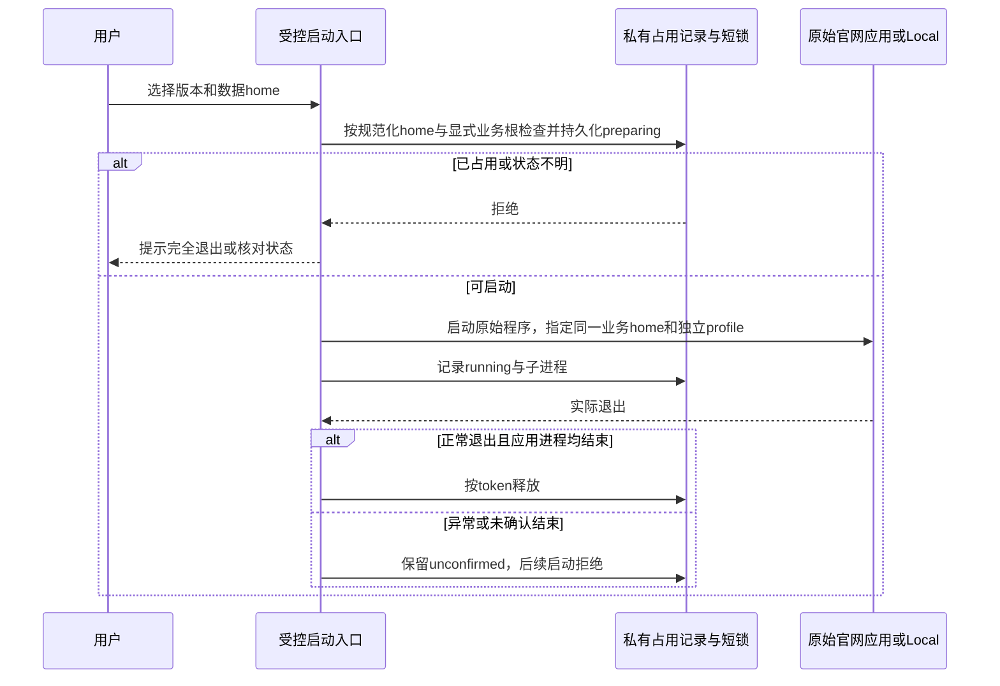

# 03: 验证共用业务数据并实现双向接管保护

Status: done

Issue-Tracker: local-markdown

## Parent

[ZCode Local spec](../../local-edition/spec.md)

**What to build:** 在隔离条件验证官网与 Local 的两种启动顺序，避免双重接管，确认历史数据、凭据及 Local 扩展存储域的兼容边界。

**Blocked by:** [02 构建可独立启动的 ZCode Local 候选应用](02-local-app.md)

## Background

独立 App 和单个连接锁不足以保证官网版与 Local 能安全共用业务数据；该核心可行性须在群协作扩展前验证。

## Modules

桌面启动与进程占用、数据访问边界、Bot 连接所有权、Local 兼容存储。不预先固定源码文件名；以实施基线的受控模块上下文为准。

## Acceptance criteria

- [x] 官网先启动和 Local 先启动均验证；按用户已接受的双向受控入口提示退出占用方，不强杀，不以 Local 私有锁宣称原始程序绕过入口仍受保护。
- [x] 官网 Reader、项目/会话历史和机器人配置可用，验证 Local 扩展存储域不会破坏共用格式；后续实际群配置继续回归这一契约。
- [x] 使用隔离数据和既有凭据机制核对可用性，不读出 Secret 或接管真实机器人；未降级保护或进行日常数据切换。

## Spec coverage

用户故事：45、47、48、66、67、68。
验收场景：T25、T26、T27、T34。

## Execution notes

一次只处理本 issue。实现遵循已确认测试边界和 TDD，保留无关改动；验证记录区分实际执行、合成场景与待真实验收。完成后记录改动、验证结果和既有逻辑影响，再置 done。

## 实施记录（2026-10-21）

- 起点 `0db392a8`，分支 `3.16.2-local.1`，工作树干净。本轮只处理 03。
- 首先以固定 Electron 41.0.3 / Chromium 146.0.7680.80 核对共享 native singleton，再用可丢弃进程验证两种身份、两种启动顺序、未就绪、无响应及竞争；未通过前不进入日常数据。
- 测试沿用已确认的应用进程入口、版本化存储与旧 Reader 边界，不新增内部测试接口；实际凭据不读出、不复制，不能用合成密钥测试替代实际兼容结论。
- 在机制可行性确认后，先记录启动所有者、保护顺序与 Local 存储兼容契约，再修改行为。父规格保持不变。

### 启动方式补充裁定

共享 Electron 41.0.3 native singleton 的隔离实测：正常响应时两种先后顺序均挡住第二进程；旧进程被暂停后两种顺序均约 20 秒收到 SIGKILL，第二进程取得锁。因此不采用共享 native profile 作为无强杀保证。

用户于 2026-10-21 对以下问题回答：「接受受控入口，保留官网原始程序（推荐）」。问题原文：

> 03 是否接受“通过受控入口打开官网版和 Local”的使用方式？官网原始程序原样保留；受控入口先核对占用，发现另一版仍在运行就提示退出，不强杀。原始官网程序若绕过入口直接打开，仍无法由 Local 保证安全。

该答复明确了首版支持的启动边界。后续实现与验收均从受控入口发起；官网原始程序保留，绕过入口直接打开的路径不宣称受保护。本票不安装或替换日常应用。

### 入口与所有权契约

- 提供本机命令 `pnpm local:launch`，选择 official / local 和对应 .app；日常默认沿用同一 home，候选必须显式指定隔离 home。两版各用独立 Electron profile，业务数据继续由原服务读写 `.zcode/v2`。
- 受控入口是启动所有者：以 home 的 realpath 作为占用身份，在 `.zcode/local/launch-owner.json` 保存版本化占用记录，复用已有异步目录锁与原子私有文件写入；Local 业务扩展预留 `.zcode/local/v1/`，不改官网严格格式。该入口不成为任务调度者。
- 先在短临界区检查占用并持久化 preparing，再启动子进程并记录 running；之后等待实际退出。已有占用、损坏/未知版本、启动中断或异常退出均拒绝接管。时间戳不作为夺锁依据，不调用非零信号终止另一应用。
- 正常退出码 0 且实际进程组和应用进程均已结束时才能按原 token 释放；观察超时只得到状态不明，不自动放行。入口自身崩溃后，已持久化记录仍阻止下一次启动；03 不提供强行清锁按钮。
- 日常启动额外核对已运行的官网/Local 进程，避免首次进入受控方式时忽略原有应用。绕过入口的启动竞争仍按用户已接受的边界披露。
- 应用路径核对 bundle identity 和可执行入口；命令从进程边界传递参数，不经 shell 拼接。允许应用参数透传，便于既有打开行为和隔离诊断；不自动加载日常数据到测试进程。

### 自定义数据目录补正契约

规格审查确认：既有 `setting.json.dataBaseDir` 优先于入口传入的环境变量。因此入口须在启动前异步读取 home 设置中的目录字段，实际业务根与 home 同时纳入占用，不能只锁 home。

- `--data-root` 显式选择业务根，默认与 home 相同。保存的自定义根与本次选择不一致时拒绝启动，提示显式选择，避免复制来的测试设置把候选导向日常数据。
- 目录及占用文件父目录均规范化；home 与实际业务根的记录去重，按固定路径顺序取得短锁，全部检查通过后才写 preparing。更新 running、正常释放和未知状态保留均核对同一 token。
- 两个不同 home 指向同一业务根时共享该根的占用记录；同一 home 的记录仍保留，防止旧入口未结束就按变更后的设置重启。入口不修改设置文件或官网数据格式。
- 回归从真实 CLI 进程边界验证：未显式选择重定向根时不启动；显式选择后环境指向实际根；两个 home 对同一合成根并发时只允许一个应用启动。

## 完成记录

- 实现提交 `a1d364d3`，自定义业务根审查补正 `d079cb84`，本地分支 `3.16.2-local.1`。父规格未改动。
- 启动与契约共 17 项通过；既有存储 6 文件 / 43 项通过；固定官网 Reader 双向读写合成数据通过；既有凭据服务只读检查 2 项均可解密，仅返回计数。
- 官网原始应用的签名副本与 02 Local 候选完成默认根/自定义根、官网先/Local 先的八次欢迎页启动、四次占用拒绝和正常退出；日常应用未安装、替换或接管。
- 类型检查、Lint（0 errors、96 条既有警告）、架构检查通过。全量仅一次，19970 项通过、1 项既有原生文件监听超时；失败文件独立重跑 3 项全部通过，原因未确认，未将全量写成通过。
- 两路独立审查完成：Standards 无发现；Spec 的 1 项 P2 已补正并复验关闭。受控入口之外的原始启动、真实登录/机器人连接、安装与异常恢复继续按既定后续工单处理。
- 详细验证、命令及证据见[共用数据与受控启动报告](../../local-edition/shared-data-ownership.md)。本轮结束于 03，04 未开始；没有推送到官方远端或创建发布标签。

## 测试副作用补正

2026-10-22 用户报告临时 official/fixture 系统弹窗并授权修复，单独登记 [03a](03a-test-fixture-popups.md)。原测试断言通过不代表没有系统弹窗；生产启动保护与数据兼容结论保持，测试夹具修复及系统证据见该补正单。
