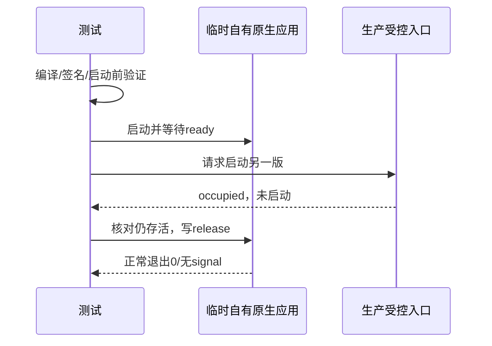

# 03a: 修复启动保护测试引起的 macOS 系统弹窗

Status: done

Issue-Tracker: local-markdown

## Background

用户于 2026-10-22 报告反复出现“official 已损坏”和“fixture 意外退出”，随后明确授权直接修复。03 的原始应用占用用例将 `/bin/sleep` 复制到临时 official.app 中，原生报告签名 ID 为 com.apple.sleep，签名校验失败；清理时终止该进程又留下崩溃报告。全量包含该用例，故后续开发重复触发。

起点 `a7b5f4cb`，分支 `3.16.2-local.1`。本票是 [03](03-data-compatibility-ownership.md) 的测试副作用补正，不进入 07，不改父规格、安装包或日常应用。

## Contract

- 保留已确认的进程边界：真实原生应用进程先启动并可观察就绪 → 受控入口拒绝另一版本 → 原进程仍存活 → 正常释放并退出 0。
- 使用自行编译的最小原生程序和与测试 bundle 一致的临时 ad-hoc 签名；启动前 codesign deep/strict 验证通过。不复制系统签名程序充当应用，不修改系统安全设置，不依赖个人签名证书或网络。
- 程序只在本次临时 home 写入 ready 及读取 release 控制文件，无 GUI、业务数据或网络。正常完成和失败清理均先请求正常退出并等待真实退出；专门的 launcher 崩溃场景仍保持原断言。
- 只改测试夹具与对应文档，生产占用判定、schema 和共享数据行为不变；macOS 原生用例沿原平台条件执行，其他平台不引入编译依赖。
- 避免再次启动已知签名无效的旧夹具：先用新增启动前签名断言取得只读红证据，再修复。对修复后的原用例及整文件重复执行，核对实际进程和退出结果、签名与新诊断报告；全量收尾保留环境失败披露，不把断言通过等同于无弹窗。

## Acceptance criteria

- [x] 临时原生测试 app 在启动前通过完整签名验证，系统签名程序不再被复制进去。
- [x] 原始应用已运行时，受控入口仍拒绝启动第二版且不终止持有者；测试程序就绪与退出被真实观察。
- [x] 定向与整文件重复运行不新增 fixture 的签名异常/崩溃诊断；全量亦核对报告，已安装官网应用签名保持有效。
- [x] 类型、Lint、架构与独立两轴审查完成，证据区分系统记录与人工屏幕观察；不宣称自动读取了 macOS 对话框。

## Completion（2026-10-22）

实现 `e277a9fe`；[修复报告](../../local-edition/launch-fixture-popup-fix.md)。启动前签名校验红→绿留档；原单项通过，完整启动与契约 17 项共三轮通过；一次全量包含修正用例，20043 项通过、3 项失败、10 项跳过，349.14 秒。失败仍为既有 Web 测试固定 5173 被其他项目占用，未改测试、未终止其他项目、未记全绿。

全量后诊断增量为 0（fixture 仍为修复前 10 份），本次全量生成的临时应用通过 deep/strict，Identifier=dev.zcode.app、Signature=adhoc；已安装官网应用签名也通过。证据为 `~/.local/share/zcode-local/research/issue-03a/audit-final.json`。这是签名/进程/系统记录证据，不是自动屏幕观察；旧弹窗可能仍需用户关闭。

根类型、Lint（96 条既有警告、零错误）、架构、格式及两轴独立审查完成，Standards 0 / Spec 0。生产逻辑与安装应用未改，07 未开始。
