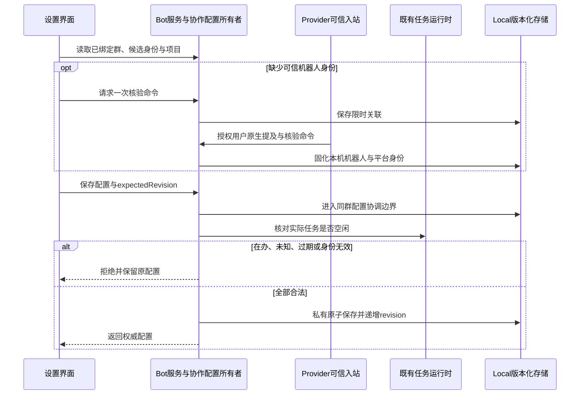

# 04: 从设置启用协作群并保存身份、职责与项目绑定

Status: in-progress

Issue-Tracker: local-markdown

## Parent

[ZCode Local spec](../../local-edition/spec.md)

**What to build:** 用户能在 Local 设置中完成每群配置、必要的一次原生提及核验，并在重启后继续使用。

**Blocked by:** [03 验证共用业务数据并实现双向接管保护](03-data-compatibility-ownership.md)

## Background

现有群开关没有完整表达 PM、执行者职责、唯一授权用户和固定工作区。

## Modules

共享配置协议、Bot 服务与 Local 持久存储、机器人设置界面、工作区身份。不预先固定源码文件名；以实施基线的受控模块上下文为准。

## Acceptance criteria

- [ ] 通过界面选择群、一个 PM、执行者及职责、授权用户和工作区，保存后重启一致；其他群不受影响。
- [ ] 缺可信机器人身份时一次原生提及核验，不能用昵称或手填平台 ID 绕过；改名不改职责。
- [ ] 在办时拒绝关键配置变更，变更成功递增授权版本；Local 新配置不破坏官网旧 Reader。

## Spec coverage

用户故事：26、33、34、35、36、37、38、39、40、68。
验收场景：T01、T06、T16、T17、T24、T25。

## Execution notes

一次只处理本 issue。实现遵循已确认测试边界和 TDD，保留无关改动；验证记录区分实际执行、合成场景与待真实验收。完成后记录改动、验证结果和既有逻辑影响，再置 done。

## 实施契约（2026-10-21）

- 起点 `901fdb2f`，分支 `3.16.2-local.1`，工作树干净；仅处理 04。沿用已确认的 Bot 事件/服务、版本化存储、设置界面边界进行 TDD。
- 仅 Local 构建提供协作设置能力；未启用群、官网/Preview、私聊与远端既有行为保持。共享协议具备严格运行时校验；UI 经 hook 调用已有 Bot 服务 RPC。
- 协作服务拥有每 Provider/群的配置和授权版本，保存到实际业务根 `.zcode/local/v1/collaboration.json`；复用异步短锁与私有原子写入，不给官网 v3 文件或数据库扩字段。
- 群选项来自现有可信已绑定群；机器人选项关联本机配置 ID、Provider、应用 ID 与群内可信 open_id。授权用户从已绑定的可信用户中选择；项目选项来自本机项目服务，保存固定项目/工作区身份，不接收任意路径。
- Provider 已校验的自身 botOpenId 可直接登记。缺少时在设置生成限时、绑定群/机器人/应用/已绑定用户的一次核验命令，用户在群内原生 @ 对应机器人发送；正文名字、手填 open_id、其他用户、过期/错误命令均不能形成核验。核验命令不创建执行任务。
- 飞书 open_id 只在单应用内有效，不能把各机器人绑定的用户 open_id 当成同一全局 ID。入站保留 Provider 原始 tenant_key 与 sender union_id；授权用户以同租户、同应用提供方的可信 union_id 关联，各机器人仍保留自己的 open_id。缺失跨应用证明时保持未核验，不以昵称或相同路径猜测。[官方身份说明](https://open.feishu.cn/document/platform-overveiw/basic-concepts/user-identity-introduction/introduction)。
- 每群一个 PM、至少一个执行者，每个执行者职责非空，同一机器人不可重复。界面只提交选项 ID 和职责，实际身份由服务填入；改名不改变 ID 和职责，替换应用须重新核验。
- 项目权限沿用现有规范化规则：旧配置中的本机项目根路径须解析为同一个项目选项，不扩大范围、不改写旧权限配置。
- 既有群开关仍是机器人群接入的唯一事实；协作开关只控制本群协作模式。一次核验命令由设置发起、绑定用户原生确认后，复用既有激活流程接入该机器人；之后关闭原群开关不会被普通消息重新打开。
- 保存使用 expectedRevision 防止旧窗口覆盖；有效变更成功递增 revision，无变化不增加。配置在办/接收输入中或实际任务状态不明时拒绝关键变更，既有运行时是事实来源，不用磁盘任务最后结果或 UI busy 推断空闲。
- 同群入站登记与设置保存共享协调边界，防止异步核对与任务受理交错；不新增执行队列。绑定后的群读取固定项目，不跟随桌面当前项目；项目失效或授权范围不符时拒绝，不回退到其他工作区。
- 接收中的协调记录须跨 Host/进程可见：在 Local 同一短锁内登记输入调用令牌，finally 按令牌移除；不记录正文，不表示执行已受理。进程崩溃留下的记录按状态未确认拒绝配置变更，后续 12 核对恢复；不能只用单实例内存 Map 宣称跨窗口安全。
- 04 不实现后续派单角色校验、静默、选人卡片、执行串行或恢复流程；仅提供这些工单依赖的可信持久配置和授权版本。

