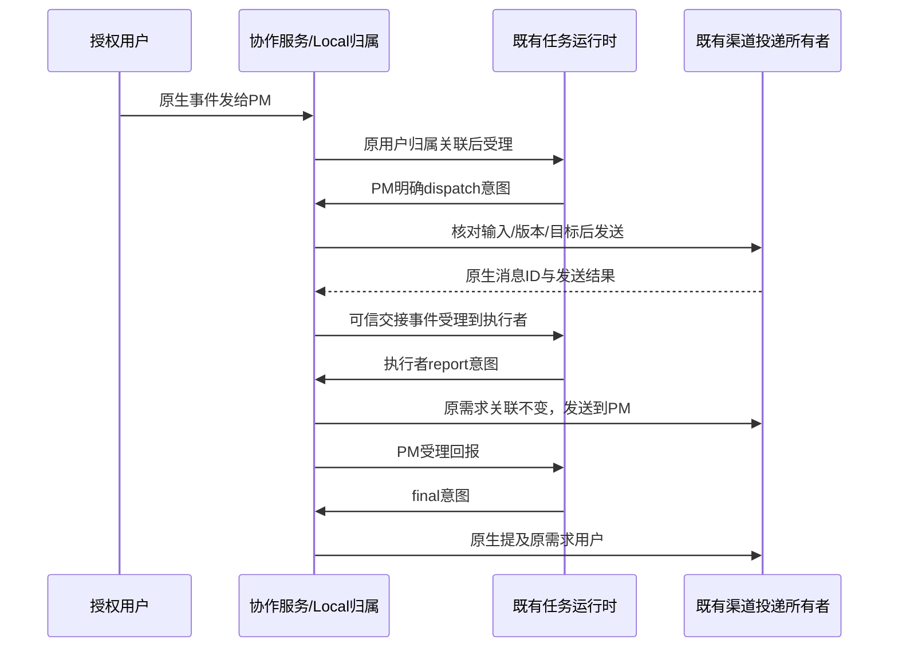
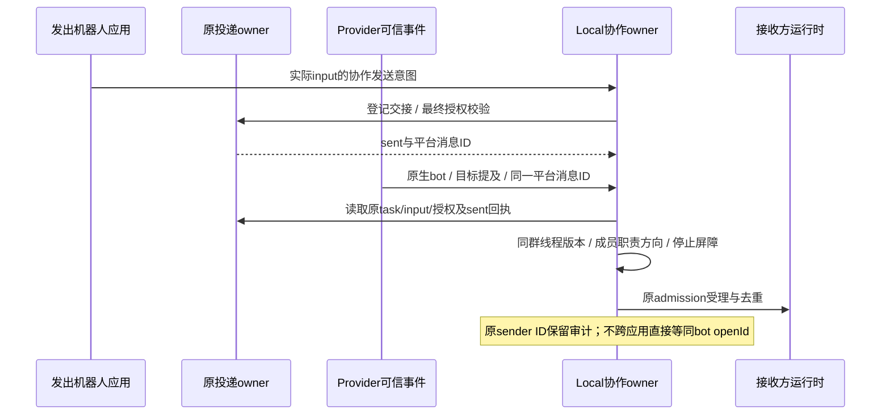

# 05: 走通可信派单、回报与原需求用户归属

Status: done

Issue-Tracker: local-markdown

## Parent

[ZCode Local spec](../../local-edition/spec.md)

**What to build:** 从可信用户输入走通一次用户→PM→执行者→PM→用户的短链，明确发送意图，保持原需求归属。

**Blocked by:** [04 从设置启用协作群并保存身份、职责与项目绑定](04-group-collaboration-settings.md)

## Background

当前轮次发送者会覆盖 initiator，普通群成员也可能被当作任务来源。

## Modules

Provider 入站身份、共享任务来源协议、Bot 受理与投递、Agent 渠道回复契约。不预先固定源码文件名；以实施基线的受控模块上下文为准。

## Acceptance criteria

- [x] 授权用户、PM 和执行者按配置路由；用户直派引导回 PM，执行者不能互派，其他真人不能改任务。
- [x] 原需求用户跨轮保留，最终汇报原生提及正确用户，不跟随当前回报者或正文身份声明。
- [x] 复用已有多应用绑定与投递路径，记录必要本机来源/结果诊断；集成测试观察实际收件人与任务受理。

## Spec coverage

用户故事：1、2、3、4、7、13、26、69。
验收场景：T02、T03、T04、T05、T16、T35。

## Execution notes

一次只处理本 issue。实现遵循已确认测试边界和 TDD，保留无关改动；验证记录区分实际执行、合成场景与待真实验收。完成后记录改动、验证结果和既有逻辑影响，再置 done。

## 实施契约（2026-10-21）

- 起点 `d17b18ce`，分支 `3.16.2-local.1`。沿用已确认的「可信飞书事件→实际运行时受理→渠道实际发送」测试边界，不连接真实群、不读取日常凭据。本票不进入 06–18。
- 原需求、每次输入归属与交接关联由既有协作服务唯一维护，保存到 Local 版本化存储；不向官网 v3 Bot 文件或 SQLite 加字段，不复制群聊正文、不创建第二个执行队列。
- 仅对明确启用的 Provider/群生效。可信授权真人可向 PM 发需求或控制请求；直发执行者得到经 PM 派单的引导，不受理工作。其他真人无权改变任务；机器人控制请求不能获取真人权限。
- 机器人输入必须对应同群、同线程、当前配置版本及合法方向的已发送渠道交接记录，并匹配平台原生消息 ID 与发送者身份。正文、昵称、引用和模型自报身份不建立交接；无已确认发送结果时保持未受理，不盲目重发。长链与恢复策略留给 10/12。
- 现有 ReplyToChannel 增加可选的严格协作意图：dispatch、report、question、final；启用协作时必须明确意图。PM 可向指定执行者派单/追问，执行者只能向 PM 回报/追问，PM 最终汇报只能面向原需求用户。06 再校验具体职责的语义声明。
- 模型只提交意图、目标本机机器人选项及正文，不能提交平台 ID 或原用户声明。Host 从实际执行 inputId/taskId、固定工作区和 Local 归属重读授权，构造唯一原生收件人；不复用当前回报者充当原需求用户。
- 原输入来源保留当前发送者用于审计，原需求归属独立保存；每次 CLI 受理前注入精简、明确标记的协作上下文与合法目标选项，原文和既有来源结构保持。工具仍通过同一 Host RPC、投递 owner 和幂等键发送，不另建发送路径。普通终答不视为新的派单；纯确认整链静默归 07。
- 事件顺序：入站校验 → 既有任务/固定工作区路由 → Local 输入归属关联 → 既有运行时受理；发送前重读实际执行输入和配置 → 登记交接关联 → 既有投递 owner → Provider 回执。接收方只消费已确认发送事实。拒绝、发送关联及结果沿既有日志/投递事实留本机诊断，不记完整正文。

### 边界补充（2026-10-22）

- 发送前同时核对成员当前项目权限、固定项目仍在目录、目标群仍接入；来源已取消/丢弃/停止的迟到交接不再受理。
- 合法交接可在执行者已接入的群内首次创建对应话题上下文；显式停用的既有话题不能借此重开。话题内同一工具调用重放必须返回原回执。

- 工作区沿用统一身份 key（identity 去首尾空白，空值退回 path），路径事实另行核对；逐消息诊断使用 debug，生产可核查结果仍在原投递事实和 Local 关联记录。

- 协作授权必须延续到既有投递 owner 的最终检查，涵盖节流等待、unknown 落盘及重试窗口；准备后撤销版本、目标接入或权限时投递置 invalidated，不发送。无新增发送 owner。

## Completion（2026-10-22）

实现 `7317fa0e`，审查补正 `1a46a276`；[交付与验证报告](../../local-edition/trusted-handoffs.md)。补正后 14 文件 / 339 项相关回归、CLI 两文件 / 15 项、根与 CLI 类型、Lint（根 96 / CLI 69 条警告，零错误）、架构与格式通过。默认群及话题的固定官网 Reader 读写与 Local 读回通过；两轴审查首轮 Standards 2 项 P2、Spec 1 项 P1，复审全部关闭。

实现检查点启动的一次全量：20023 通过、3 失败、10 跳过；失败均为其他项目占用既有固定 5173 端口，未记全绿。审查补正后的 339 项相关回归通过。没有连接真实群、读取日常凭据、打包安装或启动下一票；02 候选仍不含 04/05。后续按编号等待用户继续。

### 18 真实验收补正：原生机器人交接按已确认回执绑定（2026-10-24）

- 用户已确认按此边界修正并继续真实验收。实测同一派单原生消息 ID 与 PM 的 sent 回执对应，接收事件解析及原生目标提及均成功，但事件发送者 open_id 与配置保存的 PM bot openId 不同；旧代码直接比较后拒绝。ID 不同的具体 Provider 原因尚未独立确认，不将其推断为旧循环守卫或缺少接收权限。
- 发送来源由原投递 owner 已确认的同一平台消息回执和 Local 交接索引绑定，不要求发出应用保存的 bot openId 等于接收应用事件的 sender open_id；不能把单一应用视角的 ID 当作跨应用发送者判据。原生 sender ID 继续作为原始来源保留，不覆盖为配置中的 ID，不用名字或正文建立映射。
- 接收仍必须是可信 Provider 原生 bot/app 事件、非自身回声、原生提及目标；必须匹配同 Provider/群/线程、当前配置版本及成员/项目权限、合法方向和职责、原来源 task/input、sent 状态及精确 providerMessageId、原 authorization/sourceCommandId、accepted 且未停止/取消/丢弃的来源输入，以及未停止/关闭的原需求。任一不明即拒绝；仅有机器人身份、正文声明或相同提及不建立交接。
- 原生平台分配的消息 ID 与原发送 owner 的真实回执是绑定依据；不接受由模型或设置 RPC 提交的消息 ID 来建立新交接。未知或错误回执不授权，不新增平台查询、用户身份映射、发送 owner 或持久 schema；真人授权、旧循环守卫及去重规则保持。
- 测试沿已确认的 Provider 回调→真实 Bot 服务/Repo/协作 owner→可控任务 SDK 入口：默认群与话题中的 PM→执行者→PM 使用各接收视角的不同 sender ID 完成合法双向交接；重投不重复执行。伪造正文、无关联机器人自己的消息、错误回执、真人冒用回执、未知发送状态、来源停止/取消/丢弃及原撤销/范围/版本边界继续拒绝。外部 API/模型和身份均为合成夹具，不把它当作真实验收。
- 验证和固定端点复审后准备下一本地修订候选；只在明确空闲时经原维护入口切换。旧真实派单不重放，真实数据不恢复覆盖，父规格和 T01–T36 定义保持冻结。

