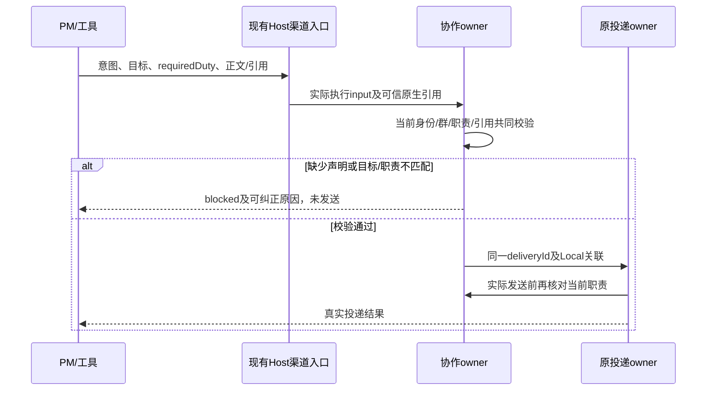

# 06: 在派发前拦截错误角色与错误引用

Status: in-progress

Issue-Tracker: local-markdown

## Parent

[ZCode Local spec](../../local-edition/spec.md)

**What to build:** 派单声明所需角色，实际收件人不匹配时保持未派发，并给出可纠正的原因。

**Blocked by:** [05 走通可信派单、回报与原需求用户归属](05-trusted-handoffs.md)

## Background

合法引用仍可能指向不适合该任务的机器人。

## Modules

Agent 渠道回复契约、角色校验、Bot 投递及结果展示。不预先固定源码文件名；以实施基线的受控模块上下文为准。

## Acceptance criteria

- [ ] 合法但指向错误角色的引用被发送前拦截，不产生错误目标消息或执行任务。
- [ ] 原生身份、群授权和当前职责共同核对，用户选人也不能暗改职责。
- [ ] 语义归类仍由 PM 判断，测试与说明不把角色绑定校验写成通用语义识别。

## Spec coverage

用户故事：27、32、42。
验收场景：T07。

## Execution notes

一次只处理本 issue。实现遵循已确认测试边界和 TDD，保留无关改动；验证记录区分实际执行、合成场景与待真实验收。完成后记录改动、验证结果和既有逻辑影响，再置 done。

## 实施契约（2026-10-22）

- 起点 `91fb69af`，沿用 05 的真实 Bot 服务/Repo/Provider 组装及外部可控运行时/HTTP 测试边界，按 TDD 验证实际发送与任务受理。本票只实施 06，不创建 08 的选人卡片，不连接真实群或读取凭据。
- PM dispatch 必须声明 `requiredDuty`；PM 向执行者 question 同样核对声明。该字符串按设置中的职责去首尾空白后精确比较，大小写/同义词不猜测。PM 负责先判断任务语义，再从当前上下文选择对应职责；代码只核对声明与绑定，不分析正文决定职责，不使用 Jev。
- 协议允许旧调用缺少 requiredDuty 以返回可纠正的 `blocked/required_duty_missing`，启用群不得据此发送。职责不匹配返回 `blocked/role_mismatch`，含声明和实际职责及纠正说明；不写新的交接/投递，不产生错误目标消息和执行者任务，不伪装为 sent/failed 的网络尝试。
- 可使用本机 targetBotId 直接选择，或附加一个当前可信输入中的原生 mention 引用。引用只证明身份；Host 解析后还须与本机目标的已核验平台身份一致，再校验当前职责。错误、过期、跨群/跨任务引用或未决 mentionName/candidateRef 保持未发送，返回可纠正的 blocked。完整候选选择、持久待发与续发归 08；用户选择不能借此改变原消息声明或设置职责。
- 角色声明由同一协作 owner 保存到 Local handoff 索引，仅增加可选字段供旧 Local 文件读取。准备时、原投递 owner 最后发送前及机器人输入受理前均校验当前版本/身份/职责；旧索引缺少职责不能授权新的 PM→执行者派发。已有 sent 事实不会改写，未知回执不重发；旧应用读 Bot v3 与 SQLite 的格式不变。
- CLI 输入/输出 schema、描述和上下文同步；blocked 作为已有工具结果传给模型供纠正，不新建群消息、专属 UI 或发送路径。普通未启用群沿用既有 ref/name 解析及结果。
- 持久归属/角色配置仍由 bot-collaboration 唯一管理，Host 渠道入口只传实际执行来源解析出的可信引用；原投递 owner 保留幂等与结果事实，不增加缓存或执行队列。桌面 continuous 与手机 replayable 的原 owner/lease 与 CommandInbox 不变。

- 同一 toolCallId 已投递但参数被改写时优先报幂等冲突；不得把历史已发送误说成新的 blocked 未发送。
