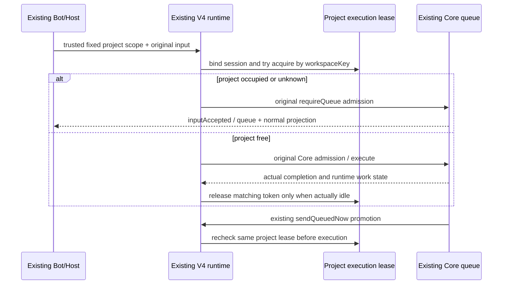

# 09: 保证同一项目实际执行串行

Status: done

Issue-Tracker: local-markdown

## Parent

[ZCode Local spec](../../local-edition/spec.md)

**What to build:** 依据固定项目身份复用运行时受理与排队，使新工作等待在办执行结束，不新增平行调度器。

**Blocked by:** [05 走通可信派单、回报与原需求用户归属](05-trusted-handoffs.md)

## Background

多个机器人会话各自串行，并不代表同一项目不会同时执行。

## Modules

群工作区绑定、任务运行时受理与队列、Bot 任务关联及可见状态。不预先固定源码文件名；以实施基线的受控模块上下文为准。

## Acceptance criteria

- [x] 同项目不同机器人上下文同时收到工作时，实际执行不重叠，新需求有明确排队状态。
- [x] 其他群或桌面切换不改本群项目；工作区身份及现有 owner/lease 防护保持。
- [x] 停止或失效后队列状态可核对，界面和 Bot 服务不各保存一份已受理队列。

## Spec coverage

用户故事：8、9、36、37。
验收场景：T16、T17、T18。

## Execution notes

一次只处理本 issue。实现遵循已确认测试边界和 TDD，保留无关改动；验证记录区分实际执行、合成场景与待真实验收。完成后记录改动、验证结果和既有逻辑影响，再置 done。

## Implementation contract

- 实施基线 `59ed44e5`。原 CLI CommandInbox/Core 队列是已受理输入、排队及执行状态的唯一所有者；Bot/界面不增队列。现有会话级串行不足以覆盖跨机器人任务，扩展原 V4 运行时的项目执行租约。
- Host 仅对已授权的 Local 群输入注入固定项目 ID 与 workspaceKey（identity.trim() 或 path），通过可选严格协议字段传入，不从模型正文或桌面当前项目读取。Local 话题也默认 queue，不抢占原会话。普通未启用群/私聊/桌面不添加该字段，保留原行为。
- CLI 在现有 storage root 的 Local 扩展目录保存 session→固定项目/工作区绑定，以及按 workspaceKey 排他的当前执行租约，不保存第二份 accepted queue、输入正文或投递结果。相同工作区不能因群/机器人/任务或项目显示名不同而绕过租约；不同工作区身份保持隔离。绑定不写官网 Bot v3/SQLite/输入 intent 格式；已有会话不得改绑不同项目。
- 在 Core admission 前原子取得租约；忙碌输入交原 requireQueue，立即得到真实 queue ACK。自动/手动队列提升仍走原 sendQueuedNow，并在启动前重查同一租约；竞争失败保留原项，不假启动、不抢占其他会话。FIFO 仍是原会话 CommandInbox/Core 顺序；不新增跨会话排序器或全局严格 FIFO 承诺。
- 租约覆盖前台执行及其仍运行的后台工作。停止请求或群确认不释放；只在真实完成/失败/实际停止后，原 runtime 确认没有活动/待运行工作及后台任务时释放。复用既有队列重评入口；租约只是互斥事实，不承担任务调度。停止/取消/失效仍由原队列/授权接口处理，不复制状态。
- 跨 Host/CLI 通过现有私有原子文件与文件锁协调。进程退出、损坏元数据或执行状态未知保持阻塞，不按超时猜测空闲、不自动重发；更广泛崩溃核对和恢复属于 12。租约释放核对唯一 token，旧释放不能清掉新 owner。
- 队列可见状态沿既有 CLI snapshot/进度与 Bot waiting 表情投影；群设置的在办检查继续查询真实队列/执行，queued 也不得改关键配置。桌面 continuous 与手机 replayable 继续由原 task owner 广播同一排队事实，保留 owner/lease、跨 Host 和 stale-run 防护。

测试沿已确认 Bot 事件→任务受理边界，并复用实际 V4 server/App/Core 与合成模型端口验证跨会话互斥、原队列续跑、停止及隔离；只测试内部锁函数不足以证明实际串行。真实群验证留在 18。

2026-10-22 完成，基线 `59ed44e5`，实现提交 `387fbb3e260e3bab2804ca84011cd3ab768591f8`（含同会话续跑补正），验证与收尾复验见[交付与验证报告](../../local-edition/project-serial-execution.md)。实现已本地入库，当前完成源码交付，真实模型/群验收留 18；未推送、未打包或更新安装候选，10 未开始。
