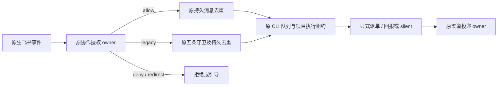

# 10: 允许合法协作长链持续推进

Status: done

Issue-Tracker: local-markdown

## Parent

[ZCode Local spec](../../local-edition/spec.md)

**What to build:** 仅为启用协作的群改造接收策略，让合法长链持续运行，同时保持身份、去重、串行和静默保护。

**Blocked by:** [06 在派发前拦截错误角色与错误引用](06-dispatch-role-validation.md)；[07 让纯确认轮真正静默结束](07-silent-acknowledgments.md)；[09 保证同一项目实际执行串行](09-project-serial-execution.md)

## Background

固定五条机器人消息守卫会截断正常工作，直接移除又会失去终止保护。

## Modules

Bot 群消息受理、持久去重、角色与任务作用域。不预先固定源码文件名；以实施基线的受控模块上下文为准。

## Acceptance criteria

- [x] 超过五条的正常派单/回报链仍可推进，不以调大固定数字作为实现。
- [x] 无授权来源、重复事件和纯确认不会借长链策略重新开始工作。
- [x] 未启用群的原保护不被全局移除，多轮与重启场景有证据。

## Spec coverage

用户故事：17、41。
验收场景：T11、T12。

## Execution notes

一次只处理本 issue。实现遵循已确认测试边界和 TDD，保留无关改动；验证记录区分实际执行、合成场景与待真实验收。完成后记录改动、验证结果和既有逻辑影响，再置 done。

## Implementation contract

- 实施基线 `63b229f2`。仅当现有协作所有者 authorize 对当前入站返回 allow 时，不以连续机器人消息次数截断该消息；不调大计数阈值，不按正文、机器人身份或 Local 宿主开关单独授予豁免。未启用协作的群及非 Local 宿主继续使用原五条限制。
- 原生身份、同群/线程、配置版本、当前职责、来源任务/输入和原投递 owner 的 sent 收据仍为受理前提；unknown、失效、未关联消息及错误方向不受理。withInbound 继续协调受理与配置修改，授权判断不写入新的持久格式。
- 原 autoReplyGuard 的消息 ID 去重仍在停止、准备及任务受理前生效，计数到五后饱和，保持官网 Bot v3 的 0–5 严格格式，Local 合法交接不再由该计数作受理判据。重复事件不重新受理、不重发；重建服务后仍从同一原存储读取。绑定输入时继续重查协作授权，09 的固定项目串行范围不变。
- 纯确认通过 07 的显式 silent 结束，不创建新交接；普通终答不产生新的机器人派单。代码不按正文猜测确认或无进展，也不把 13 的 PM 三轮整改语义引擎塞入本票。
- 测试沿父规格已确认边界：合成飞书 Provider 回调 → 真实 Bot/协作/Repo 与渠道投递 → 可控任务 SDK 受理端口及实际 HTTP 请求。覆盖默认群/话题超过五条的交接、服务重建、并发重投、无授权来源及静默后不续链；真实模型和真实群遵循仍留 18。

## Completion（2026-10-22）

基线 `63b229f2`，交付与验证见[合法协作长链报告](../../local-edition/collaboration-chain-admission.md)。196 项相关回归、根与完整 CLI 类型、Lint/架构/变更范围格式、固定官网 Reader 及两轴审查通过。一次全量 20090 项通过、3 项既有端口环境失败、10 项跳过；原生夹具新增诊断 0。本票完成源码交付，真实模型及真实群验收留 18；未推送、未打包安装、未更新旧候选，11 未开始。实现 SHA 随归档提交回填。
