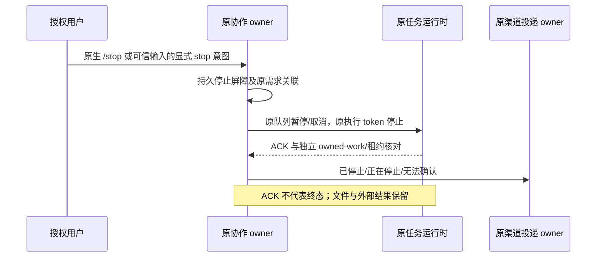

# 11: 将用户叫停连接到实际任务停止

Status: done

Issue-Tracker: local-markdown

## Parent

[ZCode Local spec](../../local-edition/spec.md)

**What to build:** PM 能停止后续派发，向原执行任务发出真实停止请求并核对状态，保留现有工作成果。

**Blocked by:** [09 保证同一项目实际执行串行](09-project-serial-execution.md)

## Background

一句收到停止不能证明当前执行或后续排队工作已经结束。

## Modules

PM 控制意图、任务运行时停止接口、群队列与结果回报。不预先固定源码文件名；以实施基线的受控模块上下文为准。

## Acceptance criteria

- [x] 只有可信授权用户可以叫停，PM 停止后续派发并作用到原任务。
- [x] 区分已停止、正在停止、无法立即停止，不能以请求成功代替实际结果。
- [x] 已有文件、改动及外部结果保留；队列不在叫停后继续派发被停止的工作。

## Spec coverage

用户故事：18、19、20。
验收场景：T02、T21。

## Execution notes

一次只处理本 issue。实现遵循已确认测试边界和 TDD，保留无关改动；验证记录区分实际执行、合成场景与待真实验收。完成后记录改动、验证结果和既有逻辑影响，再置 done。

## Implementation contract

- 实施基线 `0a118c69`。原生授权用户向 PM 发送 `/stop` 时，沿当前群/线程、配置版本、PM 原任务及 Local 输入关联定位原需求；不按正文、昵称、桌面当前项目或模型提供的 taskId 另找目标。执行者、其他用户和未关联机器人不能停止整条协作链。自然语言叫停由 PM 明确声明 stop 控制意图，同样须绑定实际执行输入和其可信真人来源，不以模型语义判断代替身份核对。
- 原协作 owner 在同一 Local 文件锁中先持久登记该需求的停止屏障与调用身份，再调用既有任务运行时。屏障拒绝后续派单、迟到机器人回报的再次受理、待选卡续发与仍在准备中的旧输入；原渠道 owner 的 sent/unknown 事实保留，不盲目补发。停止记录不是第二份 accepted queue 或执行状态表；已停止结论只允许记录从运行时确认的完成事实。
- 运行时适配沿原固定 workspaceKey 和 task owner 路由，先暂停原队列自动推进，再删除原输入的待执行项，暂停原目标，按观察到的执行 token 停止前台，并取消原任务可取消的后台工作。停止仍在进行、任务不可立即取消、断线、身份未知或接口不支持时如实返回，不能因 stop ACK、队列为空、模型确认或超时判作已停止。其他需求、群、话题、工作区和普通会话不被误停。
- 最小运行时扩展只暴露原 Core owned-work 与项目租约的只读核对事实，覆盖后台及 detached sidecar；原 stop/cancel/queue 接口继续拥有实际停止，不新建调度器、执行队列或恢复引擎。原任务查不到或旧进程租约未知时保持无法确认，广泛恢复属于 12。
- 用户看到的结果明确区分已停止、正在停止、无法立即停止/无法确认。重复、并发及重启后的旧停止事件仍关联原停止调用，不能误伤后来的工作。确认旧需求停止后，新的授权真人输入可以启动新需求；旧屏障不可被原派单、卡片或终答复活。
- 文件、源码改动、历史和外部结果均保留；不执行 Git 回滚、产物删除、外部撤销或强杀日常应用。
- 测试沿已确认的 Provider 回调 → 真实 Bot/协作/Repo/渠道发送 → 任务 SDK 边界，并补实际 V4 server/App/Core 与合成模型端口的停止证据。覆盖默认群/话题、PM 到原执行者、停止 ACK 先于实际结束、队列/后台保护、来源与 stale-run 拒绝、重投/服务重建、文件保留及普通会话兼容。真实模型和真实群验收仍留 18。

## Completion

2026-10-23 完成源码交付。实施与如实验证见 [11 报告](../../local-edition/stop-execution.md)；实现提交待本地入库后回填。223 项根相关回归、214 项 CLI 测试、根与完整 CLI 类型、Lint/架构/格式、固定官网 Reader 及两轴复审通过。完整全量补跑 20117 通过、10 跳过，退出码 0；此前无完整汇总的运行和启动前工具链失败日志均保留。原生 fixture 新诊断 0，夹具与官网应用签名有效。未知 verifier 来源保守返回无法确认；广泛恢复归 12，真实群/模型验收归 18。未推送、安装或启动日常应用，12 未开始。
