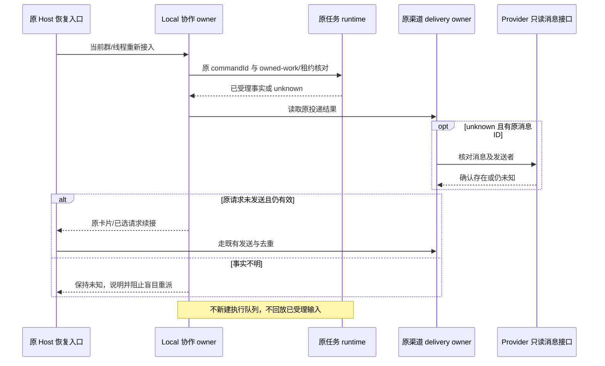

# 12: 在断线和重启后核对状态再恢复

Status: done

Issue-Tracker: local-markdown

## Parent

[ZCode Local spec](../../local-edition/spec.md)

**What to build:** 重建协作状态时先核对执行、停止、卡片和投递记录，安全续接或明确报告状态不明。

**Blocked by:** [08 通过候选卡片选人并自动续发原消息](08-recipient-selection.md)；[11 将用户叫停连接到实际任务停止](11-stop-execution.md)

## Background

缺回报或确认丢失既可能未执行，也可能已执行，自动重派会重复产生副作用。

## Modules

Bot 持久恢复、任务运行时查询、渠道投递核对、卡片待发记录。不预先固定源码文件名；以实施基线的受控模块上下文为准。

## Acceptance criteria

- [x] 已经执行或发送的工作不因重启/缺回报重复派发，未执行且可安全继续的才恢复。
- [x] 发送可能成功但收据丢失时先核对，未知状态明确说明，不靠超时重发或假定成功。
- [x] 旧卡片和旧授权不能复活，停止状态与已有成果保持，重启不改变需求归属。

## Spec coverage

用户故事：21、22、31、38。
验收场景：T12、T15、T22。

## Execution notes

一次只处理本 issue。实现遵循已确认测试边界和 TDD，保留无关改动；验证记录区分实际执行、合成场景与待真实验收。完成后记录改动、验证结果和既有逻辑影响，再置 done。

## Implementation contract

- 实施基线 `4967777c9f817b0bb96cf1d4bc649388686c1e68`。只处理本票，父规格冻结；不推送、安装、重启日常机器人，不进入 13 或真实群/模型验收。
- 继续以 Local 协作 owner 拥有配置、原需求/输入/卡片关联及恢复通知领取，以原 CLI CommandInbox/Core 拥有输入与执行，以原 Bot delivery owner 拥有发送结果。恢复不保存第二份 accepted queue、运行状态表或业务流程，不用 PID、时间或界面 phase 证明副作用未发生。
- 启用群在启动重新订阅、可信入站及正式回复准备时，先沿原 provider/chat/thread、配置版本、任务、workspaceKey 和来源输入核对记录；停止与撤销群授权命令仍走原鉴权路径，未知状态不能阻止用户发出真实叫停或撤权。普通群/私聊/桌面保持原行为。
- 最小扩展是任务 SDK 的只读按原 commandId 查询（原 ACK、原 runtime queue/activeWorks、owned-work/租约）与 Provider 的按已知 message_id、群/线程及核验发送者读取。unknown/断线/旧 CLI/缺失或矛盾证据不解释为未执行；已确认受理的输入绝不重新 submit，也不重建执行正文或附件。查询使用可信 desktop-continuous/原 workspace owner，手机 replayable 仍复用原状态和租约。
- CLI 冷启动查询沿既有 transcript 索引，从 canonical user message 的完整、严格校验的 conversationInputIntent 恢复 inputAccepted（原 commandId 与原 admitted delivery）；缺失、无效或仅 assistant/timeline 旁证继续保留无类型 ACK，SDK 不据此提升受理。不另建输入事实表。
- `/new` 与正常任务切换保留的历史输入仍按原 taskIds/input/workspace/authorization 核对；只读核对不要求旧任务仍 active，不因此阻断新任务。卡片续接、正式发送和恢复通知仍校验各自当前任务。
- 已受理、排队或已结束的事实只修正原 Bot 输入的受理记录，不启动第二次执行。旧项目租约没有 live owner 或原输入无法确认时保留未知，不自动删除租约。遗留入站协调令牌仅在持有者已退出且能够关联原输入并核对受理事实后清理；不可关联的旧令牌不猜测释放。
- 渠道 sent/unknown 原事实保留。unknown 有已知消息 ID 时核对 Provider 的群/线程、发送者和应用身份，再由原投递写入路径确认；没有 ID、读取失败、404/删除或不匹配都不能证明未发送，更不能因超时重发。Local 的人工“未收到”也不把 unknown 变成可重发的 failed；legacy 保持兼容。
- 卡片先校验实际任务、当前授权、版本、截止时间、停止屏障与投递事实。只有尚未领取展示的有效卡片，或已选定但尚未领取发送、且无任何发送事实的原请求，可沿原 present/reply 路径安全续接。claimed/unknown 不重发，sent 不重复；失效、撤销和已停止需求不复活。
- 关键配置变更继续核对原 owned-work/租约和未决投递；运行时状态未知不得因界面空闲而放行。
- 11 的停止屏障不因重启丢失；恢复只继续原停止核对，确认全部原 owned work 结束才记录 stopped，不恢复旧队列或目标。未知结果向原授权用户明确说明；通知发送前领取去重，真实发送结果仍归原 delivery owner。
- 验证沿已确认的 Provider 回调→真实 Bot/Local/Repo/渠道组装→受控任务 SDK，以及真实 SDK→外部 Agent wire、实际 V4/App/Core 的公开边界。覆盖重建、丢 ACK、丢收据、失效卡、停止保持、跨 owner、固定工作区和普通会话；不使用真实凭据、真实群或真实模型。

## Delivery

实现与验证见 [12 状态核对报告](../../local-edition/state-reconciliation.md)。276 项根相关、169 项 CLI、根/CLI 类型、Lint/架构与变更格式、固定官网 Reader 和独立双路复审通过。一次完整根全量 20141 通过、3 个固定 5173 端口冲突失败、11 跳过，退出码 1；本轮核实占用为 breakx/frontend Vite，未终止其他项目、未宣称全绿。原生 fixture 新诊断 0、签名有效。未知租约/无收据/不可关联旧 token 保守保持未知；真实群留 18。仅本地源码交付，13 未开始。实现 SHA 入库后回填。
