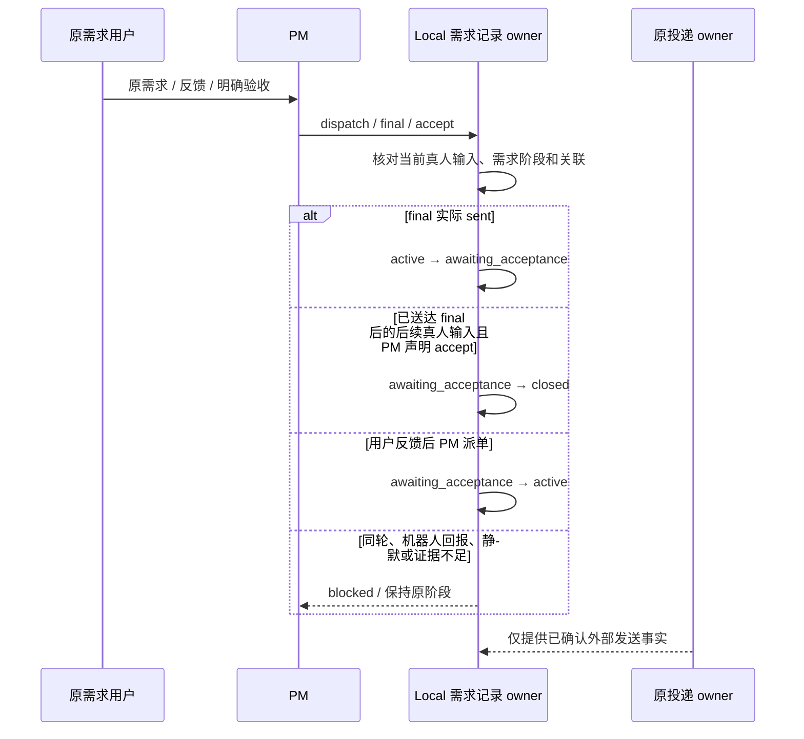

# 13: 落实 PM 审核、依赖推进与用户验收闭环

Status: in-progress

Issue-Tracker: local-markdown

## Parent

[ZCode Local spec](../../local-edition/spec.md)

**What to build:** 通过通用角色上下文和既有需求记录，让 PM 按已确认规则持续推进，并区分代码保证与模型判断。

**Blocked by:** [10 允许合法协作长链持续推进](10-collaboration-chain-admission.md)；[12 在断线和重启后核对状态再恢复](12-state-reconciliation.md)

## Background

机制可发送不代表 PM 会正确核验、判断等待依赖或结束无进展整改。

## Modules

Bot 角色上下文与规则注入、PM 需求记录接口、受控行为场景。不预先固定源码文件名；以实施基线的受控模块上下文为准。

## Acceptance criteria

- [ ] 目标内连续推进；等待用户时只派发无依赖工作，不编造答复，不把待验收视为关闭。
- [ ] 核对产物和验证证据；同一问题三轮无进展向用户说明，正常阶段交接不误计。
- [ ] 最终汇报后仅明确用户通过才关闭，反馈继续原需求；不接入 Jev，不改业务仓库章程，不把脚本输出当作真实模型可靠性证明。

## Spec coverage

用户故事：5、6、10、11、12、14、15、16、17、42、43。
验收场景：T19、T20、T23。

## Execution notes

一次只处理本 issue。实现遵循已确认测试边界和 TDD，保留无关改动；验证记录区分实际执行、合成场景与待真实验收。完成后记录改动、验证结果和既有逻辑影响，再置 done。

## Implementation contract

- 实施基线 `f0f8b211b91819a55f13420f1d096c8933a0fd0a`。只处理本票，父规格保持冻结；不推送、安装或启动日常应用，不进入 14/18，也不把受控模型场景说成真实模型可靠性证明。
- 需求拆解、依赖判断、产物语义审核、是否整改及同一问题“三轮无进展”的识别继续由 PM 模型负责。代码不解析正文、不按交接次数推断整改轮次，也不承诺识别所有语义误判；只注入明确章程并核对显式阶段转换、当前可信输入和既有任务/投递关联。
- 复用既有 Local 需求记录，不新增工作流数据库或调度器。需求增加 `active`、`awaiting_acceptance`、`closed` 三个阶段：最终汇报已经由原渠道投递 owner 确认 `sent` 后才进入待验收；用户反馈后的 PM 派单重新进入 active；只有 PM 在晚于最终汇报的可信真人输入上显式声明用户已验收，才能关闭原需求。机器人回报、静默、等待用户、普通交接和 PM 自己的最终汇报都不能关闭需求。
- `ReplyToChannel` 增加 PM-only 的 `accept` 控制意图，要求单个空 text part。Host 沿实际 `taskId/inputId/workspace/revision` 重读需求、可信输入类型和已送达 final；同轮 final 不可自验收，后续真人输入上的误用也不能越过上述阶段检查。`accept` 只返回严格 `{status: acceptance_recorded}`、记录关闭并让本轮终答静默，不产生消息或投递收据。
- 每次输入注入同一份角色上下文。PM 明确获得持续推进、仅等待有依赖工作、核对实物与验证证据、三轮无进展及独立工作继续、final 待验收、明确通过才关闭、反馈继续原需求的章程；执行者获得只向 PM 回报结果/证据/阻塞且不得声明用户验收的上下文。`requirement` 当前阶段、原需求用户和当前角色仍从 Local 可信记录生成，模型不能提交这些事实。
- PM 最终汇报只表示请求验收，不等于关闭；没有新的用户输入时 `accept` 返回 blocked。已关闭需求后的后续真人消息创建新需求，已验收前的问题反馈继续原需求。停止、恢复、群配置、长链受理、固定项目串行及原发送去重保持不变。
- 验证沿用已确认边界：合成 Provider 回调 → 真实 Bot/Local/Repo/渠道组装 → 受控任务 SDK，并覆盖角色上下文、待验收持久化、反馈继续、拒绝自验收、显式验收关闭、重启和普通群兼容。T19/T20/T23 仅证明受控输出下的机制与章程注入；真实 PM 是否按章程完成语义判断、真实群闭环留 18。

