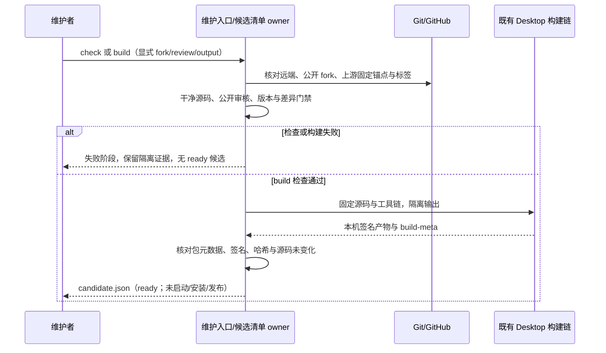

# 14: 从维护入口生成可追溯的版本候选

Status: in-progress

Issue-Tracker: local-markdown

## Parent

[ZCode Local spec](../../local-edition/spec.md)

**What to build:** 建立统一维护入口的检查/构建能力，结合用户 fork、版本分支和候选清单重复产出可核验版本。

**Blocked by:** [02 构建可独立启动的 ZCode Local 候选应用](02-local-app.md)

## Background

一次手工构建不能承担长期更新、远端备份和版本追溯。

## Modules

本地维护命令、Git 远端与版本元数据、官方构建链、公开内容检查。不预先固定源码文件名；以实施基线的受控模块上下文为准。

## Acceptance criteria

- [ ] origin 为核实归属后的用户 fork，upstream 为官方且不误推；通用代码与私有材料分开。
- [ ] 用户主动触发检查/构建，冲突或验证失败停止；官方已解决的补丁可退役，不后台安装。
- [ ] 候选版本、分支、源码锚点、包元数据对应，发布采用固定标签且不改写已发布内容；工具链可持续复现。

## Spec coverage

用户故事：50、51、52、53、54、55、56、58、59、71、72。
验收场景：T29、T30、T35。

## Execution notes

一次只处理本 issue。实现遵循已确认测试边界和 TDD，保留无关改动；验证记录区分实际执行、合成场景与待真实验收。完成后记录改动、验证结果和既有逻辑影响，再置 done。

## Implementation contract（2026-10-23）

- 公开接口为 `pnpm local:maintain check|build --fork owner/repo --review FILE --output DIR`。沿用父规格已确认的命令/进程测试边界；测试使用真实临时 Git 仓库、显式临时候选根与数据根，网络和打包工具仅在系统进程边界使用受控替身。
- `scripts/local-maintenance/` 是仓库维护脚本层，不进入 Main、Host、CLI/runtime 或机器人调度。维护入口独占本次候选目录及 `candidate.json`；没有另建候选数据库。现有 Desktop build-meta 仍独占包内版本和短源码锚点，入口核对而不重写它。
- check/build 只由显式命令触发。check 通过实时 GitHub API 获取官方 main 的固定 commit（已持有同 SHA 的对象可复用，缺失必须 fetch）、源码版本、最新公开 release 和补丁等价结果；不 merge/rebase、不自动退役补丁。review JSON 必须明确所核对上游 commit、能力差异/阻塞和逐项补丁保留或退役依据；等价补丁尚未退役、review 过期或有阻塞时停止 build。语义等价仍需维护者审阅，不从 patch-id 自动推断。
- fork 通过 GitHub API 核对 public/fork/source/owner；origin fetch/push 必须精确指向传入的 fork，upstream fetch 指向官方，push URL 必须为禁用值。拒绝多 URL、官方 origin 和错误 pushDefault。命令不写远端配置、不推送、不创建/移动标签。核实用户 fork 后再单独说明并执行远端迁移；旧 origin/main 将随 remote rename 成 upstream/main，架构默认 merge-base 需继续明确指向官方，不用 fork main 冒充官方基线。
- 未提交/未跟踪源码、冲突/进行中的 Git 操作、工具链不匹配、公开内容检查失败、检查/构建/签名/元数据验证失败均终止，不产生 ready 清单。诊断只写阶段/错误码，不输出密钥、私有正文或完整工具输出；原始日志只留仓库外本机目录。公开扫描覆盖官方分叉以来可达的新增/修改 blob 和敏感文件名；它只补充人工公开审核，不能保证识别所有私密语义。
- 版本取根 package.json，要求分支同名 `官方版本-local.N`、N=1..999；发布名固定为 `v版本`。候选清单记录完整 HEAD、Git tree、lockfile hash、mise 声明/实际工具链、官方基线和 review hash、包内 build-meta、平台数字版本、产物 SHA-256。远端/本地已有同名标签时必须解析到相同源码，否则拒绝并要求新修订；本票不发布标签。候选目录必须全新，拒绝覆盖。
- build 顺序为检查 → 锁定全新仓库外候选目录 → 临时数据根 → frozen-lockfile 安装/原生准备 → typecheck/lint/架构/受影响测试 → 现有 prepare:desktop-runtime → build:no-runtime-assets → bundle:desktop → 包内元数据/签名/哈希核验 → 原子写 ready 清单。源码在完成前再次核对；变化、失败或并发重入保留失败证据，不提升为可安装候选。
- 候选输出禁止日常应用目录、仓库和用户业务数据目录；不启动应用。当前实际产物验证为本机 macOS，其他系统在缺少等价签名/包验证前明确拒绝 build，不声称跨平台实测。可复现指同一源码、锁文件和声明工具链可重建，不承诺签名/时间戳产物逐字节相同。

