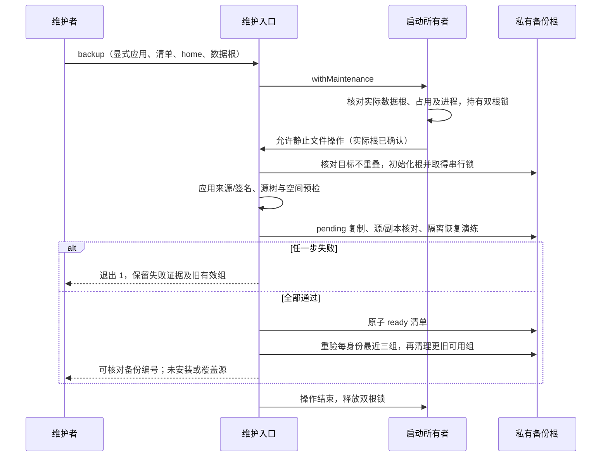

# 15: 备份应用与业务数据并验证保留策略

Status: done

Issue-Tracker: local-markdown

## Parent

[ZCode Local spec](../../local-edition/spec.md)

**What to build:** 通过维护入口创建、核对和列出应用/数据备份，保留最近三组可用恢复基线。

**Blocked by:** [14 从维护入口生成可追溯的版本候选](14-versioned-candidates.md)

## Background

没有一致且可恢复的备份，就不能安全替换日常应用。

## Modules

维护命令的备份能力、数据定位、版本与备份清单、本机私有存储。不预先固定源码文件名；以实施基线的受控模块上下文为准。

## Acceptance criteria

- [x] 应用、业务数据和 Local 必要记录形成一致备份，可对应版本/时间/源码锚点并验证恢复可用性。
- [x] 备份失败、空间不足或不完整时不继续替换，失败快照不挤掉有效备份。
- [x] 只清理明确备份目录，保留最近三组可用备份并保护在用数据和唯一恢复基线，不上传 fork。

## Spec coverage

用户故事：62、63。
验收场景：T27、T32。

## Execution notes

一次只处理本 issue。实现遵循已确认测试边界和 TDD，保留无关改动；验证记录区分实际执行、合成场景与待真实验收。完成后记录改动、验证结果和既有逻辑影响，再置 done。

## Implementation contract（2026-10-23）

- 公开入口扩展为 `local:maintain backup --home HOME --data-root ROOT --local-app APP --official-app APP --app-manifest FILE --backup-root DIR`、`backup-list --backup-root DIR`、`backup-verify --backup-root DIR --id ID`。全部路径显式绝对指定，存在的官网应用路径及其父目录别名按真实路径核对，缺失路径复用维护入口已有 canonicalPath 的父目录解析；app-manifest 是当前待备份 Local 应用的 14 候选清单，不是即将安装的新应用。只支持当前已验证的 macOS。沿用父规格已确认的维护命令/进程 seam，不另设内部函数测试边界。
- 维护脚本继续独占候选与备份清单；不建立第二个候选数据库。备份根必须在仓库、应用及 home/data 的 `.zcode` 之外，初始化为空目录并写私有 owner 标记；已有任意目录不能直接收编。后续命令验证 owner 和私有权限，按根串行，崩溃遗留锁不按时间抢占。
- `local-launch` 公开 `withMaintenance` 临界区，复用其 home/实际业务根规范化、设置重定向核对、固定顺序 owner 锁和现存应用进程观察。已有 preparing/running/unconfirmed、损坏记录或进程观察失败均拒绝备份；实际根确认后才允许创建备份根，锁覆盖目的根初始化、完整复制和校验。维护脚本不直接读写启动 owner，不接管任务状态。直接绕过受控入口启动的竞争仍受 03 已披露边界约束。
- 范围为当前 Local 完整签名应用、去重后的 home 与实际业务根 `.zcode` 内容（包含 v2 数据、CLI 配置/历史等），以及 `.zcode/local/v1` 的 Local 必要记录。排除可重建 Electron profiles、启动占用文件及其锁；不读取外部系统凭据库、不解密秘密、不备份项目工作区文件。缺失实际 v2 数据、未知文件类型或指向范围外的链接均停止；保存链接而不跟随到外部，权限随文件保留，外层目录 0700、清单 0600。
- 先核对当前应用与原候选完整树 hash、版本/完整源码锚点和 deep/strict 签名，再计算源树与所需空间；空间需容纳快照及恢复演练副本并保留余量。复制到唯一 pending 目录，重新核对源未变化与副本完整树，再在 pending 内复制恢复演练副本并核对；SQLite 文件（页头识别及 .db/.sqlite/.sqlite3，包括坏页头）在演练副本执行只读 integrity_check。通过后删除演练副本，原子发布 ready backup.json（schema 1，版本、时间、完整源码、来源路径与内容 hash、可用性），再执行保留清理。没有 ready 清单就不能作为安装/回退基线；失败从入口退出 1，不提供安装行为。
- list/verify 每次重新校验快照内容和应用签名，不仅信任 ready 文本。verify 重做独立恢复演练，不覆盖源、启动应用或连接机器人；可恢复性指本机完整文件恢复与数据库结构有效，不代表跨版兼容、系统密钥迁移、GUI 或业务验收。
- 默认按成功创建顺序保留每个 home/data 身份最近三组可用快照；不同身份分别保留，避免其他测试根挤掉唯一恢复基线。失败、半成品、损坏或未知目录不计入三组且不自动删除；只有新快照及保留的三组重新验证通过，才清理同身份更旧的可用组。仅删除 owner 根下由本入口生成的 UUID 组目录，禁止路径穿越、symlink 和源/在用数据重叠；清理失败如实返回，保留新旧恢复依据。15 不实现安装、程序回退或覆盖数据恢复，16/17 需重新验证清单后使用。

## Completion（2026-10-23）

应用、home/实际业务数据与 Local v1 记录备份、清单核验、独立文件恢复演练和每身份三组保留已落地。
完整应用来源/签名、真实 SQLite/WAL 与异常、空间不足、复制失败、占用、目录别名和保留保护通过命令入口验证；没有新增候选数据库。
44 项维护进程、18 项启动/契约、类型、Lint、架构与变更格式通过；pre-push 的 affected 全选按合同跳过，根完整 UT 未请求、未执行。
两轴审查的 2 项 P2 与 2 项 P3 全部关闭，最终源码固定 `410b533bf76b4f55d644942132c81b076a15c2ca`。
使用 14 真实签名候选加合成数据实际 backup/verify 成功，未启动或安装、未接管日常数据、未连接模型/机器人、未发布 tag。
证据、触发/根因/修复与失败披露见[交付报告](../../local-edition/backup-retention.md)。16 尚未开始。
