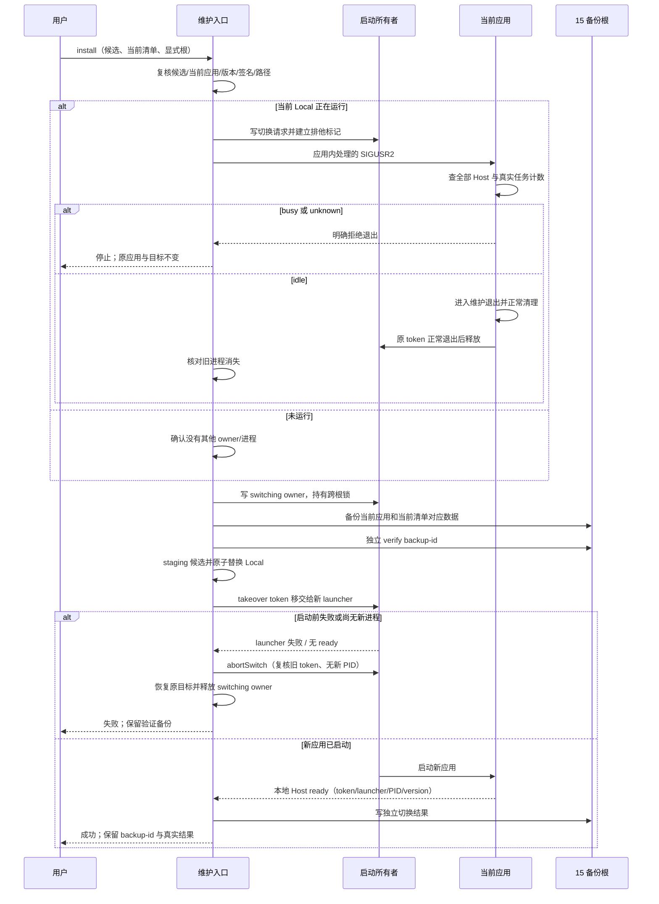

# 16: 从维护入口安全切换到候选版本

Status: done

Issue-Tracker: local-markdown

## Parent

[ZCode Local spec](../../local-edition/spec.md)

**What to build:** 用户发起安装后，条件满足即自动完成切换；有在办任务或状态不明时仅准备候选并等待。

**Blocked by:** [09 保证同一项目实际执行串行](09-project-serial-execution.md)；[15 备份应用与业务数据并验证保留策略](15-backup-retention.md)

## Background

构建与备份各自成功，还不等于能安全完成退出、替换、启动和连接核对。

## Modules

维护命令的安装能力、运行时任务状态、桌面进程生命周期、连接核对。不预先固定源码文件名；以实施基线的受控模块上下文为准。

## Acceptance criteria

- [x] 候选验证通过、任务结束和备份成功后提示并正常退出、替换 Local、启动和核对连接，不逐步重复审批。
- [x] 忙碌、未知、退出失败、备份失败或兼容检查失败时停止切换，不强杀，不覆盖官网应用。
- [x] 隔离安装演练成功，故障如实报告并保留恢复依据；真实日常切换仍遵守用户主动发起和系统权限条件。

## Spec coverage

用户故事：56、58、60、61、67。
验收场景：T27、T31、T34。

## Execution notes

一次只处理本 issue。实现遵循已确认测试边界和 TDD，保留无关改动；验证记录区分实际执行、合成场景与待真实验收。完成后记录改动、验证结果和既有逻辑影响，再置 done。

## Implementation contract（2026-10-23）

- 公开入口扩展为 `local:maintain install --candidate FILE --current-manifest FILE --home HOME --data-root ROOT --local-app APP --official-app APP --backup-root DIR`。`candidate` 是待安装的新候选，`current-manifest` 描述当前正在使用、将被备份的 Local；二者都必须是 ready 清单，入口重新核对完整应用树、版本/源码锚点、平台身份和签名，不能只信文本。全部路径显式绝对指定；只支持当前已验证的 macOS。沿用父规格已确认的维护命令/进程 seam，不另设内部函数测试边界。
- 维护入口继续独占候选、备份和切换结果；不建立候选数据库、第二份任务队列或独立备份链。`local-launch` 独占进程观察、launch owner 和接管协议；运行时任务事实仍由 Main/Host 现有计数所有者回答。安装入口不直接写 `launch-owner.json`，也不根据进程存在、超时或备份清单文字猜测任务已结束。
- 实际数据根 `.zcode/local/maintenance/switch-gate/` 是本次切换唯一的并发门，不属于业务状态或任务队列。入口在任何退出请求前独占创建并绑定 takeover token；存在该门时普通 `run` 和第二个 install 都 fail closed。成功后只能由 `completeSwitch` 在新 running owner 与预期 runtime ready 均匹配时清理；回调失败交给 `abortSwitch` 在同一跨根锁内恢复后再清理。未完成、进程崩溃或状态不明都保留门供人工核对，不按时间抢占。
- 当前应用由 16 构建时，包内 build-meta 带 `localMaintenanceProtocol: 1`。入口先验证当前清单与包内该能力。旧应用正在运行时若不具备协议，返回需要先完全退出，不发送可能被默认处理的信号；旧应用未运行时可直接进入维护临界区。新候选也须带该能力，确保后续升级仍可安全切换。
- 当前 Local 运行时，入口在实际数据根 `.zcode/local/maintenance/` 原子写带随机 token 的切换请求；该瞬时控制目录不属于 Local v1 业务记录，不进入 15 备份载荷。入口提供跨根 launch 排他标记，再向已验明的当前应用 PID 发送由应用处理的 `SIGUSR2`（避开 Node 的 inspector `SIGUSR1` 语义）。Main 只在所有仍存活的窗口 Host 已就绪时，以 Host 的真实运行任务计数回答；任一 Host 未就绪、计数读取失败或结果无法确认都回答 unknown，非零回答 busy。第一步只返回 idle/busy/unknown 且不退出；只有入口读到明确的 idle 后原子写同 requestId/token/appPid 的 commit 并再次发信号，Main 在 commit 下重查门禁后才回答 accepted 并进入退出。读取 idle 前超时、busy、unknown、无响应或 token 不匹配均不退出、不替换，并安全撤销未提交请求；提交后收到显式 busy/unknown 同样证明 Main 未退出并可清理重试，提交后无响应、accepted 后未干净退出的状态不明则保守保留请求、切换门与证据并返回未知，不把迟到信号当成成功。不使用 SIGKILL/SIGTERM、不关闭系统保护。
- Main 接受切换后置应用进入维护退出态，绕过常规交互确认但复用既有 Host/Agent 有界清理并正常 `app.quit()`。维护入口必须观察到请求 token 匹配、旧 launcher 已按原 token 释放且 Local 进程实际结束，才写 `switching` launch owner；退出失败或状态不明停止并保留原应用 owner，不把观察超时当成功。官网版本占用、任何异常 owner、多个进程或多个 root token 均拒绝。
- `switching` owner 由 `local-launch` 后续接管，不接受普通 `run`，也不按超时回收。维护回调在同一跨根 owner 临界区内复用 15 的备份创建/verify 实现，备份参数必须使用当前应用和 `current-manifest`，不能使用待安装候选；必须在切换关键区再独立 verify 所得 backup-id。SQLite 完整性检查在隔离恢复副本内使用 `PRAGMA query_only=ON`，既保持 WAL 读取语义，也支持干净关闭后已无 `-wal/-shm` 的正常数据库。空间、复制、完整性、数据库检查、部分清理或签名失败都停在替换前。回调以结构化 failed 返回并保留 switching owner/切换门，维护入口必须先在同一 owner 锁内恢复目标再 abort，恢复失败返回 `install-rollback-unconfirmed`，不能释放边界假装成功。
- 新候选先在同文件系统、目标应用父目录内复制到唯一 staging 目录并重新验签/逐项 hash；候选清单、官网应用、目标 Local、home/data、备份根和 staging 均按真实路径互斥。当前应用备份及候选复核均通过后，先把目标 Local 原子改名为同目录回滚目录，再把 staging 原子改名为目标。第二次改名失败必须恢复原目标；若回滚目录也因文件系统错误无法恢复目标，必须保留 switching owner、回滚/候选证据并返回 `install-rollback-unconfirmed`，不能释放 owner 后留下目标缺失或可再次启动的假成功状态。成功后仅在启动核对通过时清理回滚目录，备份仍是长期恢复依据。
- 成功后由带一次性 takeover token 的 `local:launch` 接管 `switching` owner，启动新目标并等待新 Main 在实际 Host 就绪后写出的 runtime-ready；ready 必须匹配新 owner token、存活 launcher 与原应用 PID、候选版本。超时、进程提前退出或状态不符如实失败，不强杀可能已启动的新应用，也不删除备份。若启动前 launcher 失败、ready 超时前仍保留原 `switching` token 且没有新应用进程，维护入口调用 `local-launch.abortSwitch`：同一跨根锁内复核 token 和进程，再执行目标恢复回调、释放 switching owner；若新 owner/PID 已出现则拒绝 abort 并保留候选、备份和启动证据。维护入口原子写独立切换结果（候选、前后版本/源码、backup-id、时间和结果），不冒充 17 的程序回退或数据恢复。
- “连接核对”在本票自动化中只表示新应用与本地 Host 已就绪；合成演练不连接真实模型或机器人，不读取真实凭据。真实日常切换须另由用户主动发起并在隔离验证、任务/进程/数据门禁满足后进行；无当前运行应用的首装、已有 Local 升级、busy/unknown、退出失败、备份失败、候选不兼容、替换失败、启动失败均需从命令入口观测最终磁盘、owner、备份和退出码。

## Completion（2026-10-23）

维护入口新增 `install`，以 token 绑定切换门串行退出、备份、替换、takeover 和结果落盘；Main 使用 idle/commit 两阶段确认，真实 Host readiness 与任务计数控制自动退出。当前应用/候选完整树、build-meta、签名、版本路径和官网真实路径隔离均重新核验；失败保留 recovery evidence，回滚失败 fail closed。

最终源码 `82619df1d39c8cbc55a3074d15a84b19da51aaa5`，实现/补正提交 `5985be20`、`b9817f9e`、`3a210d8f`、`82619df1`。实际验证 21 项安装进程、45 项维护/备份、68 项启动/协议、类型/Lint/架构与变更格式通过；pre-push 的 schema 8 项、架构 36 项通过，affected 全选按合同跳过；仓库级格式命令仍报告 2144 个全仓文件，未记全绿。

使用实际签名 local.1 与仓库外 drill-only local.2 app bundle 完成真实文件切换：备份 `backup-ab2f30be-6082-4fe5-89e6-0b90e2a6533e` 独立 verify 成功，switch `switch-ff034d6f-d877-41f4-a1c4-b82ae8e78602` ready，local.2 本地 Host ready 后再次正常退出。local.2 DMG builder 下载超时，没有 ready 交付包；未安装日常应用、未接管日常数据、未连接真实模型/机器人、未发布标签。详见[交付报告](../../local-edition/safe-installation.md)。17 未开始。
