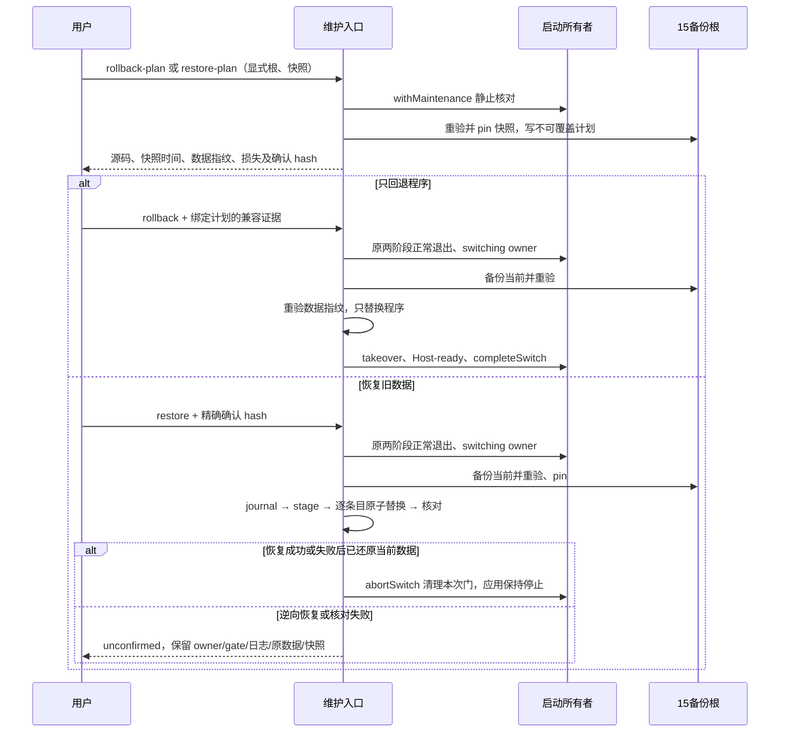

# 17: 分开提供程序回退与数据快照恢复

Status: done

Issue-Tracker: local-markdown

## Parent

[ZCode Local spec](../../local-edition/spec.md)

**What to build:** 维护入口能选择兼容的程序回退，必要时在明确确认后恢复旧数据，并保护当前结果。

**Blocked by:** [16 从维护入口安全切换到候选版本](16-safe-installation.md)

## Background

退回旧程序可能还能保留当前数据，直接恢复旧快照则会丢失新增内容。

## Modules

维护命令的回退/恢复能力、版本兼容检查、备份清单与应用启动。不预先固定源码文件名；以实施基线的受控模块上下文为准。

## Acceptance criteria

- [x] 旧程序兼容时保留当前业务数据；不兼容时禁止直接打开。
- [x] 必须恢复旧数据时先备份当前数据，展示旧快照时间和损失影响，明确确认前不覆盖。
- [x] 恢复失败保留可核对状态与有效快照，不宣称无损跨版合并，隔离演练验证可恢复结果。

## Spec coverage

用户故事：62、63、64、65。
验收场景：T32、T33。

## Execution notes

一次只处理本 issue。实现遵循已确认测试边界和 TDD，保留无关改动；验证记录区分实际执行、合成场景与待真实验收。完成后记录改动、验证结果和既有逻辑影响，再置 done。

## Implementation contract（2026-10-23）

- 父规格及原验收矩阵冻结。公开进程 seam 沿用已确认的隔离维护命令。只处理 17；真实日常数据恢复必须由用户主动触发并明确确认，本轮仅使用合成数据。
- 新增 `rollback-plan` / `restore-plan`：共同参数为 `--id BACKUP --current-manifest FILE --home HOME --data-root ROOT --local-app APP --official-app APP --backup-root DIR`。在原 `local-launch.withMaintenance` 静止边界重验 15 ready backup、当前完整应用、源码和真实数据身份，生成私有 `recovery-UUID/plan.json`。计划绑定当前数据树（含模式）、两端源码、应用路径、备份清单 hash、快照时间、逐组件新增/修改/删除数量与损失说明，不输出文件正文。所选快照 pin 后不参与自动保留清理；最近三组普通有效基线规则继续有效，人工核对计划/日志不再使用后才可清理 pin。
- `rollback --backup-root DIR --plan recovery-UUID --compatibility FILE` 只替换程序，数据不从快照复制。兼容审阅 schema=1，`kind=local-rollback-compatibility`、`planSha256`、`currentDataSha256`、`from`/`to`（完整 commit/version）、`decision=compatible` 和非空 `evidence` 均须与计划一致。它是维护者基于存储源码/迁移/隔离 Reader 证据的显式输入，不由版本号、Host-ready 或签名推断语义兼容；未知、不兼容或旧审阅均拒绝。首次启动前在 owner 临界区重验数据指纹和审阅，复用 16 的备份、staging、替换和失败边界；目标支持维护协议 1 时再 takeover/Host-ready，早期无该协议的已验证旧应用只完成替换并保持停止，不伪造连接检查。当前运行程序缺少协议时要求先正常退出，不向其发送信号。
- `restore --backup-root DIR --plan recovery-UUID --confirm SHA256` 与程序回退分离。restore-plan 的 stdout 展示旧快照时间、损失数量、全量替换影响和确认 hash；没有精确确认不退出应用、不备份、不覆盖。确认后复用 `switchToCandidate` 正常退出和 switching owner，在同一锁内再核对计划、数据、目标身份，先用 15 创建并独立 verify 当前应用/当前数据备份并 pin，再从已重验快照准备独立副本、校验 hash 和 SQLite。恢复 `.zcode` 业务条目及 `local/v1`，保留现有 owner、控制目录和 profile。应用文件不变，恢复后保持停止；后续打开前须独立确认所选程序兼容恢复数据，不承诺跨版合并。
- 数据根必须与备份 home/data 的真实路径及身份完全相同；禁止把旧 setting.json 的 dataBaseDir 重定向到其他根。业务路径、应用、官网与备份根按真实路径互斥，拒绝 symlink 目录、损坏快照、半成品、空间不足和不一致身份。home=dataRoot 时去重。本票不扩大 03 已披露的绕过受控入口保护范围。
- 恢复失败时 home 的 setting.json 可能正位于 before 副本；`abortSwitch` 在该特定恢复边界使用显式规范化 home/dataRoot 寻址，不重新依赖正在恢复的设置。只有原 token、两根一致且无 child PID 的 switching owner 与原 gate 都匹配时才执行回调，普通 run/maintenance 的数据根校验保持不变。
- 恢复 journal 属于维护入口，记录计划、当前备份、阶段和每条目的原子改名意图。所有临时副本在源根同文件系统的唯一目录；owner 锁及持久切换门覆盖全部改名。失败优先按逆序恢复原条目，成功核对后才 abort 释放；逆向恢复、日志写入或 owner 核对失败则保留 owner/gate、临时原数据、15 有效快照和 journal，报 unconfirmed。崩溃不自动续跑、不按时间抢占，日志不是第二份业务状态。
- 16 留下的 previous app、ready backup 与启动证据是程序回退输入线索；本入口只信重验的 ready backup 和完整当前程序，不直接信任 previous 文件名。新 PID 出现后的未知 owner/gate 必须先由人核对两根 owner、gate/request/runtime、launcher/child/整个进程组及已配置 app 进程；保留原记录的私有副本，确认全部写进程结束且应用/数据与有效备份可核对后才可人工解除。损坏/部分记录或无法证明结束时停止并保留材料；不提供 force、TTL、自动清理或强杀入口。恢复半途崩溃还须按 journal 与 before 副本核对每个条目，不能仅删锁重试。

## 18 验收补正合同（2026-10-23，用户已确认）

沿用 15 的显式插件链接对象策略。当前数据指纹涵盖链接路径、类型、权限和目标字符串 hash，不读取外部目标；旧快照按其清单策略重验。restore-plan 在精确确认 hash 覆盖的预览内展示旧快照与当前数据的插件依赖数量，并说明只恢复链接对象，外部内容不受备份与恢复保证。restore 仍先备份当前，再恢复链接对象；不跟随或写入目标，不因目标变化、缺失而伪造外部可用性。隔离恢复回归验证目标内容不变、旧链接恢复、当前链接保留在恢复前备份、非插件外链仍拒绝；真实数据恢复仍须用户主动触发并精确确认，本次仅授权修正和启动前备份。

## Completion（2026-10-23）

完成源码端点 `ca707b5f600c1924c14fb9d07ebe1aecdefde4b3`，实现 `dfe1d288`，补正 `ca707b5f`。程序回退要求绑定数据指纹与两端源码的兼容证据，数据恢复独立预览/确认、备份当前并保持停止；失败保留 journal、before/after、当前有效基线与 owner/gate。早期无维护协议应用可兼容回退并保持停止。恢复 abort 只在原双根 owner/gate token 一致且无新进程时使用显式根，普通启动根校验不变。

13 项恢复进程场景通过，包含真实 SQLite/WAL、同根、精确确认、回退保留新内容、旧计划拒绝、替换/逆向失败、崩溃与 pin 保留；最终备份/安装 44 项、维护 22 项、启动/契约 25 项通过。根类型、Lint 0 errors / 97 存量 warnings、架构 0 新违规、变更格式通过；pre-push schema 8 项、架构工具 36 项通过，affected 官方选中 2063/2063 后按合同跳过 UT，不代表全量。仓库级 fmt:check 仍报告 2144 个全仓文件，未记全绿。首次 pre-push 因实现尚未提交被脏工作树门禁拒绝，干净提交后重跑通过。

固定比较 `68088f7e...ca707b5f` 两轴复审：Standards 0 项；Spec 首轮 P2（pin 占普通保留名额）与 P3（预览缺组件明细）均补正关闭。真实 SQLite 回归暴露 stage integrity 改写 shm，已仅在独立演练副本核验 SQLite，stage 用完整树同一性验证；红/绿与独立差异证据均保留。

操作、失败核对与边界见[交付报告](../../local-edition/rollback-restore.md)，本机证据根 `~/.local/share/zcode-local/research/issue-17/`。测试使用临时可执行夹具、真实 ASAR/SQLite 和受控签名/构建边界，未启动真实签名候选、未安装日常应用、未接管日常数据、未读真实凭据或连接模型/机器人。18 未开始。
