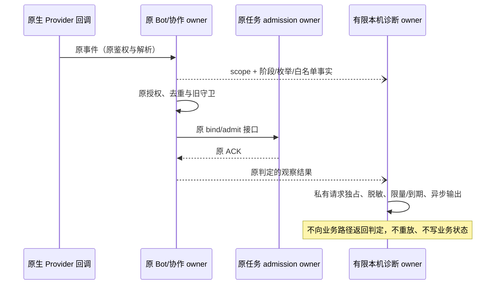

# 18: 完成整体回归与真实群只读验收

Status: in-progress

Issue-Tracker: local-markdown

## Parent

[ZCode Local spec](../../local-edition/spec.md)

**What to build:** 汇总所有子项证据，在项目群空闲时验证真实闭环与关键异常，形成待用户确认的最终交付。

**Blocked by:** [13 落实 PM 审核、依赖推进与用户验收闭环](13-pm-review-acceptance.md)；[17 分开提供程序回退与数据快照恢复](17-rollback-restore.md)

## Background

单项合成测试和安装成功不能证明完整 PM 协作与长期维护可交付。

## Modules

集成与界面回归、隔离维护演练、真实群只读场景、交付证据。不预先固定源码文件名；以实施基线的受控模块上下文为准。

## Acceptance criteria

- [x] 覆盖父 spec T01–T36，明确合成、真实、受限和未执行证据，所需检查真实执行且失败有归属。
- [ ] 指定群空闲时走通用户→PM→执行者→PM→用户，以及静默、错角色/卡片、长链、停止和恢复关键场景，不改业务代码、不部署、不打断工作。
- [ ] 核对最少诊断和公开内容边界，用户明确验收后才视为整体通过；不擅自关闭或改写父 spec。

## Spec coverage

用户故事：12、13、14、15、16、17、19、21、22、25、41、49、67、69、70、72。
验收场景：T36。

## Execution notes

一次只处理本 issue。实现遵循已确认测试边界和 TDD，保留无关改动；验证记录区分实际执行、合成场景与待真实验收。完成后记录改动、验证结果和既有逻辑影响，再置 done。

## Implementation contract（2026-10-23）

- 本票基线 `f2dfa97ff78e28abe48918d2348a3ce43ee25efe`；父 spec 冻结 blob `25efc393d4c8d5cf0fb44cbbd4ca8b04dd6c1387` 保持不变。不部署、不发布 tag；发现产品问题先记录触发、证据和影响，不在验收票中静默修复。用户已确认退出官网并授权经受控入口启动 Local；启动前先保护当前数据。插件外链阻塞已获用户明确确认，按 15/17 的补充合同修正维护脚本并补回归，其他业务实现不变。
- 复用已确认的事件到实际 Provider 请求、CLI CommandInbox/项目租约、设置界面 RPC/持久化、维护命令/临时磁盘等公开 seam。运行当前源码明确选择的相关根测试、CLI 工具和 V4/项目执行测试、设置界面、维护/备份/安装/恢复命令及类型/Lint/架构检查；不把 affected 全选后跳过当作根全量，也不把“整体回归”扩成未授权的全库单测。
- 只引用父规格 T01–T36，不复制或重写其验收矩阵。交付证据索引记录各 ID 的当前测试、历史报告、实际运行类型（合成、真实进程、真实签名、真实模型/群）、基线及未覆盖项。历史报告与原始本机产物分开核对，缺失产物如实记录，不能仅根据文档 done 声称本轮复验通过。
- 所有新测试产物、截图、隔离 HOME/data 和原始日志保存在仓库外本机私有 `~/.local/share/zcode-local/research/issue-18/`。公开文件只保存脱敏命令、数量、源码与结论，不写群名/chat ID、真实人员/机器人身份、消息正文、凭据或内部地址。复用现有诊断，检查新增源码日志及公开提交内容；静态扫描不能替代语义审阅。
- 真实群只读指任务只读项目内容，不修改业务文件、不部署，不代表不发送验收消息。须核实用户指定群、可信授权用户、PM/执行者原生身份、实际运行 Local 源码/协议/CLI 版本及原 owner/租约/任务状态；空闲无法证明时停止该项，不抢占、不强杀、不重启日常应用。真实凭据只由既有应用机制使用，不读出、复制或新增明文存储。当前正在运行的官网程序不能冒充 Local 验收版本。
- 真实流程先形成可核对的有限只读场景文本和预期结果，再沿既有应用/原渠道执行：基本闭环、静默、错角色/候选卡片、超过五次交接、同项目串行、叫停、恢复核对与 PM 待用户验收。场景使用专门验收标记，观察实际渠道收件人与任务/投递事实，不能以脚本预置模型输出证明 T19/T20/T23。任何并发在办工作、任务副作用未知或连接异常立即保留事实并停止，不自动重试消息。
- 用户未提供目标群/运行版本或真实流程尚未执行时，记录明确的受限/待验收状态，不能勾选真实群标准或将 18 标 done。最终整体通过必须由用户明确验收；父 spec 不自行关闭。独立可执行回归先完成，真实步骤仅等待缺失的信息与必要人类操作，不要求重复批准已授权的普通源码提交和 fork 分支 push。

### 已批准的最小接收诊断（2026-10-24）

用户明确允许最小诊断及空闲后的受控切换。本节仅增加一次本机观察能力，不修改父矩阵或接收规则；原“真实步骤不改业务代码”的边界对本次经批准的诊断例外适用，其他业务行为保持原合同。

- Bot 服务沿既有 Provider 回调记录 native、回调鉴权、准备、解析、去重、协作授权、旧守卫、绑定及实际 admission 的阶段/枚举结果。观察不能参与业务判定，不假设可追溯旧事件，不新增业务队列、授权来源或重放入口。
- 唯一诊断 owner 位于独立受控模块 bot-receive-diagnostic，通过公开入口供 Bot 服务使用；它只拥有有限日志写入生命周期，不扩张已有协作契约的方法数。Local 能力及 `ZCODE_LOCAL_RECEIVE_DIAGNOSTIC_FILE` 同时启用才读取一次请求文件；官网/未配置时不创建文件。没有设置 UI、远端 RPC 或云端上传。
- 请求为私有独占目录中的 schema 1 严格 JSON，包含单个 botId/chatId、32 字节随机 salt、未来最多 30 分钟的绝对 expiresAt 和 1–200 的 maxRecords。请求及目录必须为当前用户所有、权限分别 0600/0700、无链接；拒绝非普通文件、过大文件及已领取请求。一次领取与同目录 `events.jsonl` 使用独占创建，后续不覆盖、不跟随链接、不自动清理其他文件。多 Host 不共享诊断写入所有权。
- 输出只含时间、序号、以本次 salt 对 messageId/发送者做的 HMAC 摘要（分离命名空间）、固定阶段/结果及白名单布尔/有限计数/类型枚举。正文、原始身份/消息 ID、名称、项目路径、异常原文、header、token、凭据和任意扩展字段均不得进入输出。scope 必须精确匹配请求中的机器人及群；未知 scope 不记录。
- 指定机器人的既有 WebSocket owner 成功连接后，可记录一条不含消息/群数据的 connection/ready，使实际观察器领取及就绪可核对；此生命周期记录仅按请求 bot 匹配，普通消息记录仍须 bot/chat 双重精确匹配，且同样占用数量和有效期额度。
- 诊断 IO 异步串行且最多缓存 200 条元信息，限制与有效期同时生效；失败关闭诊断自身并吞掉 IO 错误，不影响接收/回调结果。dispose 停止新记录并等待已领取写入收口，不延长业务受理锁。该写入缓冲不是执行队列，不写入 Bot v3 或 Local ledger。
- 测试沿已确认 Provider 回调→真实 Bot/协作/Repo→可控任务受理及临时磁盘输出边界，先证明日志缺失红灯，再验证成功/拒绝阶段、脱敏与 scope 隔离、默认关闭/官网禁用、时限/数量/重建独占、坏文件/链接及 IO 失败不影响业务；不拿合成回调冒充真实入站。
- 经原维护入口生成新候选并验签、独立核对源码后再保护当前数据；仅在重新确认实际空闲、owner/gate 明确且原受控退出成功后切换。busy/unknown 不强制退出，不安装/改写官网包，不重置计数或自动重发旧派单。新诊断就绪后另核对需求状态和有限只读探测，不伪造真人。

## Progress（2026-10-23）

隔离回归与当前 ready 候选准备完成，等待真实运行门禁与用户最终验收。详情见[整体验收记录](../../local-edition/final-acceptance.md)和[证据索引](../../local-edition/acceptance-evidence-index.json)。根 647 通过/1 跳过，CLI 工具 33、V4/项目执行 169、设置界面 5 通过；根类型、CLI 32/32 缓存类型任务、根 Lint 0 errors/97 warnings、CLI 0 errors/70 warnings/13 原样上游行数诊断通过。

维护首批 78/79：owner 冲突场景提前返回 exit-unconfirmed，未到预期 startup-unconfirmed；原始失败保留、根因未确认，独立复跑 1/1 通过。两次真实候选入口的维护/备份 45 项均通过，不把重复结果相加。首个候选因 DMG 工具下载超时无 ready；复用既有完整工具缓存后，原入口从 cd6bc0f2 生成候选并完整验签/核对归档；另独立复核通过。未发布 tag、未启动/安装当前候选。仓库级格式检查报告 2143 个文件，退出 1，未记全绿。

用户已指定唯一群、PM 和产品执行者，并确认 Local 尚未启动；目标名称/真实标识仅保存于本机私有证据。当前官网应用 3.16.2 / 2469e253 无 Local 协作能力，保持运行未被退出。真实群测试消息 0；身份/授权/实际空闲、真实模型、当前凭据/连接和最终用户验收均未执行。父 spec 保持冻结和原状态；18 仅 ready-for-human，不记 done。

固定范围 f2dfa97f…6b424008 的独立 Standards / Spec 复审均无可操作发现。干净提交 pre-push 的 schema 8/架构工具 36、Lint、架构通过，文档改动 affected 选择 0/2063；本票变更格式和证据索引/链接/公开目标名称核对通过。后续继续真实验收前须由用户结束相关任务并正常退出官网应用，再从原受控入口核对数据根和实际群状态。

### 启动前实际阻塞

用户随后确认已结束任务并正常退出官网应用，进程观察确认无相关应用/Host。既有维护入口的启动前备份在真实数据源树核验时返回 backup-external-link：3 个 CLI 插件缓存/marketplace 中的现有符号链接不符合 15 的范围内链接约束。未生成载荷/ready 备份，未改动链接，未启动 Local，消息仍为 0；owner/gate 均无遗留。用户已明确选择“按此边界补正并继续验收”，现按 15/17 补充合同实施并先验证，之后重试备份与受控启动。

### 已批准补正与复验

插件链接对象补正源码 `8c752d581e8880db2533df11b5dc5018a5a2d837`，仅修改维护脚本，应用候选仍为 cd6bc0f2。新增 6 项场景先红后绿，完整维护/备份/安装/恢复 85/85 通过；根类型、Lint 0 errors/97 存量 warnings、架构、变更格式及 pre-push 通过，affected 0/2063。固定 32fc9e01…8c752d58 的 Standards/Spec 两轴均 0 项。原批次失败和全仓格式失败不被覆盖。真实启动前备份已生成 ready 清单，记录 3 个插件依赖；实际原链接保持不变，独立 backup-verify 也已通过，尚未启动 Local。

### 真实 Local 已启动

完整启动前备份及独立核验通过后，已从原受控入口启动 cd6bc0f2 候选。owner/runtime/存活 PID/token/版本 ready 对应，回环调试端口；未替换官网包或覆盖数据快照。真实 UI 显示指定执行者已连通；11 个相关任务引用的权威核对均 idle，首轮有 5 个 busy，随后权威核对 11/11 idle；未清租约、未停止或重发任务，未推断具体 busy 项如何结束。协作仍 revision 0/未启用，已为指定 PM/执行者生成原生核验命令，等待同一绑定真人在群内确认后再保存配置和发起只读需求。群闭环和最终用户验收仍未完成。

### 原生核验与协作配置已保存

前两组过期命令保留为失败尝试；最新 Provider 入站证明指定 PM/执行者均 verified/connected，授权真人唯一。群空闲时通过实际设置 UI 保存 revision 1，并从原服务独立重读核对：只启用指定两名机器人、原有项目和本轮只读职责。已准备限定文档读取、文件/行号依据、PM 审核后待用户验收的初始需求，请求受理前 Local 需求/输入仍为 0，项目 Git status/diff 指纹已私有记录。等待真人发出初始需求；不把原生核验或配置成功计为业务闭环通过。

### 真人需求与 PM 派单已记录（2026-10-24）

真人初始需求已受理，Local 记录 1 个 active 需求、1 个输入、1 个交接关联、0 个在途入站协调记录。PM dispatch settled，原投递 sent 且有 Provider message ID；原生提及目标与指定执行者核验身份一致。执行者尚无对应入站记录，真实链路只到 PM 派单发送，未通过整体闭环。派单后项目 Git HEAD/status/diff 与请求前指纹一致，未重发或清理当前需求，Local 保持运行。

现依据既有飞书接入契约，请用户只读核对两应用当前发布版本的 include_bot 接收权限；实际授权尚未独立核实，根因未确认，不自动扩权、发布或重放消息。脱敏观察见整体验收记录及 `live-demand-chain-summary.json` 私有证据，真实验收与用户最终确认继续待完成。

### 旧循环守卫排查（2026-10-24）

用户提供旧往返上限线索后，指定群主聊天实际读数为 PM 0、执行者 4，上限 5，协作 revision 1 仍启用；派单 ID 未见执行者持久去重/输入。原存储交接的来源任务、accepted 输入、sent 收据、授权、版本及职责前提匹配。原长链和 legacy 守卫用例定向复跑 5 通过/127 未选中跳过；合成回归不代替真实接收事件。当前不足以确认旧守卫为根因。用户随后澄清只能看到群消息，未查看后台事件；此前把选择回答解释为接收事件证据的推断已撤回。截图仅证明 PM 派单已显示，实际接收/解析/受理阶段仍未知，不再要求用户提供不可见结构。未改源码、重置计数或重发，18 保持 in-progress。

### 截图与现存诊断边界

真实截图未见执行者回报，不构成接收事件或完整闭环证据。受控启动日志的已知接收/失败标记计数均为 0；生产 debug 禁用，不能将此解释为平台未推送。原派单缺少可离线复现的 native 事件，尚不能定位丢弃阶段；未开启原始 payload 日志、伪造事件或重放消息。截图与更正后的脱敏记录保留本机私有证据。

### 最小诊断实现与验证（2026-10-24）

用户已明确允许最小诊断及空闲后的受控切换。先补局部合同，再从原 Provider/服务入口得到缺文件红灯，实现后正常受理、解析过滤、授权拒绝及 IO 失败不影响受理通过；SDK 收件顺序和连接就绪也先红后绿。新增 bot-receive-diagnostic 的私有请求、白名单输出、scope/数量/期限/独占、链接拒绝及 FIFO 不阻塞退出契约 12 项通过。架构检查曾报告协作契约方法数超限，现已按独立观察 owner 收口，复验通过；未放宽策略。根类型检查通过，Lint 0 errors/97 存量 warnings，变更格式及父规格冻结核对通过。

29 个指定根测试文件首轮 683 通过/1 跳过；后续一轮 683 通过/1 失败/1 跳过，最终串行轮 684 通过/1 失败/1 跳过（新增连接及 FIFO 场景使数量变化，不累加）。同一失败均为未修改的 Main 维护契约在 markHostReady 后读到 starting 而非 ready；该文件单独复跑 8/8 通过。源码可见初始 starting 发布为未等待异步写，ready 另行发布；当前记录仅保留实际失败与该时序风险，不把并发负载或诊断变更推断为已确认引入原因。不把这组回归写成全绿，也不在本次诊断授权中静默修改维护语义。候选构建和实际切换尚未执行，后续仍逐次核对 owner/runtime ready，未知即停。

本机原始红绿、定向/串行回归、类型/Lint/架构日志位于私有证据根 receive-\* 文件；普通服务 debug 策略不变，一次诊断产物与常驻服务日志分开。构建前还须固定源码端点复审，之后才按已批准流程准备候选与切换。

固定 `a240e91d...19059fb36abebbcdb9daf19268ca636110cc5cad` 两轴复审：Standards 0、Spec 0。该源码普通推送前，官方 affected 实际选择 109/2064 个文件，1822 通过/2 跳过；不是全量，也不覆盖上述未选中的维护契约失败。schema 8、架构工具 36、Lint/架构及 fork 分支推送通过。

原安装入口要求目标版本严格更新，因此本次诊断候选沿 14 规则使用下一本地修订 `3.16.2-local.2`，分支与根版本同步，旧 local.1 分支保留 19059fb3 源码。不放宽版本门禁、不修改冻结父规格、不创建或发布标签。当前运行仍为原 local.1 候选，local.2 尚未构建或切换。
