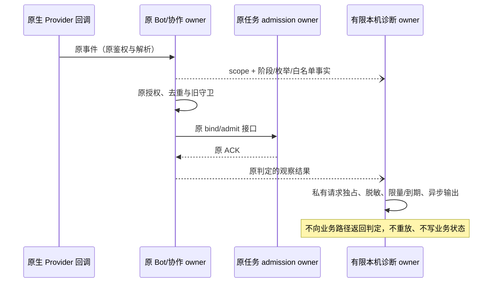
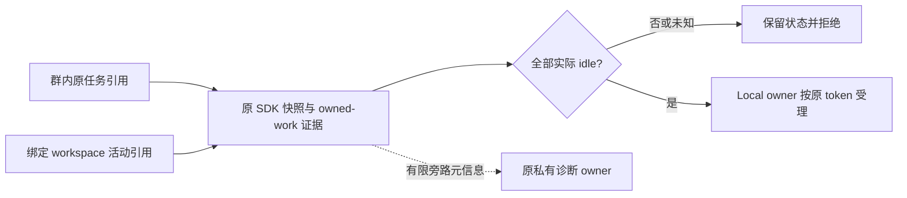
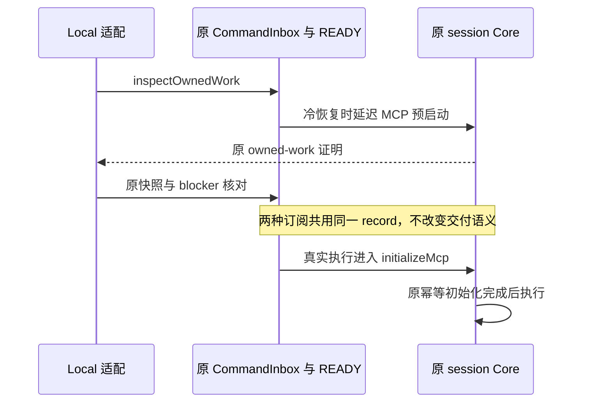

# 18: 完成整体回归与真实群只读验收

Status: in-progress

Issue-Tracker: local-markdown

## Parent

[ZCode Local spec](../../local-edition/spec.md)

**What to build:** 汇总所有子项证据，在项目群空闲时验证真实闭环与关键异常，形成待用户确认的最终交付。

**Blocked by:** [13 落实 PM 审核、依赖推进与用户验收闭环](13-pm-review-acceptance.md)；[17 分开提供程序回退与数据快照恢复](17-rollback-restore.md)

## Background

单项合成测试和安装成功不能证明完整 PM 协作与长期维护可交付。

## Modules

集成与界面回归、隔离维护演练、真实群只读场景、交付证据。不预先固定源码文件名；以实施基线的受控模块上下文为准。

## Acceptance criteria

- [x] 覆盖父 spec T01–T36，明确合成、真实、受限和未执行证据，所需检查真实执行且失败有归属。
- [ ] 指定群空闲时走通用户→PM→执行者→PM→用户，以及静默、错角色/卡片、长链、停止和恢复关键场景，不改业务代码、不部署、不打断工作。
- [ ] 核对最少诊断和公开内容边界，用户明确验收后才视为整体通过；不擅自关闭或改写父 spec。

## Spec coverage

用户故事：12、13、14、15、16、17、19、21、22、25、41、49、67、69、70、72。
验收场景：T36。

## Execution notes

一次只处理本 issue。实现遵循已确认测试边界和 TDD，保留无关改动；验证记录区分实际执行、合成场景与待真实验收。完成后记录改动、验证结果和既有逻辑影响，再置 done。

## Implementation contract（2026-10-23）

- 本票基线 `f2dfa97ff78e28abe48918d2348a3ce43ee25efe`；父 spec 冻结 blob `25efc393d4c8d5cf0fb44cbbd4ca8b04dd6c1387` 保持不变。不部署、不发布 tag；发现产品问题先记录触发、证据和影响，不在验收票中静默修复。用户已确认退出官网并授权经受控入口启动 Local；启动前先保护当前数据。插件外链阻塞已获用户明确确认，按 15/17 的补充合同修正维护脚本并补回归，其他业务实现不变。
- 复用已确认的事件到实际 Provider 请求、CLI CommandInbox/项目租约、设置界面 RPC/持久化、维护命令/临时磁盘等公开 seam。运行当前源码明确选择的相关根测试、CLI 工具和 V4/项目执行测试、设置界面、维护/备份/安装/恢复命令及类型/Lint/架构检查；不把 affected 全选后跳过当作根全量，也不把“整体回归”扩成未授权的全库单测。
- 只引用父规格 T01–T36，不复制或重写其验收矩阵。交付证据索引记录各 ID 的当前测试、历史报告、实际运行类型（合成、真实进程、真实签名、真实模型/群）、基线及未覆盖项。历史报告与原始本机产物分开核对，缺失产物如实记录，不能仅根据文档 done 声称本轮复验通过。
- 所有新测试产物、截图、隔离 HOME/data 和原始日志保存在仓库外本机私有 `~/.local/share/zcode-local/research/issue-18/`。公开文件只保存脱敏命令、数量、源码与结论，不写群名/chat ID、真实人员/机器人身份、消息正文、凭据或内部地址。复用现有诊断，检查新增源码日志及公开提交内容；静态扫描不能替代语义审阅。
- 真实群只读指任务只读项目内容，不修改业务文件、不部署，不代表不发送验收消息。须核实用户指定群、可信授权用户、PM/执行者原生身份、实际运行 Local 源码/协议/CLI 版本及原 owner/租约/任务状态；空闲无法证明时停止该项，不抢占、不强杀、不重启日常应用。真实凭据只由既有应用机制使用，不读出、复制或新增明文存储。当前正在运行的官网程序不能冒充 Local 验收版本。
- 真实流程先形成可核对的有限只读场景文本和预期结果，再沿既有应用/原渠道执行：基本闭环、静默、错角色/候选卡片、超过五次交接、同项目串行、叫停、恢复核对与 PM 待用户验收。场景使用专门验收标记，观察实际渠道收件人与任务/投递事实，不能以脚本预置模型输出证明 T19/T20/T23。任何并发在办工作、任务副作用未知或连接异常立即保留事实并停止，不自动重试消息。
- 用户未提供目标群/运行版本或真实流程尚未执行时，记录明确的受限/待验收状态，不能勾选真实群标准或将 18 标 done。最终整体通过必须由用户明确验收；父 spec 不自行关闭。独立可执行回归先完成，真实步骤仅等待缺失的信息与必要人类操作，不要求重复批准已授权的普通源码提交和 fork 分支 push。

### 已批准的最小接收诊断（2026-10-24）

用户明确允许最小诊断及空闲后的受控切换。本节仅增加一次本机观察能力，不修改父矩阵或接收规则；原“真实步骤不改业务代码”的边界对本次经批准的诊断例外适用，其他业务行为保持原合同。

- Bot 服务沿既有 Provider 回调记录 native、回调鉴权、准备、解析、去重、协作授权、旧守卫、绑定及实际 admission 的阶段/枚举结果。观察不能参与业务判定，不假设可追溯旧事件，不新增业务队列、授权来源或重放入口。
- 唯一诊断 owner 位于独立受控模块 bot-receive-diagnostic，通过公开入口供 Bot 服务使用；它只拥有有限日志写入生命周期，不扩张已有协作契约的方法数。Local 能力及 `ZCODE_LOCAL_RECEIVE_DIAGNOSTIC_FILE` 同时启用才读取一次请求文件；官网/未配置时不创建文件。没有设置 UI、远端 RPC 或云端上传。
- 请求为私有独占目录中的 schema 1 严格 JSON，包含单个 botId/chatId、32 字节随机 salt、未来最多 30 分钟的绝对 expiresAt 和 1–200 的 maxRecords。请求及目录必须为当前用户所有、权限分别 0600/0700、无链接；拒绝非普通文件、过大文件及已领取请求。一次领取与同目录 `events.jsonl` 使用独占创建，后续不覆盖、不跟随链接、不自动清理其他文件。多 Host 不共享诊断写入所有权。
- 输出只含时间、序号、以本次 salt 对 messageId/发送者做的 HMAC 摘要（分离命名空间）、固定阶段/结果及白名单布尔/有限计数/类型枚举。正文、原始身份/消息 ID、名称、项目路径、异常原文、header、token、凭据和任意扩展字段均不得进入输出。scope 必须精确匹配请求中的机器人及群；未知 scope 不记录。
- 指定机器人的既有 WebSocket owner 成功连接后，可记录一条不含消息/群数据的 connection/ready，使实际观察器领取及就绪可核对；此生命周期记录仅按请求 bot 匹配，普通消息记录仍须 bot/chat 双重精确匹配，且同样占用数量和有效期额度。
- 诊断 IO 异步串行且最多缓存 200 条元信息，限制与有效期同时生效；失败关闭诊断自身并吞掉 IO 错误，不影响接收/回调结果。dispose 停止新记录并等待已领取写入收口，不延长业务受理锁。该写入缓冲不是执行队列，不写入 Bot v3 或 Local ledger。
- 测试沿已确认 Provider 回调→真实 Bot/协作/Repo→可控任务受理及临时磁盘输出边界，先证明日志缺失红灯，再验证成功/拒绝阶段、脱敏与 scope 隔离、默认关闭/官网禁用、时限/数量/重建独占、坏文件/链接及 IO 失败不影响业务；不拿合成回调冒充真实入站。
- 经原维护入口生成新候选并验签、独立核对源码后再保护当前数据；仅在重新确认实际空闲、owner/gate 明确且原受控退出成功后切换。busy/unknown 不强制退出，不安装/改写官网包，不重置计数或自动重发旧派单。新诊断就绪后另核对需求状态和有限只读探测，不伪造真人。

## Progress（2026-10-23）

隔离回归与当前 ready 候选准备完成，等待真实运行门禁与用户最终验收。详情见[整体验收记录](../../local-edition/final-acceptance.md)和[证据索引](../../local-edition/acceptance-evidence-index.json)。根 647 通过/1 跳过，CLI 工具 33、V4/项目执行 169、设置界面 5 通过；根类型、CLI 32/32 缓存类型任务、根 Lint 0 errors/97 warnings、CLI 0 errors/70 warnings/13 原样上游行数诊断通过。

维护首批 78/79：owner 冲突场景提前返回 exit-unconfirmed，未到预期 startup-unconfirmed；原始失败保留、根因未确认，独立复跑 1/1 通过。两次真实候选入口的维护/备份 45 项均通过，不把重复结果相加。首个候选因 DMG 工具下载超时无 ready；复用既有完整工具缓存后，原入口从 cd6bc0f2 生成候选并完整验签/核对归档；另独立复核通过。未发布 tag、未启动/安装当前候选。仓库级格式检查报告 2143 个文件，退出 1，未记全绿。

用户已指定唯一群、PM 和产品执行者，并确认 Local 尚未启动；目标名称/真实标识仅保存于本机私有证据。当前官网应用 3.16.2 / 2469e253 无 Local 协作能力，保持运行未被退出。真实群测试消息 0；身份/授权/实际空闲、真实模型、当前凭据/连接和最终用户验收均未执行。父 spec 保持冻结和原状态；18 仅 ready-for-human，不记 done。

固定范围 f2dfa97f…6b424008 的独立 Standards / Spec 复审均无可操作发现。干净提交 pre-push 的 schema 8/架构工具 36、Lint、架构通过，文档改动 affected 选择 0/2063；本票变更格式和证据索引/链接/公开目标名称核对通过。后续继续真实验收前须由用户结束相关任务并正常退出官网应用，再从原受控入口核对数据根和实际群状态。

### 启动前实际阻塞

用户随后确认已结束任务并正常退出官网应用，进程观察确认无相关应用/Host。既有维护入口的启动前备份在真实数据源树核验时返回 backup-external-link：3 个 CLI 插件缓存/marketplace 中的现有符号链接不符合 15 的范围内链接约束。未生成载荷/ready 备份，未改动链接，未启动 Local，消息仍为 0；owner/gate 均无遗留。用户已明确选择“按此边界补正并继续验收”，现按 15/17 补充合同实施并先验证，之后重试备份与受控启动。

### 已批准补正与复验

插件链接对象补正源码 `8c752d581e8880db2533df11b5dc5018a5a2d837`，仅修改维护脚本，应用候选仍为 cd6bc0f2。新增 6 项场景先红后绿，完整维护/备份/安装/恢复 85/85 通过；根类型、Lint 0 errors/97 存量 warnings、架构、变更格式及 pre-push 通过，affected 0/2063。固定 32fc9e01…8c752d58 的 Standards/Spec 两轴均 0 项。原批次失败和全仓格式失败不被覆盖。真实启动前备份已生成 ready 清单，记录 3 个插件依赖；实际原链接保持不变，独立 backup-verify 也已通过，尚未启动 Local。

### 真实 Local 已启动

完整启动前备份及独立核验通过后，已从原受控入口启动 cd6bc0f2 候选。owner/runtime/存活 PID/token/版本 ready 对应，回环调试端口；未替换官网包或覆盖数据快照。真实 UI 显示指定执行者已连通；11 个相关任务引用的权威核对均 idle，首轮有 5 个 busy，随后权威核对 11/11 idle；未清租约、未停止或重发任务，未推断具体 busy 项如何结束。协作仍 revision 0/未启用，已为指定 PM/执行者生成原生核验命令，等待同一绑定真人在群内确认后再保存配置和发起只读需求。群闭环和最终用户验收仍未完成。

### 原生核验与协作配置已保存

前两组过期命令保留为失败尝试；最新 Provider 入站证明指定 PM/执行者均 verified/connected，授权真人唯一。群空闲时通过实际设置 UI 保存 revision 1，并从原服务独立重读核对：只启用指定两名机器人、原有项目和本轮只读职责。已准备限定文档读取、文件/行号依据、PM 审核后待用户验收的初始需求，请求受理前 Local 需求/输入仍为 0，项目 Git status/diff 指纹已私有记录。等待真人发出初始需求；不把原生核验或配置成功计为业务闭环通过。

### 真人需求与 PM 派单已记录（2026-10-24）

真人初始需求已受理，Local 记录 1 个 active 需求、1 个输入、1 个交接关联、0 个在途入站协调记录。PM dispatch settled，原投递 sent 且有 Provider message ID；原生提及目标与指定执行者核验身份一致。执行者尚无对应入站记录，真实链路只到 PM 派单发送，未通过整体闭环。派单后项目 Git HEAD/status/diff 与请求前指纹一致，未重发或清理当前需求，Local 保持运行。

现依据既有飞书接入契约，请用户只读核对两应用当前发布版本的 include_bot 接收权限；实际授权尚未独立核实，根因未确认，不自动扩权、发布或重放消息。脱敏观察见整体验收记录及 `live-demand-chain-summary.json` 私有证据，真实验收与用户最终确认继续待完成。

### 旧循环守卫排查（2026-10-24）

用户提供旧往返上限线索后，指定群主聊天实际读数为 PM 0、执行者 4，上限 5，协作 revision 1 仍启用；派单 ID 未见执行者持久去重/输入。原存储交接的来源任务、accepted 输入、sent 收据、授权、版本及职责前提匹配。原长链和 legacy 守卫用例定向复跑 5 通过/127 未选中跳过；合成回归不代替真实接收事件。当前不足以确认旧守卫为根因。用户随后澄清只能看到群消息，未查看后台事件；此前把选择回答解释为接收事件证据的推断已撤回。截图仅证明 PM 派单已显示，实际接收/解析/受理阶段仍未知，不再要求用户提供不可见结构。未改源码、重置计数或重发，18 保持 in-progress。

### 截图与现存诊断边界

真实截图未见执行者回报，不构成接收事件或完整闭环证据。受控启动日志的已知接收/失败标记计数均为 0；生产 debug 禁用，不能将此解释为平台未推送。原派单缺少可离线复现的 native 事件，尚不能定位丢弃阶段；未开启原始 payload 日志、伪造事件或重放消息。截图与更正后的脱敏记录保留本机私有证据。

### 最小诊断实现与验证（2026-10-24）

用户已明确允许最小诊断及空闲后的受控切换。先补局部合同，再从原 Provider/服务入口得到缺文件红灯，实现后正常受理、解析过滤、授权拒绝及 IO 失败不影响受理通过；SDK 收件顺序和连接就绪也先红后绿。新增 bot-receive-diagnostic 的私有请求、白名单输出、scope/数量/期限/独占、链接拒绝及 FIFO 不阻塞退出契约 12 项通过。架构检查曾报告协作契约方法数超限，现已按独立观察 owner 收口，复验通过；未放宽策略。根类型检查通过，Lint 0 errors/97 存量 warnings，变更格式及父规格冻结核对通过。

29 个指定根测试文件首轮 683 通过/1 跳过；后续一轮 683 通过/1 失败/1 跳过，最终串行轮 684 通过/1 失败/1 跳过（新增连接及 FIFO 场景使数量变化，不累加）。同一失败均为未修改的 Main 维护契约在 markHostReady 后读到 starting 而非 ready；该文件单独复跑 8/8 通过。源码可见初始 starting 发布为未等待异步写，ready 另行发布；当前记录仅保留实际失败与该时序风险，不把并发负载或诊断变更推断为已确认引入原因。不把这组回归写成全绿，也不在本次诊断授权中静默修改维护语义。候选构建和实际切换尚未执行，后续仍逐次核对 owner/runtime ready，未知即停。

本机原始红绿、定向/串行回归、类型/Lint/架构日志位于私有证据根 receive-\* 文件；普通服务 debug 策略不变，一次诊断产物与常驻服务日志分开。构建前还须固定源码端点复审，之后才按已批准流程准备候选与切换。

固定 `a240e91d...19059fb36abebbcdb9daf19268ca636110cc5cad` 两轴复审：Standards 0、Spec 0。该源码普通推送前，官方 affected 实际选择 109/2064 个文件，1822 通过/2 跳过；不是全量，也不覆盖上述未选中的维护契约失败。schema 8、架构工具 36、Lint/架构及 fork 分支推送通过。

原安装入口要求目标版本严格更新，因此本次诊断候选沿 14 规则使用下一本地修订 `3.16.2-local.2`，分支与根版本同步，旧 local.1 分支保留 19059fb3 源码。不放宽版本门禁、不修改冻结父规格、不创建或发布标签。准备该修订时仍运行原 local.1 候选；后续构建与切换结果见下一节。

### 诊断候选已切换，等待新的原生观察

`b35fa82f561e17e0f4c03077d75e561b022327e2` / `3.16.2-local.2` 已由原入口构建并独立核验。维护检查 50/50 通过；构建/首推 affected 全选 2064 后按合同跳过，不算全量测试。之前的 Main 维护契约失败继续保留。

只读核对先见 5 busy，下一轮 11/11 idle；无前台、排队、待确认或快照后台任务，未停止或清理任何业务状态，具体 busy 来源仍未知。指定群 busy=false 后，原安装入口再次核对 idle/accepted、完成切换前备份及独立 verify、正常退出和原子切换。安装及独立复核确认 local.2 owner/runtime/PID/token/版本与 Host ready 一致，切换门已释放；0600 的有限诊断输出已记录指定执行者 connection/ready。

切换前备份与切换后协作 ledger 字节相同，未自动重放旧派单。当前仍不能证明执行者实际收到 PM 消息，等待真人原生发送新的只读诊断需求，真实闭环和最终用户验收未完成。详见[整体验收记录](../../local-edition/final-acceptance.md#最小接收诊断候选与受控切换2026-10-24)。

### 已批准的真实授权补正（2026-10-24）

新真人只读需求的实测事件已到达执行者，prepare/parse 和原生提及匹配成功，随后 authorization=deny，尚未到循环守卫或运行时 admission。私有 HMAC 将同一事件绑定到原 PM sent 回执，但原生 sender open_id 与配置中的 PM openId 不同。其他已观察的原任务、输入、职责、版本和发送回执前提匹配；ID 不同的 Provider 原因尚未确认，不把它推断为已证实的跨应用规则。

用户已明确允许按原投递 owner 的回执绑定方案修正并继续验收。产品规则、状态所有者、严格拒绝边界和事件图统一记录于 [05 补正合同](05-trusted-handoffs.md#18-真实验收补正原生机器人交接按已确认回执绑定2026-10-24)。先从 Provider→真实服务/Repo/协作 owner→可控任务 SDK 的默认群/话题双向交接得到红灯，再最小修正并检查错误回执、伪造来源和撤销/停止反例。固定端点复审后准备 local.3，仍仅在空闲时受控切换；旧派单不自动重放，父规格不改，18 未完成。

### 回执绑定修正已验证与复审

源码 `aca671101531717575635a6dc1a46e88e5952525`；默认群/话题不同 sender ID 的双向交接先红后绿，原始来源保留且重投不重复。错误回执、无关联机器人、自身回声、真人冒用、群/线程、未知及停止/取消/丢弃反例通过。17 文件 494 通过/1 跳过；类型、Lint 0 errors/97 存量 warnings、架构、变更格式通过；独立 Standards/Spec 各 0。普通源分支推送 affected 109/2064，1821 通过/2 跳过，非全量。首次夹具字段和提示数量误断言已按公开契约修正，原失败日志保留，详见整体验收记录。该源码复审结束时尚运行 local.2，下一修订为 local.3；后续候选与切换见下节，真实修正闭环尚待验证，18 不记完成。

### local.3 修正版已运行

候选 `71e8ae055174a2bf371a4f5de4412a1bb3301028` / local.3 由原维护入口构建，50 项维护测试及完整产物核对通过，另独立验签并核对完整应用/ZIP/只读 DMG。原安装入口核对 idle/accepted、完成切换前备份及独立 verify、正常退出并原子切换；安装后独立复核 owner/runtime/PID/token/版本和 Host ready 一致，切换门已释放，最小观察器 connection/ready。新输入前 ledger 与切换前备份字节相同，旧派单未重放。

项目与目标文档只读基线已保存，等待新的真人原生需求，尚未证明修正后的真实闭环。历史失败、全选跳过和未执行全量测试的限制保持；父规格冻结，18 未完成。

### 修正版真实结果：授权通过，回报与只读失败

新的真人需求已由 PM 受理，执行者按原 sent 派单回执 accepted 并完成 Read；原生 sender 仍不同于保存的 PM openId，确认回执绑定修正生效。窗口已过期，没有新的授权诊断行；结论来自原状态、发送回执及只读 CLI 查询。

执行者文档依据独立核对正确，但只发普通正文，没有协作 report；PM 没有后续 final，需求仍 active。两者角色章程均到达模型，通用自动回复指导与协作工具要求并存，PM 派单又禁止执行者调用该工具。另查到本轮 PM 成功 Edit 项目外台账，违反只读边界；项目 Git/文档指纹不变不能掩盖该写入。精确 Edit 预览仅留私有证据，未恢复真实数据或重发需求。

本轮真实断言为受理/执行/文档依据通过，report/final/无文件写入失败。提示适用范围与显式只读执行约束的可审阅方案见[下一步修正边界](../../local-edition/final-acceptance.md#待确认的下一步修正边界)，尚未获批或实现。按根设计缺陷规则先与用户对齐，18 保持 in-progress；不勾选真实群或整体通过。

### 已批准的协作提示与只读执行合同（2026-10-24）

用户已批准上述方案。以下为实施合同，冻结父规格及其矩阵不改；本合同不表示实现或真实验收已通过。

- 新验收通过原渠道、原生提及 PM，由同一授权真人在正文首行单独写 `[ZCODE-LOCAL-READONLY]`，下一行给非空需求。这是显式机器命令，不从“只读”等自然语言、引用、历史或机器人正文推断。Local owner 仅在原运行时证明指定群全部相关工作空闲时创建独立新需求，旧需求保持原状；busy/unknown 拒绝，不抢占、不重放。精确原消息重投沿原 input/requirement 幂等。
- 新需求的只读标记只由 Local owner 写入独立 Local ledger，所有后续 PM/执行者输入和交接继承，不接受模型覆盖或中途降级。用户明确验收/停止后的下一普通需求不继承。官网 Bot v3、配置和全局工具权限不扩字段。
- bindInput 一次返回模型章程与结构化 `{requirementId,role,readOnly}`；Bot 服务沿原 `projectExecutionScope.collaboration` 送入 V4 sendText。该 scope 的严格 schema 使旧 CLI 对未知字段拒绝，不能静默执行。Bootstrap 从它派生同一份 canonical intent 的 `localCollaboration`，排队、持久化、重试/编辑和冷恢复保留；缺少合法 Bot/Local 项目范围的结构化协作输入拒绝。桌面 continuous 与手机 replayable 读取同一 input intent。
- 模型包装按可信结构化标记区分 Local 交接与普通自动回复。Local PM dispatch/final、执行者 report 使用现有 ReplyToChannel collaboration intent；来自派单/历史的“不调用工具”不能取消 Host 路由。普通正文仍不自动变成交接；普通机器人回复指导保持原行为。模型仍判断业务语义，Host 仍验证身份、职责、原回执和阶段。
- 只读轮在 provider 工具面收窄到内置 Read/Glob/Grep/ReplyToChannel，并在实际 executor 的归一化目标、Hook/resolveInput/handler 之前再次拒绝其他工具，包括 deferred 包装、Shell、插件/MCP、子代理和工作流。允许的渠道工具仍须有协作意图并通过原 owner；不允许借普通额外发送绕过。权限模式、Hook 放行及插件自报 readOnly 不能解除约束。禁止该轮派生可写的项目记忆提取；原 session/投递持久化仍由其 owner 完成。
- Local 受限输入独立入队，不与普通输入合并为 guide；输入边界恢复同一约束，下一普通输入不被污染。缺失、不支持或无效结构拒绝，不按超时解除。无新增接受队列、身份映射或副作用重试。
- 只读轮沿原曝光机制发送四个完整工具 schema，本轮 ToolSearch 为 Off，不改 Session 设置；deferred 绕路仍在 executor 按实际目标拒绝。Local ledger 的可选只读字段不保证旧 Local reader 可读；17 的程序回退须对具体当前数据和目标源码形成兼容证据，不能因都标为 v1 就认定兼容。
- 显式只读命令绕开会自动 stopAndWait 的普通话题准备器，在原群运行时空闲及无其他协调 token 时才受理；话题在准备/等待停止也属于 busy。未启用协作时拒绝该命令，不能降级为普通开发任务。输入模型材料及工具面的只读投影纳入 cli-input-projection 受控模块，不迁移执行 owner。两处原为 5918/2196 行的投影/恢复文件按根已确认存量规则登记精确 max-lines 告警，阈值仍为 800，其他 Lint/架构规则不放宽；原失败保留。
- 测试 seam 延续已确认的 Provider→真实 Bot/Repo/Local owner→任务 admission、V4→原 CommandInbox/真实持久化→可控模型和实际工具执行、真实渠道投递请求。先证明非法 Edit 能执行/提示冲突的红灯，再逐项验证拒写、合法 dispatch/report/final、错误角色/回执/停止、排队与冷恢复、普通会话隔离。真实群仅在候选核验与空闲切换后，由真人发送新命令；不将合成输出冒充真实模型遵循。

### 协作提示与只读约束修正版准备

最终行为源码 d5471c3d 经两轴复审 0/0；Host 启动沙箱缺既有端口的夹具补正 de16c014 增量复审 0/0。原推送选定失败保留；补正后官方 affected 实跑 1373/2064 个文件、15693 项通过/4 跳过，普通 fork 推送及 API 独立核对完成。原严格安装版本门要求准备 local.4，分支与根版本已同步；构建/切换未完成，当前仍运行旧 local.3。真实需求须使用新的显式只读命令，旧需求不重放、真实台账不自动恢复，父 spec 冻结，18 未完成。

### local.4 已安装，等待新的原生只读需求（2026-10-25）

f2ef20bf / local.4 的原维护构建、50 项维护测试、完整产物及独立验签通过，最后版本增量两轴复核 0/0。旧 launcher 遗留先按 17 归档并等待用户正常退出；确认全部相关进程结束、无打开句柄/admission/项目租约后，在原 owner 锁内调用 15 公开实现备份、独立核验并逐项比对，再归档精确 owner。首轮 umask 导致链接模式差异的失败保留，未放宽校验。

原 install 冷态路径完成自己的备份/独立 verify、原子替换及启动；独立核对新 owner/runtime/PID/token/版本/Host-ready 和完整应用，gate 已释放。新输入前 ledger 字节未变，无重放；PM 有限观察器 connection/ready 不代表业务闭环。项目及已知外部台账只读基线已保存，等待真人提交带显式首行的新需求。旧 C 失败、其他真实异常及最终用户验收未完成，18 不标 done。详见[本轮现场与核验](../../local-edition/final-acceptance.md#local4-已运行新的只读真实轮待执行2026-10-25)。

### 活动索引与实际空闲核对补正（2026-10-25）

新的真实命令已跨过格式校验，但返回 readonly_busy，未创建需求或提交 CLI。原有限观察窗口已到期，不能声称观察到了本次拒绝分支。隔离的真实 Provider、协作 owner、sessions-index syncer 与任务适配器复现：仅增加一个没有提交输入的 draft，活动引用列表即非空，入口误报 busy；无 draft 的对照通过。真实 CLI 的 draft 快照及 inspectOwnedWork 均证明可保持 idle。该缺陷已确认；本机此次是否恰因 draft 拒绝仍待运行时分支证据，不用持久化终态或维护计数 0 替代逐任务证据。

- 活动引用只用于发现待核对任务。群内既有任务及当前绑定 workspace 的其他活动引用，均沿原 getBotGroupTaskBlockReason、readBotCollaborationTask / inspectOwnedWork 核对；只有可证实无运行、排队、交互且 ownedWork=idle 才通过。未知、接口缺失、查询异常、冷遗留 lease、实际后台工作继续拒绝。不能直接豁免 draft、删除引用或清理计数。
- 复用现有运行时和 Local owner，不引入 accepted 队列或第二份工作状态。全局 activeTaskRefs / listActiveTaskIds 的非终态语义保留，自动归档和其他调用方不改；本次修正空闲检查对该列表的使用方式。本地路径 fallback、远程 identity、原生身份、唯一入站 token、原命令幂等和停止边界继续保留。
- 默认关闭的原有限诊断增加静态空闲拒绝枚举及受限计数；只沿当前调用传递观察上下文，不保存正文或增加业务判断来源。原 scope/HMAC、0700/0600、30 分钟/200 条及失败不影响业务的边界保持，不因观察到期要求重发或重启。
- 先补真实 syncer/adapter→原受理入口的空白 draft 对照，及运行/排队/交互、owned-work busy/unknown、异常/缺接口、相邻 workspace 与远程身份反例。复审与下一修订构建后，仅在实际空闲时受控切换；旧拒绝消息不自动重放，18 未完成。

### local.5 已受控安装（2026-10-25）

行为源码 `461020e3` 固定端点两轴复审 0/0，版本增量 `cf7f4664` 复核 0/0。原维护入口生成 local.5 / candidate-6，50/50 维护测试通过，独立完整树/源码/签名及 DMG/ZIP 核对通过；affected 全选按合同跳过，不记全量。原运行中 local.4 经 idle→commit→accepted 正常退出，原 install 完成备份及独立 verify、替换、takeover 与 Host-ready。安装后独立核对 owner/runtime/PID/token/版本及完整应用一致，launcher/应用存活，gate 已释放。新真人输入前 ledger 字节不变，旧消息未重放。有限诊断 connection/ready 和文件指纹基线已准备；真实新需求、旧事件具体拒绝分支及最终用户验收仍未完成。详见[安装记录](../../local-edition/final-acceptance.md#local5-已运行等待新的真人只读需求)。

### 冷加载检查会启动初始化工作，方案待对齐

local.5 新真实需求仍被 busy 拒绝，未进入 ledger/CLI，选定项目及已知外部台账指纹不变。有限诊断早期记录 owned_work_busy；截图时已到期，不能拼成同一事件的完整证据。原 CLI 日志显示拒绝前恢复旧任务并启动 MCP。真实 Bootstrap/Core 的隔离最小对照连续两次各 1 通过/1 失败：没有运行、队列、交互或新模型调用，冷订阅所启动的 MCP 初始化仍使 inspectOwnedWork 返回 busy；仅释放该初始化即 idle。

待对齐：CLI 单一 owner 的纯核对不启动执行服务，真实执行初始化仍走原入口；既有工作、冷遗留租约和未知继续拒绝，不放宽 blocking work、不删除历史引用、不固定等待或人工预热。实施前按根设计缺陷规则对齐，再补 adapter→冷订阅→CLI 纵向及两种订阅模式回归。当前应用存活但 launcher 已结束，原因未知；保留 owner，后续遵守 17 人工边界。详见[诊断和待对齐方案](../../local-edition/final-acceptance.md#local5-真实拒绝及冷加载初始化反馈环2026-10-25)。18 仍 in-progress。

### 已批准的纯检查实现合同（2026-10-25）

用户确认上述边界后实施。复用原 inspectOwnedWork 命令、CommandInbox、冷恢复单飞和原 session record，不新建检查 RPC、已受理队列或第二份工作事实。该命令在冷 record 上可先经原 READY 门恢复；只有这个恢复来源将 MCP 预启动延迟到原 initializeMcp 执行入口。正常新建/恢复默认不变，检查复用已有 runtime 时不能关闭或隐藏已经启动的工作。

Core 是延迟初始化标记的唯一 owner：构造和历史上下文恢复均不启动延迟的 MCP，实际执行先解除标记并沿原幂等 initializeMcp 启动，初始化完成前不请求模型。标记不落盘、不关闭配置、不改变 residency blocking work 定义；正在初始化的原 runtime、后台工作、finalization、旧租约和未知照常拒绝。CLI 冷恢复门仍串行保护 session 身份和 READY，检查不能跨 Host 绕过原会话路由。

Local 空闲适配先通过原 readBotCollaborationTask 获取工作证明，再读取 blocker。证据读取先发 inspectOwnedWork，再沿原快照/命令事实读取输入归属，避免临时订阅抢先触发预启动；既有停止和投递 owner 不变。所有历史任务引用及绑定 workspace 的活动候选仍逐项核对。

首次检查负责安全冷恢复；快照/收据读取后再次向同一 owner 取得最终 owned-work 证明，避免读取期间才开始的后台工作被前一次 idle 遮蔽。两次命令均为原只读检查，不成为缓存、执行命令或新的工作状态。

验证 seam 已由本方案确认：真实 adapter→原命令/快照；CLI Bootstrap/Core/SQLite 冷检查→desktop-continuous 与 web-remote-replayable 订阅→真实执行初始化。使用可释放的合成 MCP 端口，断言无检查引发的连接/新增模型调用、执行时初始化恰好一次且初始化前不运行模型；另覆盖已有初始化 busy、前台/队列/交互/后台、冷 lease unknown、并发 READY 与原草稿行为。所有数据隔离，旧真实需求不重放。

### 原协作参数合同与只读错误的校正

local.6 新需求已受理、派单、执行者读取；report 多带 targetBotId 被原严格 schema 拒绝，未进入 PM 回报或待验收。工具说明却把 dispatch/report/question/final 都写成可带 configured targetBotId，与原共享合同矛盾。本次校正原合同的提示和错误，不改变允许的参数或授权规则。

report/final/accept/silent/stop 的 collaboration 对象只能有 kind；targetBotId/requiredDuty 仅用于原 dispatch/question 形状，实际收件人继续由 Host 根据原输入和配置确定。Provider schema 保持原 flat 对象兼容边界，不暴露 anyOf，也不因模型多带字段就删除字段或放行。

只读 guard 继续在工具准备、Hook、权限和 handler 前拒绝。只有原生 ReplyToChannel 提供了存在但不合法的 collaboration 参数时，将这次拒绝作为可修正的参数错误，返回固定格式说明；不调用 Host、不产生发送或降级普通回复。缺失协作意图、其他工具和 MCP 同名仍为权限拒绝。模型修正为原合法形状后，重新完整走原校验和 Host 授权，不自动重试或代填参数。

回归 seam：真实 Core executor（含 app-tool authorize）→原 ReplyToChannel handler/Host 端口；无效 report/final 额外字段在只读/YOLO 下不发送，错误可定位参数；合法修正才发送一次；普通额外发送、MCP 同名、写工具等原拒绝仍保留。真实旧需求不重放，新候选后另由真人输入验证。

### 真实验收输入格式回归补正（2026-10-25）

新的真实只读需求已完成执行者 report、PM 本轮重新读取并 final，进入 awaiting_acceptance；同一授权真人随后明确通过，PM 提交合法 accept，却返回 acceptance_requires_user。原 Feishu Provider 对真人省略 senderType，Local 的 decision 已按当前成员 owner、union/tenant 验证并允许，bindInput 原样保存可选字段；accept 仅比较显式 user，与原可信真人合同不一致。

沿原 Provider 回调→Bot/Local/Repo→受控任务 SDK seam 补回归：省略类型的真人后续输入与显式 user 均可在已 sent final 后验收；app/bot、伪造或错误用户、同轮、未送达、停止和旧版本仍拒绝。唯一 owner、原文件锁、输入关联及幂等边界不变。仅按原入站语义解释已授权记录的可选类型，不改 Provider 格式、不迁移真实记录、不解析正文自动关闭、不重放旧验收。此为原 13 合同恢复；修正候选前真实需求仍待验收，18 其他真实场景与最终确认未完成。
