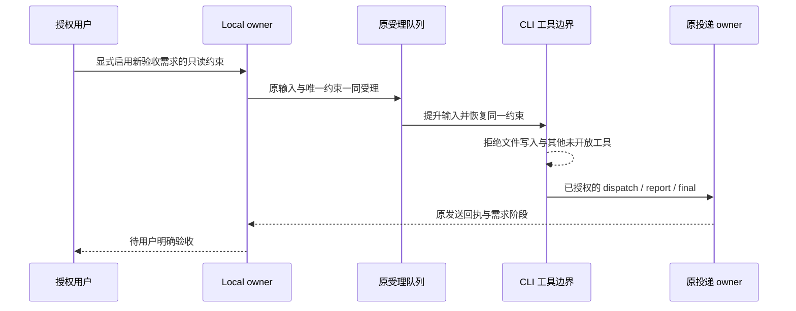

# 18 整体验收记录

Status: in-progress

对应[18 工单](../issues/zcode-local/18-end-to-end-acceptance.md)。父规格 [T01–T36](spec.md#验收场景矩阵) 为唯一验收矩阵；本报告只定位证据，不重写场景定义。当前不代表用户已验收。

当前落点：运行中的 `71e8ae055174a2bf371a4f5de4412a1bb3301028` / local.3 已证明回执绑定修正生效，但真实需求没有协作 report/PM final，且 PM Edit 项目外台账，整体验收失败。用户随后批准提示范围及显式只读约束修正；新实现已完成隔离回归，待固定源码复审与下一候选。运行应用尚未切换，18 保持 in-progress；未重发需求或恢复真实数据。

## 基线与范围

初始回归业务源码固定于 `f2dfa97ff78e28abe48918d2348a3ce43ee25efe`，最终 17 源码为 `ca707b5f600c1924c14fb9d07ebe1aecdefde4b3`。真实启动前备份暴露的插件链接边界已获用户确认，维护脚本补正源码为 `8c752d581e8880db2533df11b5dc5018a5a2d837`；后续接收观察能力及候选端点见本报告末节，不改变原业务路由。父规格冻结 blob `25efc393d4c8d5cf0fb44cbbd4ca8b04dd6c1387` 保持不变。

本机私有证据根为 `~/.local/share/zcode-local/research/issue-18/`。新测试使用隔离 HOME、合成身份和业务数据；测试入口、命令、时间、源码与退出码保存在各检查 JSON/日志中。根全量单测未执行，affected 的全选/跳过也不视为全量通过。

## 当前验证

- 根相关测试 27 文件 / 647 通过、1 专用子进程入口跳过；涵盖群协作/投递/卡片/停止/恢复、原服务兼容、Local 更新/身份、启动所有权及共享契约。
- CLI 工具 3 文件 / 33 通过；V4/项目执行、原 CommandInbox/持久化 6 文件 / 169 通过。均为受控模型与渠道边界，不能证明真实 PM 的语义判断。
- 设置界面 5 项通过：原生核验、生产 RPC 编解码、服务保存/重建读取、忙碌拒绝、其他群隔离及 1000/390 宽度、两种语言/主题。它是隔离 UI 夹具，不是日常应用的全引导流程。
- 根类型检查通过；CLI 32/32 turbo 类型任务成功（缓存结果如实保留）；根 Lint 0 errors / 97 存量 warnings，CLI 0 errors / 70 warnings / 13 条原样上游行数诊断。
- 维护/备份/安装/恢复首批 79 项中 78 通过、1 失败：owner 冲突用例期望 install-startup-unconfirmed，实际提前返回 install-exit-unconfirmed。其本机记录已有 accepted 响应，结束后 owner 已清理；原因未确认，不将并发/调度猜测当根因。原批次退出 1 保留。该用例独立复跑 1/1 通过，完整到达冲突分支并核对新目标、previous 与有效备份。
- 两次真实候选维护入口内的 45 项维护/备份检查通过；是重复验证，不与首批数量相加。实际构建中的类型/Lint/架构及依赖/闭包审计通过，affected 官方全选后按仓库合同跳过根 UT。
- 架构 0 新违规；scripts 运行语义由命令场景验证。仓库级 fmt:check 实际退出 1，报告 2143 个文件，未记全绿、未改写无关格式。

历史 01–17 工单均为 done；本机 issue-13 原始证据目录当前不存在，13 的历史报告仍可读，不能声称重新验证了缺失的原始日志。本轮重新执行协作与 CLI 机制回归；历史真实应用、官网 Reader、凭据计数等按原报告的源码和范围引用，不当作当前真实群验收。

## 证据定位与公开边界

[证据索引](acceptance-evidence-index.json) 为 T01–T36 每个 ID 提供原工单、当前检查、历史证据及限制，不包含场景定义。T19/T20/T23 的真实模型语义、T27 当前凭据/连接、T36 真实群均待验收；T25 官网 Reader 保留为历史证据；T30 未发布标签。

真实维护 check 通过 GitHub API 再次观察官方 main=`3c5b2276`、版本 3.16.2、latest release=`v3.14.3`。公开历史扫描检查 540 个本地新增/修改 blob，上游精确等价补丁为空、blockers 为空；这不替代语义审阅。Local 诊断调用与适配器的审阅确认：路由仅写 scope/动作/结果和 input/delivery/requirement/revision 元信息，经 createServiceLogger 的 debug 输出；停止/恢复警告写阶段、原因及 error 类型。未在已审阅新增路径发现正文采集或新增上传目的地，不扩大为全部既有日志审计。候选准备阶段未读取日常日志或提取凭据；启动后诊断仅计数匹配的已知告警，不收集消息正文。

## 首次真实运行候选（历史）

首次真实运行的 ready 候选清单位于本机私有 `${HOME}/.local/share/zcode-local/research/issue-18/candidate-2/candidate.json`，完整源码 `cd6bc0f23b0bc18ec8f6b7a50f6c5e3ee3370e36`，展示/分支版本 `3.16.2-local.1`。相对 f2dfa97f 仅增加 18 初始验收文档，无业务代码变化。该应用路径已由后述原安装入口切换为 local.2；旧清单保留为历史，不能再用它验证该路径的现有应用。

- 应用：`artifacts/mac-arm64/ZCode Local.app`；身份 dev.zcode.app.local，平台短版本 3.16.2 / 内部版本 3.16.2001，维护协议 1。
- 标准维护入口完成 ASAR/package/build-meta、源码、完整应用树、deep/strict 签名、完整 ZIP 成员与只读 DMG 内容核对；随后独立重新核对源码/元数据、签名、完整应用树和两个归档 hash。
- 首次 candidate-1 已生成签名应用与 ZIP，但 dmg-builder 工具下载 ETIMEDOUT，无 ready 清单。重试使用全新 candidate-2，复用 issue-14 先前已验证的完整 dmg-builder 1.2.0 工具缓存到新隔离 HOME，继续执行原构建链；没有新建打包链、关闭主机/签名校验或手写 ready 清单。
- 原 `/Applications/ZCode.app` 只读 deep/strict 签名检查通过；准备阶段未启动、安装或接管日常数据；后续受控启动结果见下文。预期发布标签仅记录，未创建或发布。

## 真实群门禁

用户已私下指定唯一群、PM 和一名产品执行者，并先确认尚未启动 ZCode Local，随后确认已结束相关任务并正常退出官网应用。名称与真实标识保存在私有证据中，公开材料不写群名、chat ID、人员/机器人身份或消息正文。

本机 `/Applications/ZCode.app` 的身份是 `dev.zcode.app`，版本 3.16.2、源码 2469e253，无 Local 维护协议；开工时该官网应用正在运行；用户确认退出后，本轮进程核对未发现其应用/Host 进程。没有在常用 Applications 目录发现 Local。不能用官网应用证明 Local 协作可用，也不能因进程存在就断言群空闲。

业务验收需求尚未发起。后续 Local 已实际受控启动并完成群空闲核对（见下文）；原生身份、授权用户、协作绑定保存和真实模型遵循仍待执行。凭据由既有机制使用，不提取或输出秘密，不强制退出官网应用。只有用户明确验收后，才可将整体视为通过；父 spec 保持原状态。

## 待执行真实流程

以下是有限验收步骤清单，详细定义仍引用父规格，不替代矩阵。执行前对照本机私有目标记录核实原生身份，并以真实 owner/任务/租约证据确认群空闲。

1. 授权用户向 PM 发出带唯一验收标记的只读需求，限定执行者读取绑定项目内一个无敏感内容的现有说明文件并回报依据；PM 核对后原生提及原需求用户，保持待用户验收。没有明确验收前不关闭。
2. 在同一范围内验证纯确认静默、正式追问/派单可达、错误角色保持未派发、歧义卡片选择一次及旧卡片失效；不人为伪造平台身份。
3. 用有限且有明确终点的只读检查分步交接超过五条，观察同项目实际串行。三轮无进展与依赖判断须记录真实模型行为，不能注入预置答案冒充成功。
4. 仅叫停本次验收任务，观察真实前台/后台及后续派单停止；不停止其他用户工作。停止或恢复事实不明时保留状态并结束该项。
5. 在不打断日常应用的条件下验证恢复核对。若必须重启、切换或人为断线，先把具体操作和影响交用户决定；不制造真实外部投递不明并盲目重发。
6. 按真实可见结果逐项记录 pass/fail/limited/not-run；对 T19/T20/T23、真实连接与凭据保留实际限制。形成最终报告后交用户明确验收。

## 交付状态

隔离证据与 ready 候选已准备，真实群与用户最终验收待执行；用户确认插件链接补正并继续后，18 回到 in-progress。用户结束任务并退出官网的步骤已完成；下述备份外链门禁现已解决，原受控启动和空闲核对通过，接下来核实指定群的原生身份/授权/绑定；不使用普通双击绕过互斥。真实步骤不改业务代码、不部署、不制造未授权中断。

父 spec 不关闭，18 不标 done。首批安装断言失败及真实群/凭据/标签/当前运行验证缺口均保留。证据根内各检查 JSON 记录命令、退出码与源码；候选自身的 source 独立记录，避免把文档端点与业务源码端点混淆。

## 候选哈希

应用树 SHA-256：`29a6ebe405d6f327171d407c704b1fab39b24e58489734b7c3ed95bac5c37de1`。

- `artifacts/ZCode Local-3.16.2-local.1-mac-arm64.dmg`：204582229 bytes，SHA-256 `691259fdf917fc35860d9fcbe3824d5a3906e2dd7aafcbc121dd802d1154e934`。
- `artifacts/ZCode Local-3.16.2-local.1-mac-arm64.zip`：195279719 bytes，SHA-256 `c0b4eea98fce3bfb3094dd63be89544db00085e15ab118569139c1b8d3e81e46`。

## 复审与归档

固定比较 `f2dfa97f...6b424008`，Standards / Spec 两个独立代理分别审查公开差异和合成证据，均无可操作发现。复审确认真实群与用户验收属于明确披露的未完成门禁，ready-for-human 不代表整体通过。

干净提交上的 pre-push：schema 8 项、架构工具 36 项、Lint 和架构检查通过；本次仅文档/证据修改，affected 官方选择 0/2063，没有执行所选外测试。变更范围格式、36-ID 索引完整性、53 条文档链接、真实目标名称不入公开材料及冻结父规格核对通过。候选构建过程中基于官方源的 affected 全选/跳过与本次文档 pre-push 的 0 项选择分别记录，不混为一次运行。

## 真实启动前新增阻塞：插件外链备份

用户确认退出后，已观察不到官网应用/Host 进程。启动前通过既有维护入口读取 bootstrap 的 dataBaseDir 定位真实 home/data，参数一致；未输出其他设置。随后尝试保护现有数据的备份，入口在源树核验阶段以 `backup-external-link` 停止，尚未生成 payload 或 ready 备份。原官网应用保留，Local 未启动，真实群消息仍为 0。结束后核对 owner 与 switch-gate 均不存在，未留下运行占用。

只读核对链接元数据，定位到 3 个现有 CLI 插件 cache/marketplace 路径下的 AGENTS.md 或 skills 符号链接；真实目标路径仅保存在本机私有记录，未移动/删除链接、未读取目标 Secret、未复制其范围外目标内容。15 现有契约拒绝范围外链接，因此不能绕过校验或把失败备份说成可恢复基线。此前“未接触日常数据”的陈述限于隔离阶段；本次尝试已由用户允许的启动前安全流程访问所选数据元信息及文件哈希，未解密或输出凭据。

用户已明确确认“按此边界补正并继续验收”：对明确限定的 CLI 插件资源目录，备份符号链接对象本身并在清单标明外部依赖；不跟随目标，不复制/覆盖目标内容，其他业务外链继续拒绝。恢复时仅恢复已确认链接对象并核对记录，不能声称外部目标也已恢复。15/17 已先更新局部合同，并补充命令级备份、独立 verify、恢复及未知业务外链拒绝回归；不排除整个插件目录，也不移改日常链接来让测试通过。

这是实际输入暴露的备份边界缺口，已按 AGENTS.md“发现设计缺陷时先与用户对齐”完成对齐。18 回到 in-progress，补正通过验证和复审后重试当前数据保护备份，再受控启动既有 ready 候选；真实群及最终用户验收仍未完成，18 不记 done。该修正仅涉及仓库维护脚本，应用业务源码与 ready 候选不变，分别记录两端源码。

## 插件链接补正验证

维护脚本端点 `8c752d581e8880db2533df11b5dc5018a5a2d837`，应用候选仍为 `cd6bc0f2`。先由新增命令级场景得到 backup-external-link 红灯，再实现显式策略，新增 6 项绿灯；完整维护/备份/安装/恢复串行进程回归 85/85 通过（含原 79 项及新增 6 项）。缺失目标仍可独立 verify，合成外部目标修改不被恢复覆盖，旧/篡改清单与例外根目录外链仍拒绝。该结果不代表真实数据恢复已执行。

根类型、Lint 0 errors/97 存量 warnings、架构 0 新违规和变更格式通过；pre-push 的 schema 8/架构工具 36、Lint/架构通过，affected 选择 0/2063。全仓格式失败与首批安装失败继续按前述保留。固定范围 `32fc9e01...8c752d58` 两个独立复审：Standards 0 项、Spec 0 项。

临时工具链重新核对：Node 24.14.0，pnpm 10.33.2。此前临时 pnpm 链接实际指向全局包 10.33.3，新的隔离 HOME 下会自准备所需版本；本轮终止了这三条尚未开始检查的准备进程，改用已有已核对的 10.33.2 缓存建立本次私有链接后执行成功。没有改全局工具链、依赖或仓库声明。

## 真实启动前备份复验通过

补正后使用显式选择的实际 home/data、既有候选及私有备份根，经原 backup 入口成功生成 ready 快照；另一次 backup-verify 独立恢复演练、SQLite integrity 和完整应用验签/源码核对通过，均退出 0。清单记录 3 个插件链接依赖，原 3 个链接对象保持不变；没有跟随或覆盖外部目标。备份保护的是待启动 Local 候选与现存共享业务数据，官网包仍原位保留，不把它描述为此前已运行 Local 的备份。未执行实际数据恢复。

原 backup-external-link 失败证据仍保留，本次成功不重写首轮结果。备份与独立核验原始日志/清单留在私有证据根，公开材料仅引用结果与边界。随后已按下文经原受控入口启动。

## 真实受控启动与群空闲核对

原 `local:launch` 脚本经显式选定的实际 home/data、官网路径与已验签 Local 路径启动候选；owner 为 running，存活 launcher/应用 PID 与 runtime 的 token、PID、3.16.2-local.1 版本及 ready 一致。调试端口仅监听 127.0.0.1。官网应用仍未运行，未替换其包；本次 Local 直接运行私有候选，使用版本独立的 Electron profile 和共用业务根。启动不是恢复旧快照，也未执行实际数据覆盖。

真实 UI 读取原有群会话和机器人，指定执行者显示飞书 WebSocket 运行及“已连通”。仅据此确认该现有应用连接状态，不当作所有模型、所有凭据或 PM 协作已验收。初次协作界面因 busy/未确认锁住；只读检查选定群 7 个上下文、6 个当前任务及 11 个相关任务引用，无远程上下文、无 pending/unknown 投递。调用现有任务服务的 block-reason 与 owned-work 读接口，首轮 6 idle/5 busy，随后 11/11 idle、无前台/队列阻塞；刷新后设置门禁解除。没有清租约、停止或重发任务，具体 busy 项未进一步归因。

核验前群协作为 revision 0、未启用（后续进展见下节）。只为用户指定的 PM 与一名执行者生成两个原生身份核验挑战，等待同一既有绑定用户在原群原生 @ 确认（10 分钟有效）；一次命令与真实身份只保存在私有材料，不写公开报告。此步必须由真人渠道完成，不能从桌面脚本伪造原生身份。尚未保存协作配置、尚未发起只读验收需求，18 继续 in-progress，最终用户验收未完成。Local 保持运行，未知状态时不擅自退出或切换。

受控启动文档增量固定复审 `8c752d58...23c5726e`：Standards 0；Spec 发现 1 项 P3（把 busy→idle 写成具体后台工作自然结束），已改为两轮权威观察事实，保留未清租约/未停止/未重发和未归因边界。该修正仅为证据表述，不改变运行代码。

## 原生身份核验与实际配置已完成

前两组一次命令过期的事实保留；没有把用户“已发送”直接当作核验成功。最新一组命令经原 Provider 入站后，两名指定机器人均显示 verified/connected，同一群只有一个已核验授权用户。真实原生身份已成立，不是从机器人名称或手工写入身份字段推断。

在确认群空闲后，通过真实协作设置 UI 仅选定指定 PM 和一名产品执行者，填写本轮只读职责、选择该原生用户及双方原有群任务所用项目；保存后 UI 显示 revision 1，另经原服务读接口重读确认 enabled、角色、职责、项目和两名已核验接入身份一致。没有新增其他执行者、扩大原项目范围或提取凭据。

真实只读需求已准备，选用绑定项目内确实存在的一份说明文档，要求执行者回报标题、已有命令及文件/行号，由 PM 审核后原生回复原需求用户并等待明确验收；项目根没有原计划默认 README，因此请求改指既有子目录说明，没有新建文件。此时 Local 需求与输入关联均为 0；在请求受理前保存了项目 Git status/diff 指纹作为后续核对起点，保留既有改动。尚未发起任务，不把配置保存当作 PM 派单、实际模型判断或交付闭环通过。接下来必须由该真人账号发送初始需求；脚本不能用机器人身份冒充用户。

本轮只新增验收记录，运行代码保持 `8c752d58` 的维护补正及 `cd6bc0f2` 的应用候选。原 85 项回归、类型/Lint/架构及已披露失败仍按各固定端点引用，不因本次真实配置操作冒称重新执行。

## 真人需求已受理，执行者入站待核对（2026-10-24）

用户确认已通过同一真人账号在指定群原生提及 PM 发出既定只读需求。随后实际 Local 记录为 1 个 active 需求、1 个输入、1 个可信交接关联、0 个在途入站协调记录；PM 的 dispatch 阶段为 settled。原投递记录为 sent 且有 Provider message ID，原生 channelMention 的 bot/open_id 目标与已核验执行者身份一致。该结果只证明真人入站及 PM 派单发送，不能证明执行者收件、执行或回报，更不代表 PM 已审核或用户已验收。

截至本次观察，尚无执行者对应输入；既有机器人运行状态为 connected，不能由此推断事件已送达。项目 Git HEAD/status/diff 在派单后的核对中与请求前指纹一致；此检查不扩大为全部文件内容审计。未重发派单、伪造入站或清理 active 需求；Local 保持运行。

仓库[飞书接入契约](../bots-feishu-group-collaboration.md#接入隔离与退出)及[官方接收消息事件文档](https://open.feishu.cn/document/uAjLw4CM/ukTMukTMukTM/reference/im-v1/message/events/receive)要求接收机器人原生提及需已生效的 `im:message.group_at_msg.include_bot:readonly`，或覆盖该场景的 `im:message.group_msg.include_bot:read`。普通真人消息权限与原生身份核验不能证明上述权限已开通。本轮未提取凭据检查权限，也未获取应用后台的已发布授权证据；正在请用户只读核对当前生效权限，缺少权限仅为待验证假设，不记为已确认根因。不擅自扩权或发布应用配置。

脱敏计数与观察边界保存于私有证据根 `live-demand-chain-summary.json`；实际投递、原生提及及项目指纹保留在对应 private 文件。后续须根据权限与实际事件证据继续排查，不能按等待时长判断旧派单可以安全重发。真实闭环、关键异常与最终用户验收仍未通过，18 保持 in-progress。

## 旧循环守卫核对（2026-10-24）

用户反馈过去 PM 与执行者互发达到旧循环上限后，需要真人原生提及才能恢复。本轮将其作为明确的排查线索；没有据此直接将当前派单记为发送失败。对指定群主聊天的原持久状态只读核对：PM consecutive=0，执行者 consecutive=4，上限为 5；revision 1 协作仍启用。当前派单消息 ID 不在执行者的 guard 去重记录或输入中，尚无第二个 Local 输入。计数尚未达到截断值，且缺少真实接收事件，不能确认本次被旧守卫拦截，也不能由未持久化反推平台从未推送。

当前源码的 `admitAutoReplyTurn` 只在非可信协作时按五条截断；协作 authorize 的 allow 继续保留消息去重，计数饱和。沿已有 Provider 回调/真实服务/持久化/可控任务边界，单独复跑原长链及 legacy 守卫用例：`pnpm exec vitest run packages/services/test/botCollaborationHandoffs.test.ts -t '可信协作长链超过|Local 宿主未启用协作的群仍保留'`，5 通过、127 未选中跳过，退出 0；隔离 HOME，Node 24.14.0 / pnpm 10.33.2，源码 `878bbe2e`。这是合成回归，不是重放真实入站，也不能证明当前真实事件获 allow。

对当前存储交接逐项核对：来源任务仍对应、原输入 accepted/done、投递 sent、授权及 sourceCommandId 匹配、当前版本和职责匹配、需求 active。没有获得执行者实际收到的 native sender/mention/thread 事件，因此不把这些已满足的存储前提扩大为实际授权成功。用户先选择了“查到接收事件”，后明确澄清只能看到群里的消息，没有查看应用后台事件或具体结构。先前把该回答解释为平台接收证据不成立。用户截图只支持 PM 派单已在群内显示，不证明执行者应用收到事件；原生接收、Provider 解析及受理位置继续未知。include_bot 权限缺失和旧守卫均不能记为已确认原因，不要求用户提供其不可见的事件结构。

私有证据为 `live-auto-reply-guard-summary.json`、`live-handoff-prerequisites-summary.json` 及 `guard-diagnosis.json/.log`。未修改业务源码、重置计数、手动伪造提及、重发派单或改变需求状态。真实闭环继续待核对。

## 接收事件证据更正（2026-10-24）

用户提供的群截图显示真人需求、PM 对执行者的原生提及派单，以及 PM 对原需求用户的派单说明；截图内未见执行者回报。它不包含飞书后台事件记录或 native payload。此前将用户选择回答记作“后台查到接收事件”的推断已撤回，不能据此排除平台未推送。截图含真实身份、正文及项目路径，只留私有材料，不入公开仓库。

继续只读核对受控启动日志中已有的接收摘要、解析、回调失败、WebSocket 失败和卡片准备失败等已知标记，均未命中；仅保存计数，不保存原始行。生产构建按现有策略禁用服务 debug，因此缺少这些摘要不能证明没有收件。旧派单也没有可用的原生事件供离线复现。未开启原始 payload 日志或新增生产诊断，没有通过业务回调伪造/重放原派单；本次无法仅据现存证据定位丢弃阶段，保持未确认。

## 最小接收诊断、候选与受控切换（2026-10-24）

用户明确允许默认关闭的有限本机观察及空闲后的受控切换。局部合同先行，诊断源码固定于 `19059fb36abebbcdb9daf19268ca636110cc5cad`，只旁路观察原 SDK/Provider/授权/守卫/受理结果，不改变路由或重放业务消息。固定 `a240e91d...19059fb3` 的独立 Standards / Spec 两轴均为 0 项。新增观察 owner 契约 12/12 通过；根类型、Lint 0 errors/97 存量 warnings、架构和变更格式通过。源码推送的 affected 选择 109/2064，1822 通过/2 跳过，不是全量。

29 个指定根文件最终串行回归为 684 通过/1 失败/1 跳过。未修改的 Main 维护契约在 markHostReady 后读到 starting；独立复跑该文件 8/8 通过。源码可见初始 starting 与 ready 发布的异步写顺序风险，但没有确认诊断变更为引入原因；未在本次范围静默修改。原失败及全仓格式失败继续保留，不将本组写成全绿。

原安装规则要求版本严格更新，下一本地修订为 `3.16.2-local.2`，候选源码 `b35fa82f561e17e0f4c03077d75e561b022327e2`，清单为私有 `candidate-3/candidate.json`。标准构建入口的类型、Lint、架构及维护检查 50/50 通过；affected 全选 2064 后按仓库合同跳过。完整应用、ASAR 元数据、deep/strict 签名、ZIP 全成员和只读 DMG 均经原入口及独立核验。应用树 SHA-256 为 `de80caa75fc5e360b65cb10b5f4f83b723154a429020ca9c2055d0ff95d7d2dc`。首次构建尝试因 GitHub API 传输失败停止，后以命令级 HTTP/1.1 重试成功；没有修改远端、全局网络配置或关闭校验。分支正常推送，没有创建或发布 tag。

切换前只读查询再次出现 11 个列表已完成、无前台阻塞的任务中 5 个 ownedWork=busy；下一轮为 11/11 idle，active turn、待确认请求及快照后台任务均为 0。首次附加旧快照读取使用 messageLimit=0 被协议拒绝，改为正数后读取成功，原失败保留。没有停止任务、清理租约或计数；不能把两轮之间的变化归因为某项具体后台工作。指定群配置另读为 busy=false、revision 1，随后原安装入口再次取得 idle 与 accepted/runningTaskCount=0。

切换前 15 备份和独立 verify 成功；原入口正常退出旧应用、原子替换并启动 local.2，安装返回 installed。另独立核对安装目标的完整应用树/源码/签名、存活 launcher 和应用、owner/runtime/PID/token/版本、Host ready，以及切换门已释放。成功后旧 previous 临时应用由原入口清理；旧应用与数据保存在有效切换前备份，旧候选归档保留。未替换官网包、执行数据恢复或伪造用户输入。当前清单指针另存私有 `live-current-local.private.json`，不改写历史 candidate-2 清单。

指定执行者观察器已独占领取一次私有请求，0600 输出目前记录 connection/ready，facts 为空；这证明观察器及既有 WebSocket 连接就绪，不证明真实模型或业务收件成功。切换前备份与切换后的协作 ledger 字节相同：1 个需求、3 个输入、2 个交接、0 个在途入站协调记录，新增记录不是本次切换重放产生。等待新的真人原生需求，在有限窗口内观察 SDK 收件至受理阶段；旧派单不自动重发。根因及完整闭环继续未确认。

私有证据定位：`receive-diagnostic-review.json`、`receive-diagnostic-contract-final.json`、`receive-diagnostic-root-serial.json`、`receive-source-push.log`、`receive-candidate-build-2.log`、`receive-candidate-verify.json`、`busy-investigation-summary.json`、`receive-install.private.json`、`receive-installed-verify.json`、`receive-postswitch-ledger-summary.json`。真实身份、消息标识、请求 salt、路径和正文不进入公开材料。

## 授权断点已确认，修正待真实验证（2026-10-24）

切换后的新真人需求到达 PM 并形成第三条已结算交接。指定执行者的有限诊断观察 transport/native received、prepare ready、parse parsed（1 条、原生提及匹配）后 authorization deny；complete ready 仅表示回调结束，不是任务受理或业务完成。私有 salt 下的事件指纹与本次原 sent providerMessageId 对应，而原生 sender ID 指纹与配置 PM openId 不同。来源 task/input、sent、authorization/sourceCommandId、accepted/done、职责、版本、目标与需求 active 等已观察前提匹配。未进入旧守卫或执行者 admission，不能把本次归因为循环上限或未推送。机器人 ID 为何不同尚未独立证明，不把真人身份的单应用规则扩大为该事件的已证实原因。

用户已批准按 [05 局部合同](../issues/zcode-local/05-trusted-handoffs.md#18-真实验收补正原生机器人交接按已确认回执绑定2026-10-24) 修正。源码 `aca671101531717575635a6dc1a46e88e5952525` 仅在既有协作 owner 中移除跨接收视角 bot ID 的直接相等要求，保留非空原始 sender 和全部原发送回执/范围/方向/版本/成员/项目/输入/停止边界；来源仍沿原投递 owner 的真实 sent 回执绑定，不新增身份映射、schema、队列或查询/发送路径。

真实协作模块的隔离私有复现：同一有效回执但 sender ID 不同先为 deny/退出 1，修改后为 allow/退出 0；错误回执仍 deny、ledger 未改。Provider→实际 Bot/Repo/协作 owner→可控任务 SDK 的默认群/话题双向交接先 2 项红灯，修正后通过，并验证原 sender 来源和重投去重。首次绿灯尝试另有夹具误断言不存在的 source.senderType，已按实际公开 schema 修正；首轮完整交接 140 通过/1 失败/1 跳过，失败是新真人拒绝反例错误要求没有原权限提示，任务始终未受理，已修正提示与受理的区分。原失败日志均保留。

最终相关回归 17 文件 / 494 通过、1 专用入口跳过；根类型通过，Lint 0 errors/97 存量 warnings，架构 0 新违规和变更格式通过。固定 `6d68c7fb...aca67110` 独立复审 Standards 0、Spec 0。普通源分支推送的官方 affected 选择 109/2064，1821 通过/2 跳过，schema 8、架构工具 36、Lint/架构通过；不是全量，不覆盖此前 Main starting/ready 的未修改失败。

为遵守原版本严格更新门禁，下一候选使用 `3.16.2-local.3` 及同名集成分支。该源码复审结束时仍运行 local.2，后续候选核验及空闲切换结果见下节；仍须以新的真人只读需求验证修正。已拒绝的旧派单不自动重放，没有清理租约/计数或恢复覆盖数据。最终用户验收继续待完成。

私有证据：`receive-authorization-findings.json`、`receive-authorize-check.private.json`、`repro-sender-boundary.log` / `repro-sender-boundary-green.log`、`receipt-fix-red.json`、`receipt-fix-green-2.json`、`receipt-fix-handoffs.json`、`receipt-fix-boundaries.json`、`receipt-fix-related.json`、`receipt-fix-typecheck-final.json`、`receipt-fix-lint.json`、`receipt-fix-architecture.json`、`receipt-fix-review.json`、`receipt-fix-source-push.log`。

## local.3 已受控切换，等待修正后的真实闭环（2026-10-24）

标准维护入口从 `71e8ae055174a2bf371a4f5de4412a1bb3301028` 生成 local.3 ready 候选，私有清单 `candidate-4/candidate.json`。构建的类型/Lint/架构、维护测试 50/50、准备/桌面/打包与完整产物核对通过；affected 官方全选 2064 后按仓库合同跳过，不是全量执行。新分支首推按明确官方基线执行原 hook 后成功，GitHub API 独立核对相同源码；没有创建或发布标签。

随后独立重新核对完整应用树/源码/ASAR 元数据、deep/strict 签名、ZIP 全成员、归档 hash 和只读 DMG 内容。应用树 SHA-256 为 `dc34c63335ac6ff3829741d9c502e3f0c0860fc8c855a0978b0c5e60642c54d3`，DMG 为 `b2869bc29faea8818c447c85af2ef4302a3f771121c231d21d5c7d1df4bb7eab`，ZIP 为 `577939ea9c3795f49aefb36da88bba2d07f222990f2fd4d68c159104f12f2f62`。复用此前完整验证的公共 DMG 工具缓存，762 个文件逐一 hash 相同，未替代原构建或验签流程。

切换前只读确认无在途入站协调记录和项目执行租约、当前 owner/runtime 对应；实际空闲仍由原安装入口再次核对。其返回 accepted/runningTaskCount=0，旧 local.2 正常退出；本次 15 备份及独立 verify 后原子替换、启动 local.3，返回 installed。另独立核对安装目标的完整应用树、元数据/签名、存活 launcher/应用、owner/runtime/PID/token/版本 ready 和切换门已释放。官网未运行且包未替换，无强杀、计数/租约重置或真实数据恢复。

切换前备份和新真人输入前的协作 ledger 字节一致：1 个需求、4 个输入、3 个交接、0 个在途协调记录。原已拒派单没有自动重放。当前私有清单指针更新为 candidate-4，旧指针另行留存，不改写历史 candidate-2/3 清单。新应用的有限观察器已独占领取私有请求，0600 输出 connection/ready；仅证明既有连接及观察器就绪。已记录新的项目 Git/目标文档只读基线，等待真人原生发送新的只读需求，再检查授权/受理、执行者回报、PM 审核及用户验收。

私有证据：`receipt-candidate-build.log`、`candidate-4/candidate.json`、`receipt-candidate-verify.json`、`receipt-builder-cache-reuse.json`、`receipt-install.private.json`、`receipt-installed-verify.json`、`receipt-postswitch-ledger-summary.json`、`receipt-readonly-before.private.json`。之前回归和 Main 维护契约的失败仍保留，不因这次实际安装成功改写历史结果。

## 修正版真实受理通过，回报与只读验收失败（2026-10-24）

新的真人原生需求由 PM 受理，PM 的实际 sent 派单在执行者侧绑定为同一回执；原始 sender 与保存的 PM openId 不同，但执行者已 accepted、promoted 并完成 Read。这证明此前修正跨过了真实授权断点，不再以旧守卫或未确认的接收权限解释本轮无回报。诊断窗口在本次入站前已过期，只有 connection/ready；本结论来自原 Bot/Local ledger、原投递回执及只读 CLI 持久化查询，不声称观察到了新的 authorization/allow 诊断记录。

执行者普通回答中的标题、开发命令及行号与实际文件独立核对一致；项目 HEAD/status/diff 指纹和目标文档 hash 前后一致。但 PM 本轮还成功调用 Edit 修改项目外台账；不能将项目指纹不变推广为全局只读通过。该次精确 Edit 输入预览保存在本机私有材料，未回滚或覆盖真实台账。执行者本轮观察到的工具只有 Read。

执行者普通自动投递为 sent，没有原生提及，也没有 ReplyToChannel 协作 report 或执行者发出的新 handoff；PM 尚未收到对应协作输入，需求仍 active，没有 final/awaiting_acceptance。普通正文不按既有合同自动转成 report，也没有因此自动重试、重放、补发或宣布验收完成。

只读核对实际 promoted 输入与模型可见用户消息后确认：两名机器人的 Local 角色章程均在，要求通过 ReplyToChannel 的协作意图完成交接。同时，CLI 通用消息包装为所有 bot 来源附加普通回复自动投递及不要调用消息工具的指导，PM 的派单正文又明确禁止执行者调用 ReplyToChannel。可以确认这几层指导并存且本轮模型选择了普通回复；尚不能仅凭共现证明某一句话必然导致模型行为，也未确认 PM 产生该禁令的历史原因。

当前 Bot 群输入公开入口没有显式只读工具策略。已有 session 工具 allowlist 和部分 turn denylist 能力不能直接等同于该入口的只读保证。初查曾误写 Plan 会阻止渠道工具；完整路径及既有回归确认 ReplyToChannel 有先于 Plan 的专用放行，该说法更正。Plan 仍允许非 destructive MCP，不能保证本次限定工具范围。上述结果不扩张为所有权限路径或模型的审计结论。

私有命令 `python3 evaluate-readonly-round.py` 对选定本轮的真实捕获作断言，退出 1：原发送回执受理、执行完成、文件依据正确三项通过；协作 report、PM final 和无文件写入三项失败。它只读取原状态及选定捕获，不重放消息、不调用模型、不改变业务状态。原项目命令核对曾因将带行尾注释的整行与裸命令作相等比较而误判，已改为独立核对命令及行号；原误判保留。较早观察脚本也曾将含相同标记的执行者输入覆盖真人输入索引，最终判定按配置中的角色分别核对，两条输入均明确存在。

私有证据：`receipt-case-c-acceptance-evaluation.json`、`receipt-cli-input-rules-final.json`、`receipt-case-c-deliveries.private.json`、`receipt-case-c-tool-metadata.private.json`、`receipt-case-c-edit-preview.private.json`、`receipt-readonly-verification-final.json`。公开材料不包含真实正文、文档标题/命令、身份、消息 ID、台账路径或变更内容。

### 待确认的下一步修正边界

用户随后已明确批准此方案；实施合同见 [18 的已批准合同](../issues/zcode-local/18-end-to-end-acceptance.md#已批准的协作提示与只读执行合同2026-10-24)。当前运行应用尚不具备该能力，实现与验证仍待完成。

- 明确可信 Local 路由指导与通用自动回复指导的适用范围：PM 派单、执行者 report 和 PM final 使用已有协作意图，普通最终正文不代替交接；业务派单不能禁止必要的 Host 协作动作。普通机器人对话仍沿原自动投递语义。保留模型判断业务内容、Host 校验身份/职责/回执/状态的分工，不从正文推断或伪造 report。
- 为下一次验收增加用户显式启用、限定到新验收需求的只读执行约束。Local owner 持有唯一约束并向 PM、执行者及后续交接传递，CLI 沿原 CommandInbox 受理和恢复边界保存并执行。工具面仅开放 Read/Glob/Grep 及经过原 owner 授权的 ReplyToChannel；文件写入、Shell、可变 MCP/插件、子代理及其他工具入口均不能绕过。不能从自然语言、超时或机器人自报推断/解除约束，未知或旧协议不支持时拒绝执行；不更改全局权限或普通开发需求。
- 先补对应局部 spec/严格协议与工具变更链，覆盖普通回复与协作回报分离、错误角色/回执/停止拒绝，以及只读约束的排队、重启恢复、默认模式/插件/子代理绕过和相邻普通输入不被污染。实际工具执行边界需证明写入被拒而合法 report/final 可发送；提示词断言不能替代这一回归。
- 验证及固定端点复审后准备下一 Local 修订，只在实际空闲时经原备份/验签/受控切换入口更新，再由真人发送一个新的有限需求。旧需求不重放，现有台账不自动恢复。最终真实模型闭环及用户明确验收仍是独立门禁。

依据根 [AGENTS.md](../../AGENTS.md)「发现设计缺陷时先与用户对齐」，上述提示指导与执行约束在实施前已完成范围确认；不得据此将尚未完成的实现、切换或真实验收记为通过，18 不记完成。

## 已批准修正的实现与隔离证据（候选待准备）

实施基线为 `d7b0f8ee0b062e05837732688bb92cf069e7399b`。先更新 18、CLI 工具变更链及模块合同，再补回归。Local owner 在原生授权真人的显式首行命令下创建独立只读需求，要求原群实际空闲且无其他协调 token；普通自然语言、引用和机器人正文不启用。约束沿原 V4 scope、canonical input intent、CommandInbox、SQLite 和实际 ActiveTurn 传递；不扩 Bot v3。稳定项目租约只取得 projectId/workspaceKey，不缓存单轮策略。

模型材料与工具面投影收口为 cli-input-projection 受控模块，原执行 owner 不迁移。Local 协作指导与普通自动投递指导分开，模型不按派单中的禁令绕过协作工具。只读轮直接曝光内置 Read/Glob/Grep/ReplyToChannel 的完整 schema；executor 在工具准备/Hook/handler 之前再次检查最终目标，拒绝 Write/Edit、Shell、MCP 同名伪装、子代理、工作流和 deferred 写入，渠道工具只接受既有协作意图。原 Host 继续校验角色、职责、回执及需求状态；本轮不派生可写项目记忆提取。下一普通需求保留原开发能力。

话题场景额外得到可复现红灯：原普通准备器会在验收命令受理前停止旧工作。现在显式验收命令绕开该准备器，busy/unknown 直接拒绝，已有准备中/等待停止也不能当 idle；原生主群与话题双向交接、final→真人明确 accept→新普通需求均已在隔离接口中验证。原已拒消息和旧需求不重放。

- 原 Provider→实际 Bot/Repo/Local owner→任务 admission 的 17 个根文件：502 通过、1 专用子进程入口跳过。含不同接收视角 ID 的原回执边界、真实原生提及、只读命令、忙碌/未知、重投、重建、交接/待验收与关闭后的隔离；不连接真实群或模型。
- CLI Core 定向 10 文件 114 通过；另以私有临时 Vitest include 配置运行受控模块公开投影契约 1/1。原包默认选择未包含 src 下该契约，因此它单独执行，不声称默认包选择已覆盖。Read 后的 Write 先证明能改合成台账，再实现拒绝，并覆盖实际 Write/Edit、Hook 未运行及下一普通轮仍能写；真实渠道工具的 report/final 可达合成端口，普通额外发送被拒。
- Bootstrap 的原 V4→CommandInbox/SQLite→实际 Turn：5 文件 62 通过，包含排队、手机 replayable 冷恢复后的编辑与重试保留约束、非法结构在 admission 前拒绝。依赖产物刷新后已重新执行相同边界并通过，不将 stale dist 当最终源码验证。
- 根类型检查通过；CLI 类型检查 32/32（24 缓存）通过。根 Lint 0 errors/97 既有 warnings；CLI Lint 0 errors/72 warnings/11 原样上游行数诊断。首次 CLI Lint 的两处超长错误保留：原文件分别 5918/2196 行，仅新增输入字段投影；按根存量合同将这两处精确登记为 max-lines 告警，800 阈值及其他检查不变。架构首次指出两个本地新增投影文件未受管，现由上述模块接管，复验 0 新违规，未改架构 baseline。

原红灯与中间失败均保留：工具夹具最初未先 Read、渠道 executor 夹具缺权限读取端口、cold runtime event store 不承载历史事件的误断言均已纠正。稳定租约误接收单轮字段、队列投影及编辑重试漏字段是在接口回归中实际暴露并修正的路径；早期 CLI 依赖产物需刷新，最终验证按实际源码和依赖刷新后的结果记录。临时阶段探针已移除，不加入应用日志。

本节是合成接口、真实持久化和实际工具机制证据，不能证明真实 PM 会遵守提示、审核依据或等待用户。当前日常数据未启用新命令；运行应用仍是旧 local.3，下一修订须复审、原标准构建/独立核验及空闲受控切换后，再由真人提交新的只读验收。原 C 失败结论及其他历史失败继续有效，18 未完成。

私有证据：`readonly-prompt-red.json`、`readonly-write-red-2.json`、`readonly-topic-idle-red.json`、`readonly-root-source-final.json`、`readonly-core-final.json`、`readonly-projection-contract.json`、`readonly-bootstrap-refreshed.json`、`readonly-typecheck-source-final.json`、`readonly-cli-typecheck-final.json`、`readonly-root-lint-source-final.json`、`readonly-cli-lint.json`、`readonly-cli-lint-2.json`、`readonly-preexisting-lines.json`、`readonly-architecture-source-final.json`。最终源码端点、复审及候选结果后续追加，不回填为已经完成。
