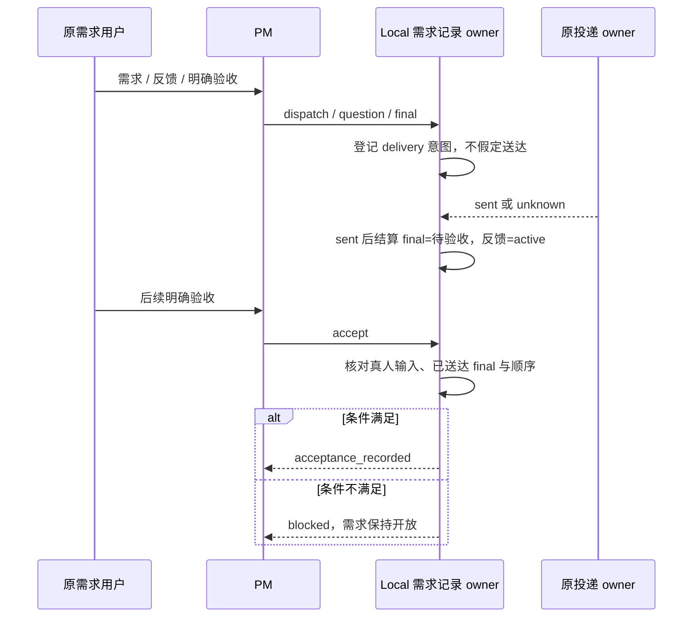

# 13 PM 审核、依赖推进与用户验收

Status: done

工单：[13](../issues/zcode-local/13-pm-review-acceptance.md)。实现提交
`4f3cbff2b574c48ccb92ab44dc51b7f816fa5d45`，分支 `3.16.2-local.1`，实施基线
`f0f8b211b91819a55f13420f1d096c8933a0fd0a`。父规格冻结 blob
`25efc393d4c8d5cf0fb44cbbd4ca8b04dd6c1387` 未修改。

## 行为与职责

Local 每次可信输入都注入同一份角色上下文。PM 获得持续推进、等待用户时只处理无依赖工作、核对实际产物与
验证证据、三轮无进展时停止单问题自主重试、最终汇报待用户验收及明确通过才关闭的章程；执行者只向 PM
回报结果、证据和阻塞，不能声明用户验收。依赖、证据和三轮判断仍由 PM 模型负责，代码不解析正文或按交接
次数推断，也不承诺真实模型一定做出正确语义判断。

既有 Local 需求记录增加 `active`、`awaiting_acceptance`、`closed` 阶段。`prepareReply` 为
dispatch/question/final 登记最小 `stageDeliveries` 意图，只有原渠道投递 owner 确认 `sent` 后才结算：
final 进入待验收，PM 在用户反馈后的 dispatch/question 回到 active。人工核对补齐丢失回执时沿同一意图
推进；旧投递迟到、旧 final 重放及执行者迟到追问都不能覆盖后续阶段。

`ReplyToChannel` 增加 PM-only `accept` 控制意图，parts 必须为一个空 text。Host 沿实际
`taskId/inputId/workspace/revision` 和可信真人来源重读需求，确认此前 final 已送达且当前输入晚于该 final，
才返回严格 `{status: acceptance_recorded}` 并关闭原需求。同轮 final、机器人输入、未送达 final、正文或
目标字段均被拒绝；关闭不产生消息或 deliveryId，本轮终答静默。已关闭后的新真人消息建立新需求，验收前
反馈继续原需求。



## 修复依据

- final 只在自动回执或人工核对为 `sent` 后推进待验收，避免把 `unknown` 当成功。
- 人工核对补齐收据后也调用同一阶段结算；原实现只修改 Bot 投递状态，需求会错误停在 active。
- 部分 dispatch/question 发送不改变当前阶段，但必须持久化 settled 事实；否则旧 final 的迟到收据可反向覆盖。
- Local owner 按登记顺序拒绝过旧阶段收据，并用投递 owner 的 bot scope 排除执行者迟到追问导致的 active 回退。
- `accept` 结果使用 `acceptance_recorded`，避免与任务 admission 的 `accepted` 混淆。

## 验证

Node 24.14.0 / pnpm 10.33.2；测试使用临时数据根、虚构身份和合成 Provider/任务 SDK，不连接真实群、真实
模型或日常凭据。

| 检查               | 实际结果                                                                                                                                                        |
| ------------------ | --------------------------------------------------------------------------------------------------------------------------------------------------------------- |
| 协作交接主回归     | `botCollaborationHandoffs.test.ts`：131 通过、1 个专用子进程入口跳过；覆盖最终汇报、明确验收、反馈、重启、丢收据、旧投递重放、执行者追问与普通兼容              |
| 停止/设置/契约回归 | 5 文件、50 项通过                                                                                                                                               |
| Bot 群普通回归     | `botsService.groups.test.ts` 112 项通过（完整全量中执行；附件路径使用临时数据根）                                                                               |
| CLI 工具           | `reply-to-channel.test.ts`、`channel-reply-permission.test.ts`：22 项通过                                                                                       |
| CLI/V4 兼容        | 6 文件、169 项通过；受控 Unix socket 在授权环境中运行，项目执行夹具使用 `/private/tmp`                                                                          |
| 类型               | 根类型检查通过；CLI 32/32 任务通过                                                                                                                              |
| Lint               | 根 0 errors / 97 条存量 warning；CLI 0 errors / 70 条 warning、13 条原样上游行数诊断                                                                            |
| 架构/格式          | 架构 0 违规；本票变更范围 formatter 通过。根全量 `fmt:check` 仍有 2154 个基线问题；CLI 全量格式检查仍被两个既有 dynamic-workflow 图夹具语法错误阻塞，均未记通过 |
| 完整根全量         | 2059 文件通过、2 失败、2 跳过；20145 项通过、15 失败、11 跳过，718.54 秒，退出码 1。15 项均因全量临时全局 `ZCODE_DATA_BASE_DIR` 与两个测试自身的 temp HOME 冲突 |
| 失败归属复跑       | 恢复 `vitest.setup.ts` 后，`credentialService` + `onboardingRecordService` 25/25 通过，确认失败来自本轮隔离方式而非工单代码                                     |

完整全量没有记为通过；其失败原因和复跑结果均保留。本票未启动 ZCode Local、未安装或更新 02 候选、未读取
真实凭据、未向真实群发送消息。

## 两轴审查

`mattpocock-skills:code-review` 要求的两个并行子任务已创建，但消息正文两次未送达，子任务均停在“等待任务”，
因此没有可用的独立子任务结论，不能记为独立双路审查通过。主代理按 Standards/Spec 两轴分别检查了完整 diff：

- Standards：无硬性规范违规；补正了结果状态命名、历史文件兼容测试、Local 读取职责拆分和阶段意图注释。
- Spec：发现并修正执行者迟到追问回退、无阶段跳转的 settled 未持久化、旧 final 迟到收据覆盖后续阶段三项问题；
  修正后验收标准均有受控机制与回归证据。

## 边界与后续

受控场景证明角色章程已注入、显式验收只能由 Local owner 核对后记录、阶段和投递事实按顺序推进；不能证明真实
PM 模型会正确拆单、判断依赖、审核证据或识别三轮无进展。真实模型遵循、真实群 T19/T20/T23 和整体验收仍归
工单 18。

本票只交付本地源码与合成公开边界证据，未推送、未创建 tag、未打包或切换日常应用。14 未开始。

## 复验入口

```sh
pnpm exec vitest run packages/services/test/botCollaborationHandoffs.test.ts
pnpm exec vitest run packages/services/test/botCollaborationStopRuntime.test.ts packages/services/test/botCollaborationSettings.test.ts packages/services/src/bot-collaboration/contract.test.ts packages/shared/src/local-collaboration/contract.test.ts packages/shared/src/channel-mentions/contract.test.ts
pnpm --dir apps/zcode-cli --filter @zcode/core exec vitest run tests/reply-to-channel.test.ts tests/channel-reply-permission.test.ts
pnpm typecheck
pnpm --dir apps/zcode-cli typecheck
pnpm lint
pnpm --dir apps/zcode-cli lint
pnpm architecture:check --changed
```

`botCollaborationHandoffs` 的专用子进程入口默认跳过；若设置 `ZCODE_TEST_ARTIFACT_DIR`，该用例只终止自身
sentinel 子进程。真实应用和真实群不在本入口。
