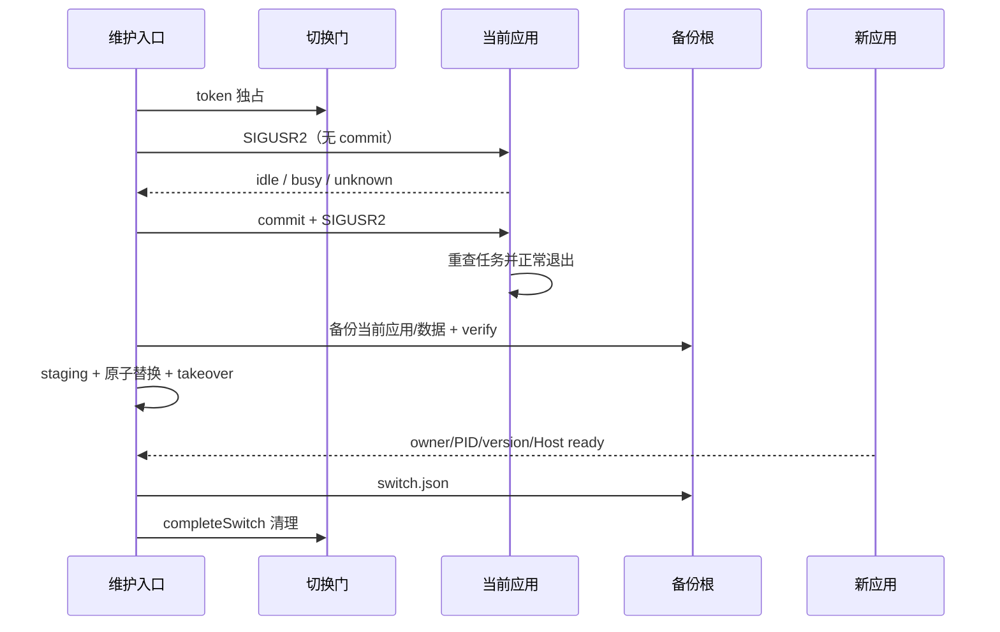

# 16 从维护入口安全切换

Status: done

设计及验收源：[16 工单](../issues/zcode-local/16-safe-installation.md)。父规格
`docs/local-edition/spec.md` 保持冻结；本票不开放真实日常安装、不连接真实模型或机器人、不提供 17 的恢复入口。

## 使用与所有权

仓库根使用 `mise.toml` 声明的 Node 24.14.0 / pnpm 10.33.2：

```sh
pnpm local:maintain install \
  --candidate /absolute/new/candidate.json \
  --current-manifest /absolute/current/candidate.json \
  --home /absolute/home \
  --data-root /absolute/data \
  --local-app '/Applications/ZCode Local.app' \
  --official-app '/Applications/ZCode.app' \
  --backup-root /absolute/private/backups
```

所有路径显式指定。维护入口继续独占候选、备份与切换结果，不建立候选数据库、第二份任务队列或独立备份链。`local-launch` 独占 launch owner、进程观察、切换门和 takeover；Main/Host 继续独占真实任务计数。

当前应用由 16 构建时，build-meta 必须声明 `localMaintenanceProtocol: 1`。正在运行的旧构建缺少该协议时要求用户先完全退出；未运行旧构建可直接升级。新候选也必须带该协议。

切换先在数据根 `.zcode/local/maintenance/switch-gate/` 建立 token 绑定的唯一并发门。存在该门时普通启动和第二个 install 都 fail closed；该目录是瞬时控制状态，不进入 15 的备份载荷。

旧应用运行时，入口发送由应用处理的 `SIGUSR2`：

1. Main 先按所有窗口 Host readiness 和真实运行任务计数返回 `idle/busy/unknown`，此阶段不退出。
2. 只有入口收到 `idle` 后才写同 requestId/token/PID 的 commit，并再次发信号。
3. Main 在 commit 下重查门禁，之后才返回 `accepted` 并走正常 `app.quit()`。

因此旧应用忙碌、Host 未就绪、无响应或迟到 idle 都不会被退出。提交后显式 busy/unknown 会释放可重试门；提交后无响应、非零退出或 owner 未按原 token 释放则保留证据并失败。

旧应用干净退出后，维护入口持有跨根 owner 锁，复用 15 的备份和独立 verify，再复制、验签和原子替换 Local。第二次 rename 失败或替换后复核失败由 `abortSwitch` 恢复旧目标；恢复本身失败时保留 switching owner、staging、previous 和切回门，返回 `install-rollback-unconfirmed`。成功启动后，`completeSwitch` 再验 running owner、存活 launcher/PID、runtime-ready 和版本，最后清理切换门并写 `switch-<UUID>/switch.json`。

“连接核对”只表示 Local 应用与本地 Host ready，不代表真实模型、机器人凭据或群协作验收。



## 验证（2026-10-23）

源码比较起点 `f30fe01a5624bd9f90e67da26f80f687db25709f`，最终源码端点
`82619df1d39c8cbc55a3074d15a84b19da51aaa5`；仅文档收尾后的交付 HEAD 为
`e2adc3a357451943f9b0901d6c5dd4f9a4c08236`。

| 验证          | 真实结果                                                                                                                                                                                  |
| ------------- | ----------------------------------------------------------------------------------------------------------------------------------------------------------------------------------------- |
| 安装进程套件  | 21/21 通过；覆盖成功、首装、旧协议未运行/运行中升级、busy/unknown/无响应/迟到 idle、commit 后任务出现、非零退出、备份失败、同版本、路径别名、并发 install、回滚失败和 launcher 未启动恢复 |
| 维护/备份套件 | 45/45 通过；新增 clean-WAL 无 `-wal/-shm` 数据库备份与 verify                                                                                                                             |
| 启动/协议边界 | 3 文件 68/68 通过；含两阶段 Main、unknown 不退出、takeover、abort 和 strict Host-ready                                                                                                    |
| 类型检查      | `pnpm typecheck` 通过                                                                                                                                                                     |
| Lint          | `pnpm lint` 通过，0 errors / 97 条既有 warnings                                                                                                                                           |
| 架构          | `pnpm architecture:check --changed` 通过，0 新违规；scripts 不在架构托管范围                                                                                                              |
| 格式          | 本票 24 个变更文件 `oxfmt --check` 通过；仓库级 `pnpm fmt:check` 返回 1 并报告 2144 个全仓文件，未记全绿                                                                                  |
| pre-push      | `pnpm verify:pre-push` 通过；schema 8/8、架构 36/36 通过，affected 全选按合同跳过 UT，显式官方基线架构 0 违规                                                                             |
| 远端          | 普通 HTTPS push 超时；GitHub API 公钥与 `ssh.github.com:443` 实际主机键一致后，严格校验 SSH 443 普通推送成功；API 与 `ls-remote` 均为交付 HEAD                                            |

前述命令均使用 Node 24.14.0 / pnpm 10.33.2。未请求、未执行完整根 UT。

## 隔离真实应用演练

证据根：`${HOME}/.local/share/zcode-local/research/issue-16/`。所有 HOME、data、应用、备份和构建目录均在仓库外；没有读取真实机器人凭据或连接真实模型。

- `candidate-1/` 是从源码 `3a210d8f` 生成的 ready 签名 arm64 候选，app tree
  `85c70c3f93bedd1cf0371d28168ea38cc61fccd7a586ecc1358ca1feeaf34746`。
- 该应用在临时 HOME/data 中实际启动，Main 写出 token/PID/version 匹配的 Host-ready；随后实际完成无 commit 的 `idle` 响应和 commit 后的 `accepted`，正常退出码 0 并由原 launcher 释放 owner。
- 为演练 local.2，仓库外临时克隆生成 `720b55ed` 源码对应的签名 app bundle，app tree
  `9eff29c40fc650932419078923bc760d698e8e757a51ab5b757bc7f19eeb0ae8`，包版本
  `3.16.2-local.2`、内部版本 `3.16.2002`、`localMaintenanceProtocol: 1`，`codesign --deep --strict` 通过。
- 该 local.2 构建在 DMG builder 下载阶段实际超时，未产出 ready DMG/ZIP 清单。因此其 `candidate.json`
  明确标记 `drillOnly: true`，只用于隔离文件切换演练，**不是可发布候选或真实日常安装证据**。
- 使用 `local:maintain install` 从实际签名的 local.1 切换到上述 local.2 app bundle：先正常退出旧应用，备份
  `backup-ab2f30be-6082-4fe5-89e6-0b90e2a6533e`，独立 verify 成功；再原子替换并启动 local.2，runtime
  `state=ready`，owner/PID/version 与新版本一致，切换结果
  `switch-ff034d6f-d877-41f4-a1c4-b82ae8e78602/switch.json`。
- 切换后合成业务文件仍在，`tasks-index.sqlite` integrity_check 为 ok，目标 app 深度签名有效；随后再次通过实际
  `idle -> commit -> accepted` 正常退出 local.2，owner 释放。

该演练证明真实签名 app bundle 的退出、备份、替换、启动和本地 Host ready 顺序，不证明真实登录凭据、模型或机器人连通，也不把 drill-only 包冒充发布候选。

## 失败与补正

- 首次真实 install 在 15 的恢复演练报 `command-failed:sqlite3`。干净关闭后的 WAL 数据库没有
  `-wal/-shm`，`sqlite3 -readonly` 无法建立共享内存。恢复副本改为 `PRAGMA query_only=ON; PRAGMA integrity_check;`，
  新增 clean-WAL 命令入口回归；真实备份重试和独立 verify 随后成功。失败 pending 组保留为 unusable，不挤掉 ready 基线。
- 首版单次 accepted 协议可能在超时清理请求后由迟到处理触发退出；改为 idle + commit 两阶段，迟到 idle 回归通过。
- 首个 local.2 构建因 Electron 下载超时失败；复用本机既有 Electron 产物后继续。后续 affected 选择在执行环境身份相关测试上失败，
  通过仓库外 drill-only 测试选择隔离修复后继续；最终 DMG builder 下载仍超时，故候选只标为 drill-only。
- 首轮安装测试曾误加入维护 build 链，会递归调用自身；已移除，install 套件保持独立 `test:local-install`。
- 路径互斥曾错误拒绝 `$HOME/.local/share` 下正常备份根；收窄为应用、候选、备份根和 home/data `.zcode` 的真实路径互斥。
- 两阶段早期在 commit 后 busy 会永久保留切换门；已区分“Main 明确未退出”与“状态不明”，前者清理并允许重试，后者保留证据。
- 并发 install、launcher 未产生新 PID、replacement 后复核失败、candidate app symlink 和回滚失败均由独立回归固定，不依赖超时或二次审批。

## Standards

固定比较 `f30fe01a...82619df1`。审查重点包括唯一 owner、单一维护/备份路径、异步文件 IO、真实路径身份、错误披露和测试 seam。

已关闭：递归 build 链、过宽 home 路径规则、共享临时日志落入仓库、commit 后永久 gate、未恢复 launcher 启动前失败、clean-WAL 误判。最终未发现新的文档规范硬违规；owner schema/状态读取在 install 与 local-launch 两侧重复是跨进程 fail-closed 复核，不合并为单一信任源。

## Spec

已覆盖用户故事 56/58/60/61/67 与 T27/T31/T34：单入口安装、自动正常退出、busy/unknown 不替换、当前应用备份、候选与备份重验、官网路径保护、原子替换、启动和 Host ready、失败恢复依据。

真实每日应用替换、真实凭据、模型和机器人连接仍未执行；隔离 drill-only local.2 包不冒充发布候选。17 的程序回退/数据快照恢复未提前实现。
