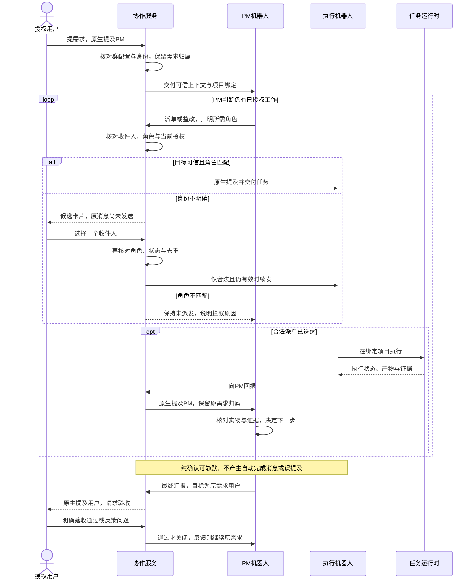

# ZCode Local：项目群 PM 协作与本地版本维护

Status: ready-for-agent

Issue-Tracker: local-markdown

日期：2026-10-21。依据：用户已整体确认首版共识，并确认本文的测试边界。本文同时作为本地 Issue，不复制第二份正文；本状态表示可开始实施，不表示功能已完成或已通过验收。

## Problem Statement

用户希望在飞书项目群中只向 PM 提需求，由 PM 派发给合适的执行机器人，执行者完成后向 PM 回报，PM 审核、整改并连续推进，直到向用户交付完整结果。现有机制不能可靠地区分有工作目的的交接与纯确认：宿主会给普通终答附加对触发者的原生提及和引用，空输出也可能变成“任务已完成”，从而让机器人再次互相唤醒。合法消息引用也不能保证收件人的角色正确；选错引用可能把任务派给错误执行者。

当前源码已有多机器人配置、群会话、原生提及、交互卡片、任务受理及投递去重等基础，但没有完整表达每群 PM 与执行者职责、唯一授权用户、稳定的原需求归属和选人后自动续发。固定的连续机器人消息限制还会截断正常协作长链。仅补充提示词，不能修正宿主自动发送、可信身份、角色绑定或重复投递的机制。

用户同时需要长期使用这个最小补丁版：保留官网版、沿用现有业务数据，能明确区分安装来源、追溯源码版本、按需合并官方升级，并在失败时保留可恢复的应用与数据。构建成功并不代表与官网下载应用能力一致，现有安装包也不能直接当作具备独立 Local 身份的新版本。

## Solution

提供单机自用的 `ZCode Local.app`，在用户明确启用的项目群中建立 PM 统一调度的协作模式。用户通过机器人设置选择本群 PM、执行机器人及职责、授权用户和项目工作区，配置按群保存，后续可复用于其他群。未启用的群、私聊和桌面会话保持既有行为。

正常流程为：用户向 PM 提需求，PM 在范围内自主派单，执行者向 PM 回报，PM 核对产物和证据后继续或整改，整体通过后原生 @ 原需求用户汇报。只有用户明确验收通过才关闭。等待用户期间，PM 可串行推进不受阻塞的工作；叫停、状态不明或同一问题三轮无进展时按已确认规则处理。

代码负责可信身份与授权、角色和收件人核对、明确的发送或静默、卡片选择及失效、重复投递防护。PM 模型按章程负责拆单、任务语义归类、依赖与审核判断，不另建完整固定工作流引擎，也不引入 Jev。错角色在发送前拦截，身份不明用卡片澄清；纯确认可以真正静默，正常交接不受原有五条固定上限误截。

应用独立安装、日常沿用既有业务数据，官网版与 Local 不能同时接管日常数据。维护通过统一终端入口完成：用户主动触发检查或升级，隔离验证通过、相关任务结束且备份成功后自动切换。版本、分支、发布标签与源码基线可追溯，通用补丁维护在用户公开 fork，私有资料留在本机。

图表示正常协作和收件人核对的因果顺序，不要求每次派单都由用户选人，也不表示被拦截的任务可以进入执行。PM 业务判断与任务运行时的实际状态分别有唯一所有者，见下文。

## User Stories

1. As a 项目用户, I want 只向本群 PM 提出需求, so that 我不必逐个协调执行机器人。
2. As a PM, I want 向明确职责的执行机器人派单, so that 具体工作由合适的执行者完成。
3. As a 执行机器人, I want 只接本群 PM 派单并向 PM 回报, so that 不会出现绕过 PM 或执行者互相派活。
4. As a 项目用户, I want 直接给执行者新任务时得到经 PM 派单的引导, so that 指挥链始终统一。
5. As a 项目用户, I want PM 在已确认目标和范围内连续推进, so that 每次交接不必等我审批。
6. As a PM, I want 关键选择或必要信息缺失时向用户澄清, so that 不会擅自扩大范围或编造答案。
7. As a 项目用户, I want 首版只有我的可信身份拥有指挥权, so that 其他群成员不能未经授权改变任务。
8. As a PM, I want 同一项目的实际执行工作串行, so that 多个机器人不会同时修改同一项目造成冲突。
9. As a 项目用户, I want 新需求默认进入队列, so that 正在执行的工作不会被无意打断。
10. As a PM, I want 等待用户时先推进没有依赖的工作, so that 一项待答复不会冻结全部进度。
11. As a 项目用户, I want 未答复和未验收的事项保留原状态, so that 沉默不会被解释为默认同意或完成。
12. As a PM, I want 核对实际产物、需求和验证证据并在必要时复测, so that 不能仅凭执行者自报完成就放行。
13. As a 项目用户, I want PM 最终原生提及原需求用户, so that 结果能提醒到我而非当前回报机器人。
14. As a 项目用户, I want 只有明确验收通过后才关闭需求, so that PM 审核通过不会替代我的最终确认。
15. As a 项目用户, I want 验收发现问题后沿原需求继续整改, so that 不必重新描述全部背景。
16. As a 项目用户, I want 同一问题三轮整改仍无进展时得到原因和选项, so that 自主重试不会无休止继续。
17. As a 项目用户, I want 正常阶段交接不计入三轮整改限制, so that 长任务不会被误当成失败循环。
18. As a 项目用户, I want 叫停后停止后续派发并请求执行者实际停止, so that 收到一句确认不等于工作仍在继续。
19. As a 项目用户, I want 得到已停止、正在停止或无法立即停止的真实状态, so that 我知道还可能发生哪些动作。
20. As a 项目用户, I want 停止后保留已有文件和改动, so that 可以另行决定继续、放弃或回退。
21. As a PM, I want 断线、重启或缺少回报时先核对执行记录, so that 不会重复派发已经执行过的任务。
22. As a 项目用户, I want 状态查不清时得到明确说明, so that 不会把未知结果误当成成功或未执行。
23. As a 项目用户, I want 纯确认、收尾和感谢可以真正静默, so that 不再引发无任务的机器人往返。
24. As a 项目用户, I want 静默时宿主也不补发完成消息或自动提及, so that 模型不发消息时不会被宿主重新唤醒。
25. As a PM, I want 正式派单、回报、追问和最终交付仍正常发送, so that 消除确认循环不会丢失实际工作信息。
26. As a 项目用户, I want 收件人按可信身份核对, so that 正文名字、改名或合法但错误的引用不会授权误派。
27. As a PM, I want 声明的所需角色与实际收件人不匹配时在发送前被拦截, so that 任务不会先落到错误执行者。
28. As a 项目用户, I want 目标身份不明确时看到候选卡片, so that 可以明确决定收件人而非让系统猜测。
29. As a 项目用户, I want 选定一个合法候选后自动续发原消息, so that 不必再次复制任务内容。
30. As a 项目用户, I want 不选择、取消或候选失效时保持未发送, so that 卡片展示不会被误报为已送达。
31. As a 项目用户, I want 重复点击或平台重投不会重复派发, so that 一个选择只产生一项有效工作。
32. As a 项目用户, I want 选错角色时仍被拦截, so that 选择收件人不会顺便改变其职责。
33. As a 项目用户, I want 机器人改名后保留原职责, so that 显示名变化不会改变指挥关系。
34. As a 项目用户, I want 在机器人设置中配置群、PM、执行者、职责和授权用户, so that 不必手改 JSON 或提示词。
35. As a 项目用户, I want 缺少可信身份时通过一次原生提及完成绑定, so that 不必手填平台 ID 或每次派单重复核验。
36. As a 项目用户, I want 每群明确绑定项目工作区, so that 其他群或桌面切换项目不会把任务路由到别处。
37. As a 项目用户, I want 在办任务结束或实际停止后才能改关键配置, so that 旧任务不会在执行中被换到新身份、职责或项目。
38. As a 项目用户, I want 配置重启后保留且旧卡片不沿用失效授权, so that 恢复运行既能继续使用又不会错误续发。
39. As a 项目用户, I want 只在明确启用的群应用新规则, so that 其他现有会话保持原体验。
40. As a 后续项目用户, I want 其他项目群能复用相同配置方式, so that 不必维护写死某个群名的特殊版本。
41. As a 项目用户, I want 正常协作超过五条机器人消息仍能继续, so that 完整需求不会被固定上限截断。
42. As a 项目用户, I want 代码校验明确身份和角色、PM 负责语义判断, so that 责任清楚且不会把模型能力当成绝对保证。
43. As a 项目用户, I want 首版不接入或评测 Jev, so that 不增加未经证明必要的模型、数据外发及维护负担。
44. As a 本地版用户, I want 独立安装固定名称的 ZCode Local.app 并保留官网版, so that 两种发布来源容易区分。
45. As a 本地版用户, I want 日常沿用现有项目、历史会话和机器人业务配置, so that 切换不必从空数据重新开始。
46. As a 本地版用户, I want 开发与候选验证使用隔离数据和合成身份, so that 测试不接管日常机器人或破坏业务数据。
47. As a 本地版用户, I want 官网版与 Local 不同时接管日常数据, so that 不会双重连接、重复执行或争写数据。
48. As a 本地版用户, I want 普通启动发现另一版占用时提示退出而非强杀, so that 正在进行的工作得到保护。
49. As a 本地版用户, I want 先核对公开源码与官网能力差异, so that 不会在切换后才发现依赖功能缺失。
50. As a 维护者, I want 实施前评估最新公开稳定基线, so that 不在旧版本重复修官方已经解决的问题。
51. As a 维护者, I want 官方已解决的本地补丁能够退役, so that 后续合并成本持续可控。
52. As a 维护者, I want 通用补丁维护在用户公开 fork, so that 源码和版本历史有独立远端备份。
53. As a 维护者, I want origin 指向用户 fork、upstream 指向官方且官方只拉取, so that 不会误推官方仓库。
54. As a 维护者, I want 本地版本与分支同名并对应固定发布标签, so that 安装包可以追溯到准确源码。
55. As a 维护者, I want 已发布后的修改进入新修订, so that 不改写已经交付的版本含义。
56. As a 本地版用户, I want 只有我主动要求才检查或升级, so that 应用不会后台换包或打断在办工作。
57. As a 本地版用户, I want Local 不从官方更新入口覆盖为官网包, so that 本地补丁不会在普通更新或启动强更中丢失。
58. As a 本地版用户, I want 一个终端维护入口管理检查、构建、安装和恢复, so that 日常仍能点图标而维护步骤容易重复执行。
59. As a 本地版用户, I want 源码冲突或验证失败时停止安装, so that 不会把未经确认的候选版本用于日常工作。
60. As a 本地版用户, I want 我发起安装后在检查、空闲和备份条件满足时自动完成切换, so that 不必逐步确认退出、替换、启动和连接检查。
61. As a 本地版用户, I want 有在办任务时只准备候选并等待, so that 升级不会擅自终止任务。
62. As a 本地版用户, I want 切换前备份当前应用及业务数据并保留最近三组可用备份, so that 故障后有清楚可用的恢复依据。
63. As a 本地版用户, I want 备份失败或空间不足时不替换应用, so that 不会在没有恢复基线时冒险切换。
64. As a 本地版用户, I want 回退程序与恢复数据分开, so that 可以兼容保留当前数据时不丢失新增内容。
65. As a 本地版用户, I want 恢复旧数据前看到快照时间和损失影响并明确确认, so that 不会因程序回退而静默覆盖新数据。
66. As a 本地版用户, I want 本地签名与系统权限采用正常方式处理, so that 不必付费建设分发流程或关闭系统保护。
67. As a 本地版用户, I want 安装后验证实际凭据与能力, so that 不能仅凭构建或启动成功就宣称可用。
68. As a 本地版用户, I want Local 扩展保持官网版读取共用数据的兼容, so that 保留官网版仍有实际意义。
69. As a 项目用户, I want 只在本机保存必要协作诊断且不记录密钥, so that 能排查问题又不新增完整群聊采集或外部上传。
70. As a 项目用户, I want 在项目群空闲时用只读任务验收完整流程, so that 测试不会改业务代码、部署或打断工作。
71. As a 维护者, I want 在已授权实现范围内完成检查后正常提交并推送到 fork 对应分支, so that 不必重复确认日常提交。
72. As a 项目用户, I want 私有数据和原始内部访谈不随补丁公开, so that 公开 fork 仅承载可公开的通用成果。

## Implementation Decisions

### 基线与补丁范围

- 实施先核对当时最新官方公开稳定源码、现有多机器人补丁和实际依赖能力。候选验证在隔离环境完成，官方已修复部分不重复维护；新版有阻塞则说明差异和选择，不强行切换。
- 首版服务单机自用和本地项目工作区，不建设完整工作流引擎、独立管理后台或在线更新服务。现有其他平台和远端链路保留兼容，不因此扩成新平台发布任务。
- 两个功能领域分别为群协作和本地应用维护。群协作复用 Bot 服务、群任务受理、渠道投递及交互机制；应用维护复用桌面产品身份、构建、启动与现有数据定位能力。

### 状态所有者和依赖方向

| 事实或状态 | 唯一所有者 | 使用约束 |
|---|---|---|
| 每群启用、角色名单、授权用户、项目绑定及配置版本 | 协作服务的持久配置 | 设置界面通过服务接口读取和修改，不直接写存储 |
| 可信来源、原需求用户、当前派单关联及待选人记录 | 协作服务，沿用群上下文和投递关联 | 与当前发言者区分，重启不能凭昵称重建授权 |
| 输入是否受理、排队、执行或停止 | 既有任务运行时 | 不用界面状态或 PM 一句确认替代；保留现有受理、作用域及过期运行防护 |
| 待发送意图、澄清、发送、失败或结果不明 | 既有渠道投递所有者 | 同一发送只有一条写入与去重路径，卡片和普通终答不得各发一遍 |
| 需求拆解、依赖、审核和待用户验收 | PM 按章程维护的需求记录 | 复用已有项目记录，不新建重复的总流程数据库；运行事实仍向运行时和证据核对 |
| 安装候选、版本及备份清单、切换结果 | 本地维护入口 | 不成为机器人任务的第二个调度者 |

界面复用现有组件、服务 hooks 与 RPC；共享协议具备类型和运行时校验。平台动作经已有平台和桌面宿主接口执行，不让 UI 直接写 Repo，不让服务依赖桌面运行时具体实现。

### 可信身份与群配置契约

- 协作配置按 Provider 与群的可信身份定位，并关联本机机器人配置、群内机器人身份、职责和授权用户。显示名只供展示或查询，不反向授予权限；正文里的“@名字”不等于原生提及。
- 明确区分平台可信发送者类型、当前消息发送者与原需求用户。原需求用户在合法交接链中保持，不能随每轮 initiator 或当前回报者覆写；模型提交的身份声明不能替代可信入站信息。
- 每群一个 PM。任务路由只允许授权用户发起或改变需求、PM 向执行者派单、执行者向 PM 回报、PM 向原需求用户最终汇报。澄清、停止及卡片操作也核对当前操作人的权限。
- 现有可信身份直接使用；缺少机器人身份时，用户以一次原生提及完成核验并保存。成员目录不能列全机器人时，不能将缺项当作唯一匹配；未核验身份不进入可发送状态。
- 列表式设置保存群、PM、执行者及职责、授权用户和项目工作区。新增或替换机器人须明确更新名单，改名不改变角色。
- 在办时更换 PM、职责、授权用户或项目绑定被拒绝并说明，结束或实际停止后才可改；不增加待生效队列。生效变更使旧选择授权失效。
- 绑定项目依据已有工作区身份规则解析，其他群或桌面切换不改本群归属。该约束是任务路由，不是文件系统沙箱。多个上下文指向同一项目时，不能以单会话串行冒充项目实际串行。

### 发送、静默与卡片续发契约

- 复用现有渠道回复入口，表达派单、回报、追问、最终汇报和静默等明确意图。派单附所需角色和任务关联，最终汇报使用原需求用户；发送前核对当前群、任务、配置授权与可信目标。
- 有效引用仅证明可引用，仍须核对实际目标与声明角色。角色不匹配必须保持未发送并给出可纠正原因，不能先发给错误执行者再让其拒单。
- 纯确认轮次的静默覆盖完整可见投递链，包括普通终答、流式内容、卡片及空输出兜底；不能先发出再靠撤回模拟静默。非静默工作消息、错误和阻塞结果不得被统一吞掉；空输出本身既不代表完成，也不默认构成成功回报。
- 身份不明或引用不匹配时，由现有交互卡片机制展示候选并保存原待发内容、任务关联和有效授权。卡片表示尚未发送，不得给出成功收据。
- 合法用户选定一个仍有效且角色匹配的候选后，续发同一条原消息；不要求重述，不顺带改任务内容或职责。选错角色、取消、失效、任务已变、配置已变或没有合法候选均保持未发送并说明。
- 卡片回调核对真实操作人、群、原任务和当前配置。重复点击、并发回调、平台重投和重启后的旧回调沿同一持久去重边界处理。
- 复用现有渠道投递记录区分未发送、已发送、失败和结果不明。外部发送可能成功但确认丢失时先核对，不盲目补发；不承诺无法证明的外部“恰好一次”，也不把结果不明记成成功。

### 自主推进、终止和恢复

- PM 按已确认目标拆解、审核与继续，不逐环审批；关键选择或必要信息不足才向用户提问。任务语义归类、依赖和无进展识别由 PM 模型负责，代码核对其显式声明与当前绑定；若语义和角色一起判断错，不能宣称代码可绝对识别。
- 同项目实际执行串行，新需求默认排队。等待用户仅阻塞有依赖的工作；PM 可推进独立工作，不能假定答复、替代用户验收或扩大范围。
- 同一问题三轮整改仍无进展时停止该问题的自主重试，原生提及用户说明原因与选项；正常阶段交接不计入。其他确定独立工作可继续。
- 正常长链不能被既有连续五条机器人上限误截。仅对启用协作的群调整受理策略，同时保留可信指挥链、去重和终止保护；不把调大数字或删除全局防护当作方案。
- 叫停必须连接实际任务停止能力，核对运行时结果并停止后续派发。停止请求已发出不等于已停止；保留产物和改动，不自动撤销外部操作。
- 重启或断线后先读取既有任务与投递记录，再决定恢复。缺回报不等于未执行，不确定时报告状态不明；不得靠定时重发掩盖恢复缺口。
- PM 审核须核对需求、产物与相关验证，必要时复测。最终汇报进入待用户验收，用户明确通过才关闭；反馈继续原需求，未答复保持原状态。
- 若现有运行时无法支持某项已确认停止、恢复或持久化要求，先给出能力差距和最小扩展方案，不能静默省略要求或擅自建设大型调度系统。

### 存储与官网兼容

- 新增 Local 协作配置、必要需求关联和待选人记录使用有版本的 Local 专属兼容存储域，由协作服务统一维护。优先复用现有持久化设施，不直接把新字段塞进官网版严格校验的共用格式。
- 既有项目、会话和机器人业务数据继续沿用；Local 记录以现有群、任务和投递关联定位，不复制完整群聊或重建平行历史。跨进程传递的新增信息通过共享协议校验，兼容既有读取路径。
- 首次切换与升级均验证共用数据和凭据。浏览器登录、缓存、窗口状态等应用数据不承诺全部共用；不能把独立应用身份等同于业务数据隔离。
- 采用本机正常签名与权限流程，不直接把签名差异判定为全部凭据失效；核对实际解密和访问结果，禁止降低凭据保护来兼容。

### Local 应用与更新入口

- 使用固定独立 Local 安装身份，应用名为 `ZCode Local.app`，与官网版和 Preview 身份区分。安装标识、运行时身份、协议及相关集成一致处理，不只改文件名；保留官网应用。
- 日常共用数据时官网版与 Local 互斥。普通启动发现占用提示完全退出，不强杀对方；本地开发和候选验证使用隔离数据及合成身份，不接管日常机器人。
- 两种启动先后顺序均须验证。未经修改的官网版不会自动遵守 Local 私有锁，不能只凭同一飞书应用的连接锁或单向检查宣称完成。无法满足时先报告实际限制，禁止带着未知争写风险切换日常数据。
- Local 同时处理普通更新、启动强更及其他可能打开官方安装包的入口，不能被官方包替换。远端服务兼容性仍如实核对，不承诺旧客户端永久可用，也不通过伪造版本绕过检查。
- 约定改动外尽量保留体验。公开源码缺失用户依赖能力时，提供差异、影响与选项，经用户接受后再切换；不把首版扩成补齐全部官网功能。

### 维护、备份与版本契约

- 统一终端维护入口提供检查上游、隔离验证和构建、安装、回退程序及恢复数据等操作，复用现有工具链与构建流程。运行环境以所选源码基线的声明为准，不依赖临时目录中的专用工具作为长期方案。
- 只有用户主动请求检查或升级才触发维护；不常驻监测、不后台合并安装。检查不等于安装，冲突或验证失败即停止并报告。
- 用户主动发起安装或升级后，相关验证通过、任务已结束且一致的应用和业务数据备份成功时，提示开始切换并自动正常退出旧版、替换 Local、启动和核对连接，不逐步重复确认。若退出或检查失败则停止继续切换并如实报告，不能强杀或宣称成功。
- 有在办任务或状态无法确认时，只准备隔离候选并等待，不强行终止。系统启动与权限确认由用户操作。
- 切换前备份当前应用和业务数据，保存版本、源码锚点、时间与可用性信息。备份必须可核对、可恢复；缺失、失败或空间不足不继续替换。
- 默认保留最近三组可用备份，位于仓库外本机私有目录，不上传公开 fork；仅清理明确的备份根目录，失败或不完整快照不挤掉有效备份，保护在用数据与唯一恢复基线。
- 回退程序与恢复业务数据分开。兼容时保留当前数据；旧版不兼容则不直接打开。恢复旧快照前先保留当前数据，展示快照时间与新增内容损失影响，用户明确确认后才覆盖。不能静默恢复，不能承诺跨版本无损合并。
- 首版采用单机自用本地签名，不先引入付费证书、公证或外部分发流程，不关闭系统安全保护。
- 源码远端采用用户公开 fork 为 origin、官方为 upstream，官方只拉取。先核对 fork 归属与地址，再配置防误推和首次公开内容核对。
- 展示版本与分支为“官方版本-local.修订号”，每版独立分支，发布标签为“v版本”。同基线修复递增本地修订，换基线从 local.1 开始；已发布内容不原地改写。平台内部数字版本按打包规则映射并保持可追溯。
- 在用户已授权实施范围内，完成约定检查后允许普通 commit/push 到 fork 对应版本分支，不逐次确认；不包含向官方推送、强推、删除或改写已发布历史和标签。发布与安装按上述独立流程执行。

### 诊断与公开边界

- 复用现有日志，仅增加必要触发来源、任务关联、目标角色、发送或拦截结果及原因，本机保存；不新增整段群聊采集，不上传诊断到 fork 或新服务。
- 原有会话历史正常保留。密钥、凭据和真实个人信息不进入新增日志、示例、测试夹具或公开提交；原始内部访谈另行私有保留或审查脱敏。

## Testing Decisions

### 已确认的测试边界

用户于 2026-10-21 确认：“是，按这个边界”。主边界是飞书事件进入、任务受理及执行结果、最终实际渠道发送的完整接口；复用现有 Bot 服务集成设施。设置和卡片补少量界面测试；应用安装、备份和恢复从维护命令入口使用隔离数据验证；最终保留真实群只读验收。

好的测试只断言外部可观察行为：哪个可信输入被接收、哪个任务开始或没有开始、实际向谁发了什么或没有发、卡片选择是否续发一次、配置重启是否生效、磁盘和应用最后处于何种可恢复状态。不绑定私有函数划分、内部调用次数、注释文本或纯样式实现。去重需要观察重复输入的最终副作用，不能只检查去重字段存在。

### 复用先例与必要补充

- 群协作优先复用已有 Bot 服务 harness：输入合成 Provider 回调，注入可控任务事件，记录真实 Provider 组装的 HTTP 请求和投递结果。主要先例为原生提及、交互卡片、群消息受理和投递恢复测试，不为每个内部辅助函数新建测试接口。
- 设置复用已有“绑定群组”桌面界面测试的 Desktop → RPC → 持久化链，核对可见配置、重启保存及其他群不受影响。卡片以 Provider 回调和可见消息为主，桌面展示仅补必要交互。
- 共用数据兼容复用已有版本化存储迁移与旧 Reader 隔离测试；实际凭据兼容单独以本机运行结果确认，不用合成密钥测试替代。
- 应用身份、更新入口复用产品身份、强更与连接锁测试先例，增加 Local 对外行为。维护入口为新接口，测试从命令/进程入口调用，在临时应用和数据根目录校验文件结果、状态与退出结果，不只测内部备份函数。
- 合成测试使用虚构身份、隔离存储与受控模型输出，不连接真实群或服务。它能证明机制，不证明真实 PM 模型已能正确拆单或审核。
- 现有部分协作场景在待人工审查目录，不能作为已通过的自动化覆盖。实施时核对实际运行入口和准入条件，不以文件存在代替测试执行。

### 验收场景矩阵

| 编号 | 场景与可观察结果 | 主要验证边界 |
|---|---|---|
| T01 | 仅启用指定群；其他群、私聊和桌面不改变既有行为 | 集成与回归 |
| T02 | 只有可信授权用户可发起、变更、验收和停止；其他人及伪造正文不授权 | 事件到任务受理 |
| T03 | 执行者只接 PM 派单，向 PM 回报；用户直派被引导，执行者不能互派 | 集成及真实群 |
| T04 | 多轮回报后最终仍原生提及原需求用户，不提及当前回报机器人 | 事件到实际发送 |
| T05 | 同一用户可保留多个不同飞书应用绑定；身份、角色与群不串用 | 配置与集成回归 |
| T06 | 改名不改职责，正文名字不冒充原生身份，缺身份需核验 | 配置、事件和界面 |
| T07 | 合法引用指向错误角色时保持未派发，无执行者任务或错误目标发送 | 事件到实际发送 |
| T08 | 明确纯确认轮普通终答不发群消息、不引用、不提及 | 集成与真实群 |
| T09 | 静默轮空输出、流式输出和卡片路径均不补完成消息，不先发后撤 | 完整可见投递链 |
| T10 | 正式派单、回报、追问、错误与最终交付仍可达，不误吞或虚报完成 | 集成及真实群 |
| T11 | 正常机器人交接超过五条仍可推进，未启用群的既有防护不被全局移除 | 多轮集成及真实群 |
| T12 | 重投、并发和重启不重复受理或发送；外部结果不明先核对 | 集成与持久恢复 |
| T13 | 歧义卡片先不发送；合法用户选一个后原内容续发一次；未选、取消和越权点击不发 | 卡片回调到实际发送 |
| T14 | 用户选择错误角色仍在发送前拦截，不以选择改变职责 | 卡片到实际发送 |
| T15 | 任务变化、配置变化、旧卡片和过期回调不续发；重启后不恢复失效授权 | 持久恢复与卡片 |
| T16 | 群工作区固定，桌面/其他群切换不改路由，同名或同路径身份按现有规则核对 | 任务受理与工作区 |
| T17 | 在办时配置变更被拒绝；结束或实际停止后可改，重启保存 | 服务和设置界面 |
| T18 | 同项目实际执行串行，新需求排队，不以多个会话各自串行冒充整体串行 | 任务运行时与真实群 |
| T19 | 等待用户时只推进无依赖工作，原待答复和待验收状态不被关闭 | PM 场景及真实群 |
| T20 | 同一问题三轮无进展后向用户说明，正常阶段交接不误计，独立工作可继续 | PM 场景及真实群 |
| T21 | 叫停连接实际停止；报告真实停止状态，保留已有文件，不再派后续工作 | 运行时与真实群 |
| T22 | 断线、重启、缺回报先核对已执行事实；状态不明不盲目重派 | 集成与恢复场景 |
| T23 | PM 核对实物和证据，最终待用户验收；沉默不关闭，反馈继续原需求 | PM 场景及真实群 |
| T24 | 设置可完成群与身份角色配置、一次核验、保存和重启，无需手改文件 | Desktop 到服务持久化 |
| T25 | Local 新数据不破坏既有官网 Reader，项目和会话历史仍可读 | 版本化存储与实际兼容 |
| T26 | 官网先开/Local 后开及相反顺序都不双重接管日常数据；不强杀对方 | 隔离应用进程及本机验证 |
| T27 | 切换前后数据、机器人配置与实际凭据可用；测试环境不接管真实机器人 | 隔离数据与切换核对 |
| T28 | 普通更新与启动强更等入口不换回官方包；远端版本限制如实披露 | 桌面集成与本机运行 |
| T29 | 候选基线和官网依赖能力差异明确，有阻塞不切换，已被官方解决的补丁不重复维护 | 候选验证与差异报告 |
| T30 | 展示版本、分支、标签、安装包与源码锚点相符，平台内部版本有效 | 构建产物与发布检查 |
| T31 | 用户主动安装且检查、空闲、备份满足时自动切换；忙碌或未知仅准备候选 | 维护命令入口 |
| T32 | 备份失败、空间不足、半成品快照停止替换；保留三组可用备份且不删唯一恢复基线 | 隔离维护命令与磁盘 |
| T33 | 兼容回退保留当前数据；不兼容先停，恢复旧快照需当前备份和明确确认 | 隔离恢复命令 |
| T34 | Local 身份、正常本地签名、权限及连接检查符合预期，不关闭保护 | 构建包与本机验证 |
| T35 | 诊断可关联必要来源与结果，无密钥、整段新采集群聊或外部上传 | 日志和公开内容检查 |
| T36 | 指定群空闲时只读走通用户→PM→执行者→PM→用户及关键异常，由用户验收 | 真实群验收 |

T19、T20、T23 等模型决策场景须区分“受控输出下机制正确”与“真实模型按章程做对”；不能用脚本预置答案作为后者的证明。真实群测试明确标记，不修改业务代码、不部署、不扩到其他群，不打断在办工作。

### 检查与证据

- 本 spec 阶段只执行文档完整性、链接、术语与覆盖核对。实现阶段先核对所选源码基线的实际测试入口，再运行影响范围内测试、类型检查、Lint 和架构检查；交互变更执行对应 E2E。
- 保存测试执行命令、退出结果、基线与候选源码锚点、场景覆盖及必要截图/日志；区分合成、真实运行、未执行和受限，不将既有失败冒充本次通过。
- 切换前必须完成基线能力、数据兼容、双向互斥、更新入口和维护恢复验证。真实凭据由既有应用凭据机制使用，报告只说明结果，不读出或复制 Secret。
- 最终由用户明确验收，未完成或失败场景有清楚归属；不能以“已启动”“已发送”或某个单测通过替代整体交付。

## Out of Scope

- 多用户分发、多设备同步、多机并行运行，以及 Windows/Linux 新安装包交付；现有跨平台实现仍须保持兼容。
- 同一项目并行执行及配套 worktree 调度、独立完整工作流引擎、复杂通用组织权限、配置待生效队列。
- Jev 或其他新增独立决策模型的接入、评测、接口预留、开关、预算及项目数据外发。
- 独立管理后台、应用内升级管理界面、自有在线更新服务器、后台自动监测或静默换包。
- 付费开发者证书、公证、对外分发、关闭系统安全保护或弱化凭据加密。
- 自动删除工作成果、自动回滚业务 Git、撤销外部已发生操作、静默覆盖当前业务数据或跨版本无损合并承诺。
- 为凑齐官网差异而重写所有缺失能力，以及声称公开源码与官网版永远功能同步。
- 扩大到未启用群、私聊或桌面会话的协作行为变更，以及把群项目绑定解释为文件系统沙箱。
- 新增整段群聊采集、外部诊断服务、公开私有业务资料、原始内部访谈、凭据或真实身份测试数据。

## Further Notes

- 术语使用[领域词汇表](../../GLOSSARY.md)；独立安装沿用 [ADR-0005](../adr/0005-local-edition-independent-installation.md)，有效裁定汇总见[首版共识总稿](consensus-summary.md)。原始逐问访谈在本机私有保留，公开推送前审查脱敏，不作为公开正文引用。
- 当前源码核对基于分支 `3.15.1-local.1`、提交 `efae59158847d23c11930310b81dcae965caf547`，只有既有多机器人绑定补丁。本 spec 的协作修复、独立 Local 身份与维护入口尚未实现；最终基线须按实施时评估结果确定。
- 本次新鲜度检查仅使用本地远端引用：相对该本地 origin/main 为 ahead 1 / behind 0，无远端跟踪分支；没有获取最新官方源码，不能据此宣称已评估最新版。
- 首版共识于 2026-10-21 整体确认；测试边界于同日单独确认。本次用户授权是落成 spec 并登记本地工单，不据此自动开始运行源码修改、创建 fork、提交推送、安装、重启或向真实群发测试消息。
- 实施顺序先做基线和能力差距核对，再按上述状态所有者完成最小兼容设计与实现，随后隔离验证、维护验证和真实群验收。技术验证失败要给出事实和最小处理方案，不提前降低已确认要求。
