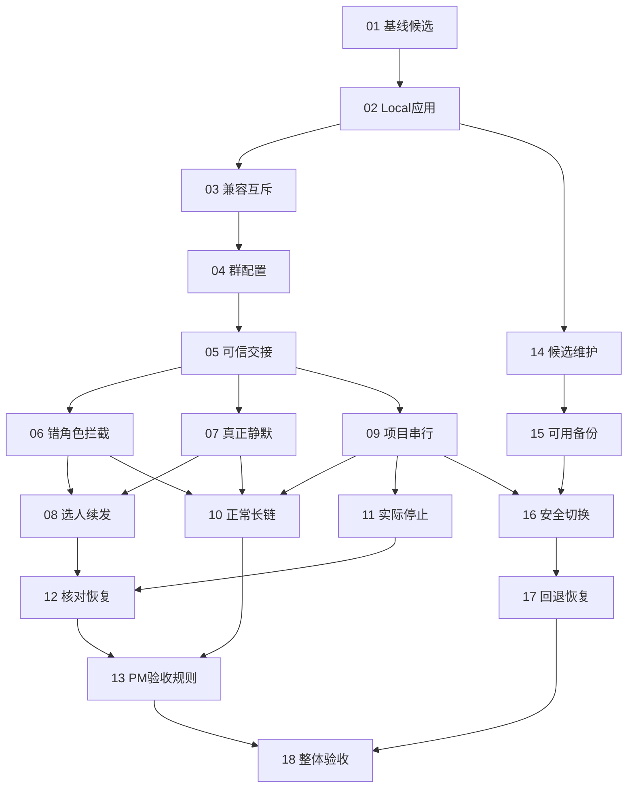

# ZCode Local issue 拆分提案

> 日期：2026-10-21。状态：用户以 implement-spec「开工」确认，已发布正式子工单并启动串行实施。
> 父规格：[项目群 PM 协作与本地版本维护](spec.md)。本提案不修改或关闭父 Issue。

## 拆分原则与执行约定

- 共 18 项：01 为可重复的候选基线与能力核对，18 为整体交付验收，其余围绕各自可演示/可验证的用户行为切分。每项包含需要的协议、服务、界面或命令及相应测试，不按技术层拆单。
- 03 先验证共用数据与双向接管保护的核心可行性，再推进群协作扩展；真实凭据通过应用既有机制核对，不读取 Secret，不接管真实机器人。不能以单向锁或源代码推断替代实测。
- 尚无证据需要先做全库机械重构，不额外安排大规模预重构；确有必要的最小整理放入对应 issue，并保持旧行为回归。若所选上游已实现某项，以回归证据兑现该票，不重复改代码。
- Blocked by 只列真实的直接阻塞；编号是建议串行执行顺序，不把前一编号自动当作阻塞。即使依赖允许，也按用户要求一次只处理一个 issue。
- 用户确认此完整拆分后，发布一票一文件，并直接从 01 开始连续推进，不再另问是否开工；每票验收与检查通过后才继续下一票。
- 按已配置的本地工单约定，正式子工单发布到 docs/issues/zcode-local/，编号从 01 开始，状态为 ready-for-agent，依赖使用本地链接。to-tickets 的 .scratch 默认位置让位于项目已配置的工单路径，不创建远端 Issue。
- 所有实现位于 ZCode；不改大尧业务源码、运行中的项目文件或业务章程。各票测试优先采用已确认的集成边界，日常应用和真实机器人只在对应兼容、切换与真实群条件满足后使用。
- 架构检查与受控上下文在改代码前执行；每票按影响范围运行测试、类型检查、Lint 与架构检查，交互补对应 E2E。基线已有失败单独记录，不改写为通过。
- 每票完成汇报：完成的用户行为、主要改动、实际验证及结果、对既有逻辑的影响、仍待后续票覆盖的边界。未完成不能标记 done；模型职责与代码硬约束分别说明。
- 最小本机诊断和私有资料保护贯穿有关票，不另建日志平台或单独的横向日志票。普通 commit/push 延用已确认授权；日常安装、系统权限、兼容差异接受及破坏性数据恢复遵守既有约定。

## 完整 issue 列表

### 01：确定官方基线与可重复的隔离候选

**背景：** 当前本地分支仍基于旧官方版本，不能将已存在的补丁和测试结果直接沿用到新基线。

**目标 / What to build：** 选定可实施的官方公开稳定基线，保留或退役现有补丁，并提供可重复的隔离构建与验证起点。

**涉及模块：** 上游源码与本地补丁历史、工具链、桌面候选构建、现有 Bot 测试设施。

**前置依赖 / Blocked by：** 无，可立即开始。

**验收标准：**

- [ ] 记录候选版本、源码锚点、用户依赖能力差异及现有补丁的保留/退役结论；有阻塞说明事实，不强行切换。
- [ ] 使用隔离数据复现候选启动和相关基线检查，记录既有失败；不安装到日常应用，不接管真实机器人。
- [ ] 明确身份、共用数据、双向互斥、停止/恢复等高风险能力的现状和验证位置；已确认不可满足的核心约束先报告并暂停受影响分支，不把已知阻塞当作后续再说。

**规格覆盖：** 用户故事 49、50、51、59；验收场景 T29。

### 02：构建可独立启动的 ZCode Local 候选应用

**背景：** 旧安装包沿用官方身份，不能明确区分安装来源，也可能走回官方更新流程。

**目标 / What to build：** 产出固定 Local 身份、可在隔离数据下启动的本机签名候选包，并阻断官方包覆盖入口。

**涉及模块：** 桌面产品身份、构建与签名、启动及更新入口、运行时数据定位。

**前置依赖 / Blocked by：** 01 确定官方基线与可重复的隔离候选

**验收标准：**

- [ ] 应用显示固定 Local 名称，安装标识、运行时和相关集成一致，官网版和 Preview 身份不被改写。
- [ ] 普通更新和启动强更等入口不会安装官方包或伪造版本绕过远端限制；不能支持的依赖如实报告。
- [ ] 以本机正常签名、隔离数据完成构建和启动检查；不降低系统保护、不切换日常数据。

**规格覆盖：** 用户故事 44、46、57、66；验收场景 T28、T30、T34。

### 03：验证共用业务数据并实现双向接管保护

**背景：** 独立 App 和单个连接锁不足以保证官网版与 Local 能安全共用业务数据；该核心可行性须在群协作扩展前验证。

**目标 / What to build：** 在隔离条件验证官网与 Local 的两种启动顺序，避免双重接管，确认历史数据、凭据及 Local 扩展存储域的兼容边界。

**涉及模块：** 桌面启动与进程占用、数据访问边界、Bot 连接所有权、Local 兼容存储。

**前置依赖 / Blocked by：** 02 构建可独立启动的 ZCode Local 候选应用

**验收标准：**

- [ ] 官网先启动和 Local 先启动均验证；普通启动提示退出占用方，不强杀，不以 Local 私有锁宣称双向完成。
- [ ] 官网 Reader、项目/会话历史和机器人配置可用，验证 Local 扩展存储域不会破坏共用格式；后续实际群配置继续回归这一契约。
- [ ] 使用隔离数据和既有凭据机制核对可用性，不读取 Secret 或接管真实机器人；不兼容先报告，不能降级保护后推进日常运行。

**规格覆盖：** 用户故事 45、47、48、66、67、68；验收场景 T25、T26、T27、T34。

### 04：从设置启用协作群并保存身份、职责与项目绑定

**背景：** 现有群开关没有完整表达 PM、执行者职责、唯一授权用户和固定工作区。

**目标 / What to build：** 用户能在 Local 设置中完成每群配置、必要的一次原生提及核验，并在重启后继续使用。

**涉及模块：** 共享配置协议、Bot 服务与 Local 持久存储、机器人设置界面、工作区身份。

**前置依赖 / Blocked by：** 03 验证共用业务数据并实现双向接管保护

**验收标准：**

- [ ] 通过界面选择群、一个 PM、执行者及职责、授权用户和工作区，保存后重启一致；其他群不受影响。
- [ ] 缺可信机器人身份时一次原生提及核验，不能用昵称或手填平台 ID 绕过；改名不改职责。
- [ ] 在办时拒绝关键配置变更，变更成功递增授权版本；Local 新配置不破坏官网旧 Reader。

**规格覆盖：** 用户故事 26、33、34、35、36、37、38、39、40、68；验收场景 T01、T06、T16、T17、T24、T25。

### 05：走通可信派单、回报与原需求用户归属

**背景：** 当前轮次发送者会覆盖 initiator，普通群成员也可能被当作任务来源。

**目标 / What to build：** 从可信用户输入走通一次用户→PM→执行者→PM→用户的短链，明确发送意图，保持原需求归属。

**涉及模块：** Provider 入站身份、共享任务来源协议、Bot 受理与投递、Agent 渠道回复契约。

**前置依赖 / Blocked by：** 04 从设置启用协作群并保存身份、职责与项目绑定

**验收标准：**

- [ ] 授权用户、PM 和执行者按配置路由；用户直派引导回 PM，执行者不能互派，其他真人不能改任务。
- [ ] 原需求用户跨轮保留，最终汇报原生提及正确用户，不跟随当前回报者或正文身份声明。
- [ ] 复用已有多应用绑定与投递路径，记录必要本机来源/结果诊断；集成测试观察实际收件人与任务受理。

**规格覆盖：** 用户故事 1、2、3、4、7、13、26、69；验收场景 T02、T03、T04、T05、T16、T35。

### 06：在派发前拦截错误角色与错误引用

**背景：** 合法引用仍可能指向不适合该任务的机器人。

**目标 / What to build：** 派单声明所需角色，实际收件人不匹配时保持未派发，并给出可纠正的原因。

**涉及模块：** Agent 渠道回复契约、角色校验、Bot 投递及结果展示。

**前置依赖 / Blocked by：** 05 走通可信派单、回报与原需求用户归属

**验收标准：**

- [ ] 合法但指向错误角色的引用被发送前拦截，不产生错误目标消息或执行任务。
- [ ] 原生身份、群授权和当前职责共同核对，用户选人也不能暗改职责。
- [ ] 语义归类仍由 PM 判断，测试与说明不把角色绑定校验写成通用语义识别。

**规格覆盖：** 用户故事 27、32、42；验收场景 T07。

### 07：让纯确认轮真正静默结束

**背景：** 普通终答、流式内容和空输出兜底都可能重新提及机器人。

**目标 / What to build：** 明确静默意图覆盖整个可见投递链，同时保留正式工作、错误及阻塞消息。

**涉及模块：** Agent 输出契约、Bot 终答与流式投递、Provider 卡片和空输出处理。

**前置依赖 / Blocked by：** 05 走通可信派单、回报与原需求用户归属

**验收标准：**

- [ ] 纯确认轮不生成群消息、自动提及、引用或卡片，不先发后撤。
- [ ] 空输出不被补成完成回报，普通终答与流式模式表现一致。
- [ ] 正式派单、回报、追问、错误和最终交付仍能发送，未启用群保持既有行为。

**规格覆盖：** 用户故事 23、24、25；验收场景 T08、T09、T10。

### 08：通过候选卡片选人并自动续发原消息

**背景：** 现有澄清结果需要模型重新调用，没有完整的持久待发消息和用户选择闭环。

**目标 / What to build：** 身份不明时给出卡片，合法用户选择后经角色和状态核对，自动续发原消息一次。

**涉及模块：** Provider 交互卡片、Bot 待发记录与投递所有者、共享交互协议。

**前置依赖 / Blocked by：** 06 在派发前拦截错误角色与错误引用；07 让纯确认轮真正静默结束

**验收标准：**

- [ ] 卡片出现时保持未发送；合法选择后原内容续发，无需重述，且不叠加普通终答或重复发送。
- [ ] 取消、未选、越权点击、错角色、任务或配置已变、无候选及旧卡片均不发送。
- [ ] 并发点击、平台重投和重启后回调沿同一持久去重路径处理；外部结果不明不假报成功。

**规格覆盖：** 用户故事 28、29、30、31、32、38；验收场景 T12、T13、T14、T15、T35。

### 09：保证同一项目实际执行串行

**背景：** 多个机器人会话各自串行，并不代表同一项目不会同时执行。

**目标 / What to build：** 依据固定项目身份复用运行时受理与排队，使新工作等待在办执行结束，不新增平行调度器。

**涉及模块：** 群工作区绑定、任务运行时受理与队列、Bot 任务关联及可见状态。

**前置依赖 / Blocked by：** 05 走通可信派单、回报与原需求用户归属

**验收标准：**

- [ ] 同项目不同机器人上下文同时收到工作时，实际执行不重叠，新需求有明确排队状态。
- [ ] 其他群或桌面切换不改本群项目；工作区身份及现有 owner/lease 防护保持。
- [ ] 停止或失效后队列状态可核对，界面和 Bot 服务不各保存一份已受理队列。

**规格覆盖：** 用户故事 8、9、36、37；验收场景 T16、T17、T18。

### 10：允许合法协作长链持续推进

**背景：** 固定五条机器人消息守卫会截断正常工作，直接移除又会失去终止保护。

**目标 / What to build：** 仅为启用协作的群改造接收策略，让合法长链持续运行，同时保持身份、去重、串行和静默保护。

**涉及模块：** Bot 群消息受理、持久去重、角色与任务作用域。

**前置依赖 / Blocked by：** 06 在派发前拦截错误角色与错误引用；07 让纯确认轮真正静默结束；09 保证同一项目实际执行串行

**验收标准：**

- [ ] 超过五条的正常派单/回报链仍可推进，不以调大固定数字作为实现。
- [ ] 无授权来源、重复事件和纯确认不会借长链策略重新开始工作。
- [ ] 未启用群的原保护不被全局移除，多轮与重启场景有证据。

**规格覆盖：** 用户故事 17、41；验收场景 T11、T12。

### 11：将用户叫停连接到实际任务停止

**背景：** 一句收到停止不能证明当前执行或后续排队工作已经结束。

**目标 / What to build：** PM 能停止后续派发，向原执行任务发出真实停止请求并核对状态，保留现有工作成果。

**涉及模块：** PM 控制意图、任务运行时停止接口、群队列与结果回报。

**前置依赖 / Blocked by：** 09 保证同一项目实际执行串行

**验收标准：**

- [ ] 只有可信授权用户可以叫停，PM 停止后续派发并作用到原任务。
- [ ] 区分已停止、正在停止、无法立即停止，不能以请求成功代替实际结果。
- [ ] 已有文件、改动及外部结果保留；队列不在叫停后继续派发被停止的工作。

**规格覆盖：** 用户故事 18、19、20；验收场景 T02、T21。

### 12：在断线和重启后核对状态再恢复

**背景：** 缺回报或确认丢失既可能未执行，也可能已执行，自动重派会重复产生副作用。

**目标 / What to build：** 重建协作状态时先核对执行、停止、卡片和投递记录，安全续接或明确报告状态不明。

**涉及模块：** Bot 持久恢复、任务运行时查询、渠道投递核对、卡片待发记录。

**前置依赖 / Blocked by：** 08 通过候选卡片选人并自动续发原消息；11 将用户叫停连接到实际任务停止

**验收标准：**

- [ ] 已经执行或发送的工作不因重启/缺回报重复派发，未执行且可安全继续的才恢复。
- [ ] 发送可能成功但收据丢失时先核对，未知状态明确说明，不靠超时重发或假定成功。
- [ ] 旧卡片和旧授权不能复活，停止状态与已有成果保持，重启不改变需求归属。

**规格覆盖：** 用户故事 21、22、31、38；验收场景 T12、T15、T22。

### 13：落实 PM 审核、依赖推进与用户验收闭环

**背景：** 机制可发送不代表 PM 会正确核验、判断等待依赖或结束无进展整改。

**目标 / What to build：** 通过通用角色上下文和既有需求记录，让 PM 按已确认规则持续推进，并区分代码保证与模型判断。

**涉及模块：** Bot 角色上下文与规则注入、PM 需求记录接口、受控行为场景。

**前置依赖 / Blocked by：** 10 允许合法协作长链持续推进；12 在断线和重启后核对状态再恢复

**验收标准：**

- [ ] 目标内连续推进；等待用户时只派发无依赖工作，不编造答复，不把待验收视为关闭。
- [ ] 核对产物和验证证据；同一问题三轮无进展向用户说明，正常阶段交接不误计。
- [ ] 最终汇报后仅明确用户通过才关闭，反馈继续原需求；不接入 Jev，不改业务仓库章程，不把脚本输出当作真实模型可靠性证明。

**规格覆盖：** 用户故事 5、6、10、11、12、14、15、16、17、42、43；验收场景 T19、T20、T23。

### 14：从维护入口生成可追溯的版本候选

**背景：** 一次手工构建不能承担长期更新、远端备份和版本追溯。

**目标 / What to build：** 建立统一维护入口的检查/构建能力，结合用户 fork、版本分支和候选清单重复产出可核验版本。

**涉及模块：** 本地维护命令、Git 远端与版本元数据、官方构建链、公开内容检查。

**前置依赖 / Blocked by：** 02 构建可独立启动的 ZCode Local 候选应用

**验收标准：**

- [ ] origin 为核实归属后的用户 fork，upstream 为官方且不误推；通用代码与私有材料分开。
- [ ] 用户主动触发检查/构建，冲突或验证失败停止；官方已解决的补丁可退役，不后台安装。
- [ ] 候选版本、分支、源码锚点、包元数据对应，发布采用固定标签且不改写已发布内容；工具链可持续复现。

**规格覆盖：** 用户故事 50、51、52、53、54、55、56、58、59、71、72；验收场景 T29、T30、T35。

### 15：备份应用与业务数据并验证保留策略

**背景：** 没有一致且可恢复的备份，就不能安全替换日常应用。

**目标 / What to build：** 通过维护入口创建、核对和列出应用/数据备份，保留最近三组可用恢复基线。

**涉及模块：** 维护命令的备份能力、数据定位、版本与备份清单、本机私有存储。

**前置依赖 / Blocked by：** 14 从维护入口生成可追溯的版本候选

**验收标准：**

- [ ] 应用、业务数据和 Local 必要记录形成一致备份，可对应版本/时间/源码锚点并验证恢复可用性。
- [ ] 备份失败、空间不足或不完整时不继续替换，失败快照不挤掉有效备份。
- [ ] 只清理明确备份目录，保留最近三组可用备份并保护在用数据和唯一恢复基线，不上传 fork。

**规格覆盖：** 用户故事 62、63；验收场景 T27、T32。

### 16：从维护入口安全切换到候选版本

**背景：** 构建与备份各自成功，还不等于能安全完成退出、替换、启动和连接核对。

**目标 / What to build：** 用户发起安装后，条件满足即自动完成切换；有在办任务或状态不明时仅准备候选并等待。

**涉及模块：** 维护命令的安装能力、运行时任务状态、桌面进程生命周期、连接核对。

**前置依赖 / Blocked by：** 09 保证同一项目实际执行串行；15 备份应用与业务数据并验证保留策略

**验收标准：**

- [ ] 候选验证通过、任务结束和备份成功后提示并正常退出、替换 Local、启动和核对连接，不逐步重复审批。
- [ ] 忙碌、未知、退出失败、备份失败或兼容检查失败时停止切换，不强杀，不覆盖官网应用。
- [ ] 隔离安装演练成功，故障如实报告并保留恢复依据；真实日常切换仍遵守用户主动发起和系统权限条件。

**规格覆盖：** 用户故事 56、58、60、61、67；验收场景 T27、T31、T34。

### 17：分开提供程序回退与数据快照恢复

**背景：** 退回旧程序可能还能保留当前数据，直接恢复旧快照则会丢失新增内容。

**目标 / What to build：** 维护入口能选择兼容的程序回退，必要时在明确确认后恢复旧数据，并保护当前结果。

**涉及模块：** 维护命令的回退/恢复能力、版本兼容检查、备份清单与应用启动。

**前置依赖 / Blocked by：** 16 从维护入口安全切换到候选版本

**验收标准：**

- [ ] 旧程序兼容时保留当前业务数据；不兼容时禁止直接打开。
- [ ] 必须恢复旧数据时先备份当前数据，展示旧快照时间和损失影响，明确确认前不覆盖。
- [ ] 恢复失败保留可核对状态与有效快照，不宣称无损跨版合并，隔离演练验证可恢复结果。

**规格覆盖：** 用户故事 62、63、64、65；验收场景 T32、T33。

### 18：完成整体回归与真实群只读验收

**背景：** 单项合成测试和安装成功不能证明完整 PM 协作与长期维护可交付。

**目标 / What to build：** 汇总所有子项证据，在项目群空闲时验证真实闭环与关键异常，形成待用户确认的最终交付。

**涉及模块：** 集成与界面回归、隔离维护演练、真实群只读场景、交付证据。

**前置依赖 / Blocked by：** 13 落实 PM 审核、依赖推进与用户验收闭环；17 分开提供程序回退与数据快照恢复

**验收标准：**

- [ ] 覆盖父 spec T01–T36，明确合成、真实、受限和未执行证据，所需检查真实执行且失败有归属。
- [ ] 指定群空闲时走通用户→PM→执行者→PM→用户，以及静默、错角色/卡片、长链、停止和恢复关键场景，不改业务代码、不部署、不打断工作。
- [ ] 核对最少诊断和公开内容边界，用户明确验收后才视为整体通过；不擅自关闭或改写父 spec。

**规格覆盖：** 用户故事 12、13、14、15、16、17、19、21、22、25、41、49、67、69、70、72；验收场景 T36。

## 依赖图

图中的边仅表示真实前置依赖，未表示并行执行。已移除传递冗余边，例如 13 经 12 已受 11 阻塞，不重复列出 11；18 的两个前置分支合计覆盖其余全部工作。

## 状态与后续

- 已按用户确认发布 [18 项实现子工单](../issues/zcode-local/README.md)，从 01 开始串行实施；实时状态以各子工单为准。
- 父 spec 的 72 条用户故事与 T01–T36 均须有本提案归属，18 再进行整体回归和真实验收。
- 用户已确认本拆分。后续执行进度记录在子工单与其索引，不关闭或修改父 Issue。
